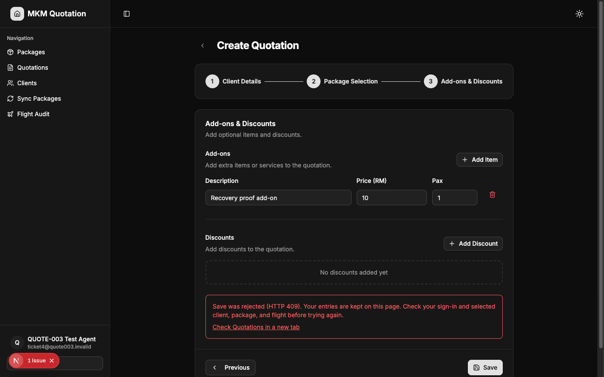
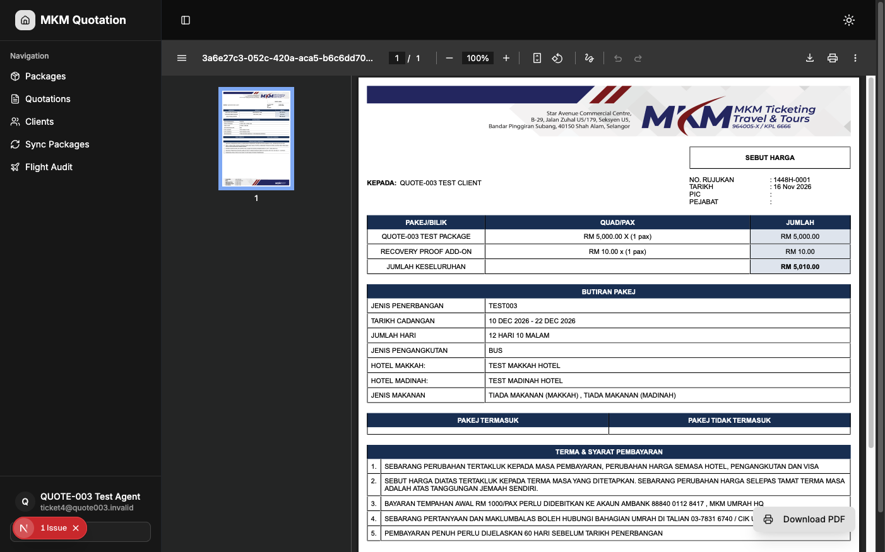
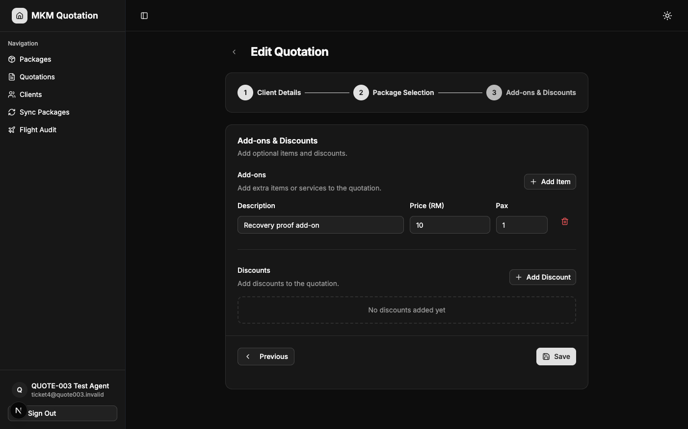
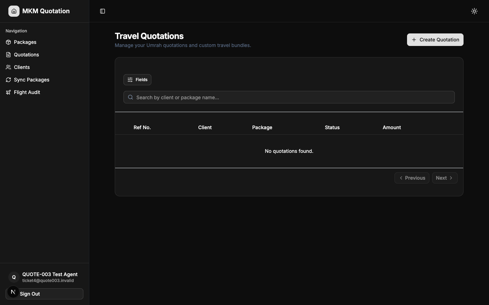

# Issue 20 verification

Tested application head `8e70113abda56748179becca47874fa23887dfc7`.
Baseline head `b95671a373f7ca65c7ff571d66ce4648986c7b5b`.
Corrected preview `http://ticket4.localhost:3150/quotations/create`.
The local server and isolated backend were stopped after verification.

[Baseline video](before.mp4) shows a real Save with a controlled HTTP409 response and no visible feedback. The interception made no backend call.
[Corrected video](after.mp4) shows HTTP409 feedback, an unknown-outcome network failure, a real successful create, review, editor reopen, and reload. Each controlled failure intercepted exactly one request. The live save made exactly one create call and returned the ID used by the review route.

The review showed quotation 1448H-0001, Quad for one pax at RM5000, and the retained add-on at RM10, total RM5010. The editor retained the add-on description and price after reload. These checks concern save recovery and persistence. They do not cover unrelated editor fields or PDF downloads.

`tests.tap` contains 138 passing behavior checks. `next typegen` followed by `tsc --noEmit` passed. ESLint passed for the three changed application files. Diff and comment review found no added suppressions or application comments. The optional cursor-team-kit deslop/control-ui skills are unavailable in this installation; the shared T3 browser and verify-mkm-app journey supplied runtime evidence.

`cleanup.json` records deletion of the one created quotation, two items, and its creation log, followed by an empty quotation query. Seeded infrastructure fixtures remain local for the parent. `process-cleanup.json` records the stopped owned instance. No shared cloud source or records were changed.

`decisions.tsv` records the design choices. `proof.json` records the runtime assertions.
