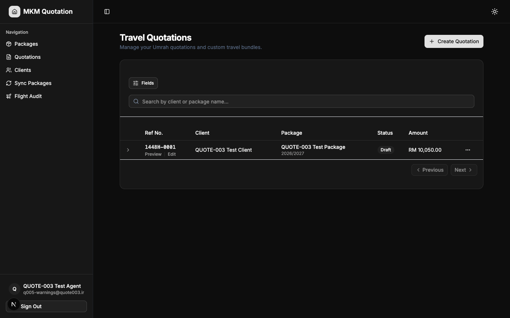
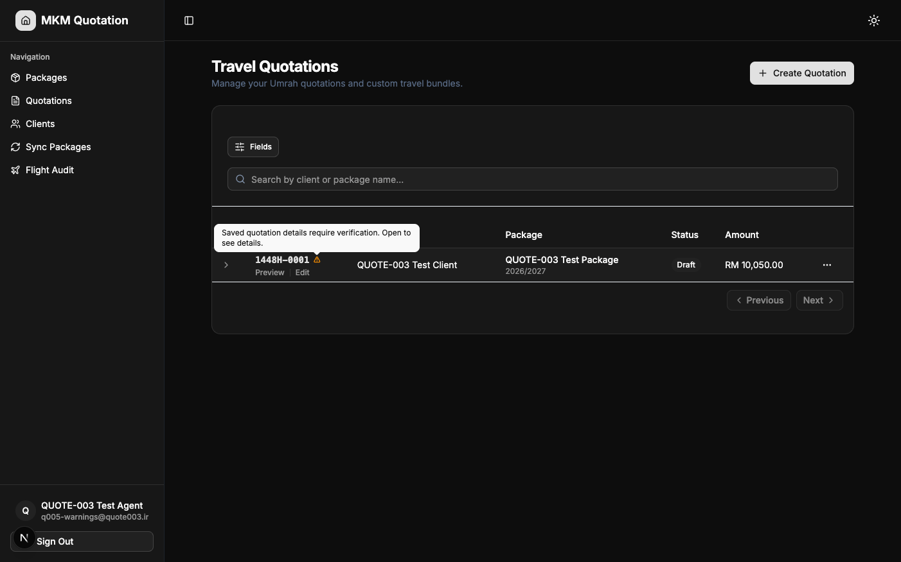
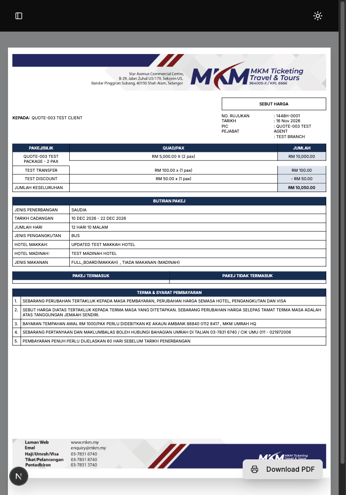

# QUOTE-005 warning and persistence proof

Issue: https://github.com/hasififwat/hasififwat-mkm-quotation-management-system/issues/30

Original browser source: `fae2c23d738bce0cbadd2882634aab7f9b6f36e1`.
Tested fixed source: `48fcc9cd693ec700914e943a952bb6b65434ad51`.
Private preview: `http://q005-warnings.localhost:3322`.
Port 3320 was occupied by a separate local Convex instance and was left alone.

[Original failure video](./before.mp4) shows edit remaining unwarned after meal and airline changes. [Original list/edit disagreement](./before-list-edit.mp4) shows the list without a warning after a hotel name change while edit warns. [Corrected journey MP4](https://raw.githubusercontent.com/hasififwat/hasififwat-mkm-quotation-management-system/evidence/quote005-stale-warnings/after.mp4) shows the list warning, search, edit warning, refresh, saved room and extra values, save, saved review, and reload. Videos and screenshots were visually inspected before publication.

## What was verified

The quotation was created through the authenticated real builder with Quad RM5,000, two passengers, Test transfer RM100 × 1, and Test discount RM50 × 1. Local supported package updates changed meals to FULL_BOARD, airline to SAUDIA, and the Makkah hotel name. No quotation was manufactured by a fixture mutation.

After refresh, the saved item rows were exactly equal to their original values. After save, item IDs were recreated by the existing update handler, while descriptions, unit prices, quantities, subtotals, and total remained equal. A separate saved review view and reload showed SAUDIA, UPDATED TEST MAKKAH HOTEL, FULL_BOARD, and RM10,050. This proves persistence beyond a save message. See [persistence assertions](./persistence.json).

The focused actual-handler suite independently covers each document field, additions and removals on both sides of collections, empty collections, meals, room availability, ordering, and unknown legacy snapshots across list, paginated list, edit, and review. The UI search path uses the nonpaginated list. Original checks: 5 passed, 16 failed. Final focused checks: 32 passed. Full repository regression suite: 447 passed. Build and final TypeScript check passed. Changed UI/test lint: zero errors and one existing unused-argument warning. Diff whitespace check passed.

Independent source review by gpt-6.1-sol found a legacy tooltip wording issue, which was corrected. It independently passed all 32 focused checks. No mutation, room-rendering control, refresh request, or creation reviewed-context logic changed. Deslop/control-ui plugins were unavailable; neither is claimed as run.

| Finding | What goes wrong | What it takes to hit it | Rarity | Who is hurt | Bucket |
| --- | --- | --- | --- | --- | --- |
| Existing full lint errors | Full lint exits 1 with 20 errors and 35 warnings. The required base independently has the same 20 error locations, and their source lines are unchanged. | Run full pnpm lint | Reproduced at base and head | Engineers validating the branch | Existing lint debt |
| Existing optional-value rendering fallback | An absent optional snapshot value can fall back to the live package value before refresh, even while a warning identifies the change. Charges remain unchanged. | Add an optional package value that was absent from the saved snapshot | Conditional; frequency unknown | Staff reading document details | Existing rendering limitation |

Legacy unknown states and individual availability/removal variants are covered by handler tests, not separate browser fixtures. This ticket does not claim to repair independently owned room rendering or refresh-request behavior. The final browser journey used a successful refresh response. No shared backend deployment or merge occurred.

## Cleanup

Owned preview tab closed. Private backend, site proxy, web server, generated keys, credentials, local database, storage, and source snapshots removed. Ports 3420, 3421, and 3322 verified free. Proof files preserved separately. See [cleanup record](./cleanup.json).
