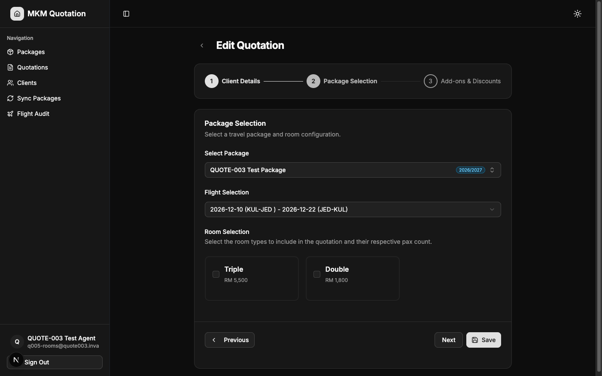
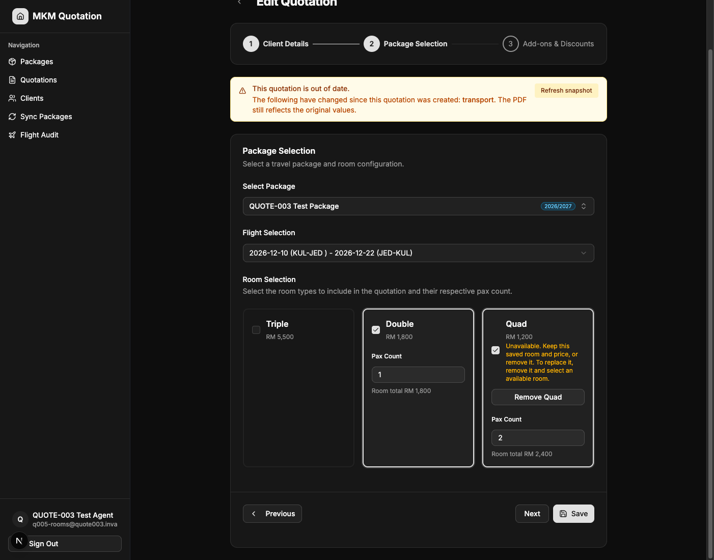
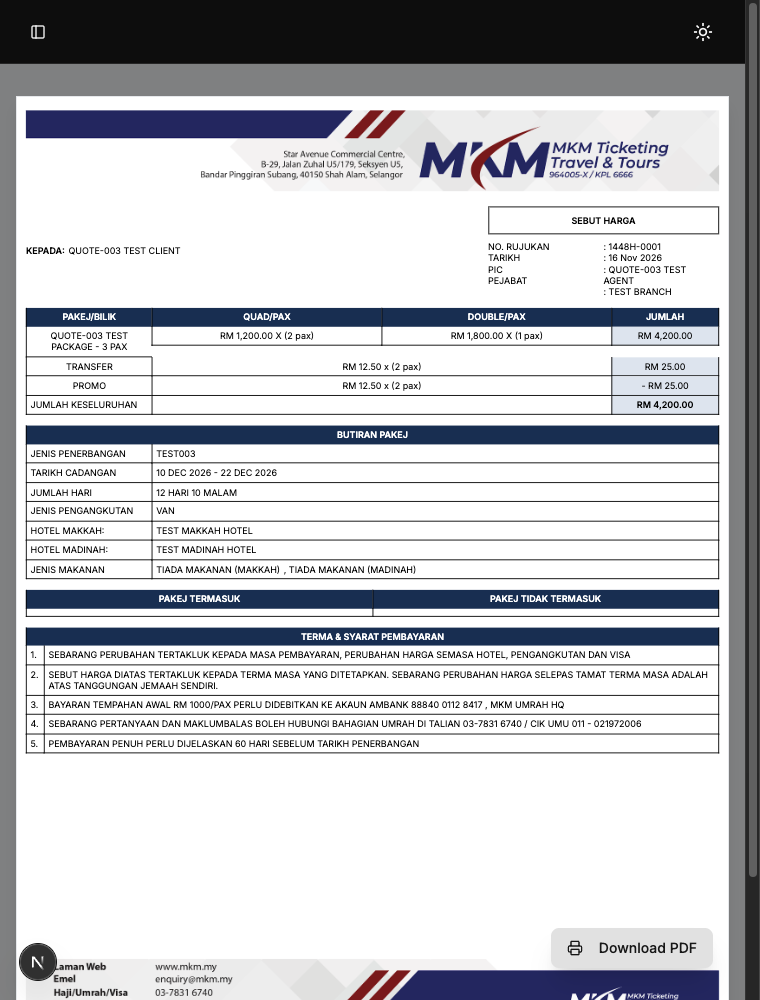

# Issue 29 browser proof

Issue https://github.com/hasififwat/hasififwat-mkm-quotation-management-system/issues/29.

Tested code head `6ba5125daa63768284c55e6ea82f855e9ee14745`. Baseline `fae2c23d738bce0cbadd2882634aab7f9b6f36e1`. Target branch `migration/nextjs-upgrade` preserves PR22/23/24/25/26/28.

Private authenticated preview `http://q005-rooms.localhost:3319`. The original assigned port3310 was occupied by another worktree and was left untouched. Backend ports3410/3411 served only this disposable instance.

## Browser evidence

[Original failure video](before.mp4) and [corrected behavior video](after.mp4) are real T3 preview recordings. The corrected video is approximately61 seconds. Rendered screenshots and decoded video frames were visually inspected before publication.

The baseline uses the real builder to create Quad RM1200 x2, then the private package update handler disables Quad. Reopening the editor hides Quad. Selecting Double RM1800 x1 and saving produces RM4200 in the saved list.

The corrected video shows the saved Quad price, pax, RM2400 subtotal, unavailable status, and keep/remove/replace guidance. Refresh snapshot changes transport from Coach to Van while preserving charges. Pax0 blocks Save. Correcting it to2, saving, reviewing, and reloading retains Quad1200x2, Double1800x1, Transfer12.50x2, Promo12.50x2, and RM4200. Keyboard Enter on Remove Quad removes its card. Saving, reviewing, and reloading then shows Double1800x1 and RM1800 with both extras unchanged. [Captured visible text](browser-proof.json) records each persisted view.

## Validation

- `node --test scripts/*.test.mjs` passed419 tests. [Output](tests.txt).
- The regression was committed before the correction. Baseline rendering failed both unavailable-room cases. Final rendering passed4 checks. [Failure](failing-tests.txt), [pass](passing-tests.txt).
- `node_modules/.bin/tsc --noEmit` passed after generating the normal ignored Next type declarations.
- Production `next build --turbopack` passed in an isolated exact-source copy with only Turbopack root set to `/` so shared dependencies resolve. A direct build in the worktree rejected the out-of-root dependency symlink. [Successful build](build.txt).
- Targeted ESLint passed for both changed files. Full repository ESLint has20 errors and35 warnings in unchanged files. [Output](lint.txt).
- Independent source review of exact final head found no actionable findings. It reran the4 render tests and diff check. Parent browser checks establish keyboard behavior and persistence. Deslop/control-ui plugins were unavailable and did not run.

| Finding | What goes wrong | What it takes to hit it | Rarity | Who is hurt | Bucket |
| --- | --- | --- | --- | --- | --- |
| Existing repository lint debt | Full lint exits unsuccessfully despite clean changed-file lint. | Run repository-wide ESLint on existing files. | Consistent. | Maintainers using lint as a release gate. | Existing tooling debt |

## Cleanup and limits

The owned browser tab closed. The owned web/backend processes stopped. Private fixtures, credentials, signing keys, and source snapshots were deleted. Ports3319/3410/3411 are free. [Cleanup record](cleanup.json). Videos, screenshots, test output, and ticket decisions remain on this evidence-only branch.

No shared backend deployment, merge, or other-worktree changes occurred. Physically deleted room types remain subject to the existing backend rejection. The supported package editor prevents deleting referenced room types. Replacement uses explicit removal followed by selecting an enabled room; this browser run verified keep and removal, not a separate new replacement purchase. No PDF export or PDF styling change was tested or claimed.
