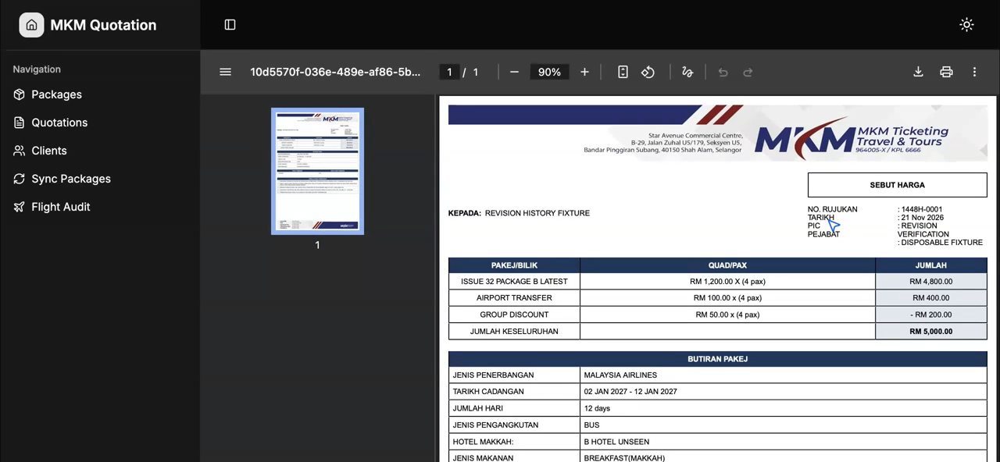
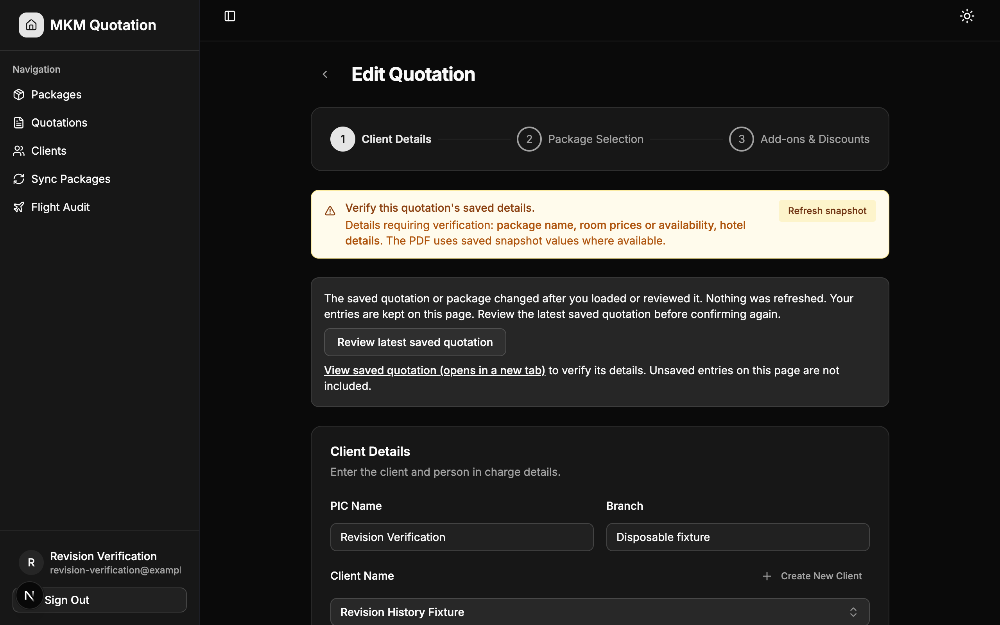

# Issue 32 browser verification

The editor now asks staff to review saved package and flight details before refreshing the quotation snapshot. The test used synthetic records in a disposable local Convex backend.

| Run | Preview URL | Exact application commit |
| --- | --- | --- |
| Baseline | `http://localhost:3554` | `dcd35dcc18719e69f6980d66864d09a7fc7fefa9` |
| Fix | `http://localhost:3554` | `78c0e1aa9c8db3ebec3a5e894350e844e3e3244a` |

## Baseline

Open a quotation saved with package A. In a separate authenticated session, use the public quotation update to save package B. Use the public package update to change B again. Click **Refresh snapshot** in the original browser tab. The reopened PDF shows **B HOTEL UNSEEN** at RM 5,000. The database contains the refresh audit entry.

[Baseline recording](before.mp4) and [baseline PDF excerpt](baseline-pdf-excerpt.txt).

## Fix

Repeat the competing save before the original editor opens review. Then open a fresh review and test two more conflicts. The first changes the saved quotation note after review. The second changes the package name, hotel, and catalog room price after review. Both confirmation requests return HTTP 409. Each rejected action leaves the quotation, its items, and all audit rows byte-identical.

Open a fresh review and confirm it. The editor keeps its unsaved draft note. The saved quotation retains the other editor's saved note, its RM 1,200 room rate for four passengers, its transfer and discount lines, and its RM 5,000 total. The confirmation adds one audit row. The saved PDF in a second tab and after reload shows **B HOTEL CONFIRMED**.

[Corrected recording](after.mp4) and [reloaded PDF excerpt](confirmed-pdf-excerpt.txt). The recordings play at twice the original speed. The baseline video and PDF captures crop the terms below the quotation details.

## Checks and cleanup

The regression reported `Missing expected rejection` before the implementation. The focused test suite passed after the fix. All 715 repository tests, TypeScript, and the Turbopack production build passed. Lint reported the same 18 errors and 61 warnings in both checkouts.

[Failing regression](failing-test.txt), [passing refresh suite](passing-test.txt), and [full test summary](test-summary.txt).

The local web process and Convex backend stopped. Ports 3554, 14055, and 14056 were free. Cleanup removed the source snapshot, generated account, signing keys, session tokens, and database. T3 closed the editor tab and left the second, unclaimed review tab open.
