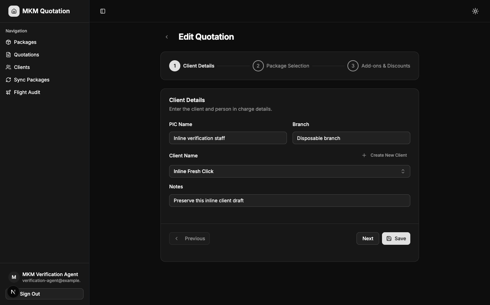

# Inline client verification at fae2c23d

Staff can create or select clients inside a quotation, preserve the draft, and save deliberately. Both suspected defects were already fixed in the requested baseline through merged PR #26 and closed issue #21. No application change or duplicate repair ticket was justified.

Tested commit `fae2c23d738bce0cbadd2882634aab7f9b6f36e1` at `http://inline3310.localhost:3310`. The real Next.js app used an isolated local Convex backend on 3320/3321 and synthetic fixtures. No mutation path was mocked.

[Actual app video](verified-flow.mp4) shows click creation, Enter creation, duplicate reuse, force-create, reselection, preserved package details, explicit Save, quotation listing, and reopening after reload.

The original draft started with MKM Synthetic Existing Client, MKM Synthetic Umrah, its February 2027 flight, Quad room, and one pax. Inline Fresh Click and Inline Fresh Enter immediately appeared as selected names. Duplicate reuse selected Inline Fresh Click rather than the candidate name. Force-create selected Inline Forced Duplicate. The picker retained all created options. PIC, branch, notes, package, flight, and room survived these actions.

The actual quotations:count query returned zero after click creation and zero after Enter, reuse, and force-create. The browser recorded five client POSTs and zero quotation POSTs before explicit Save. Save produced exactly one quotation, 1448H-0001, for Inline Fresh Click. The quotation list showed this recipient. Reopened edit after a full navigation retained it, PIC, branch, notes, flight, Quad room, and one pax. The rendered layout was inspected.

Verification commands passed.

- `node --test scripts/inline-client.test.mjs scripts/quotation-save.test.mjs scripts/quotation-amounts.test.mjs` passed all 50 tests.
- `pnpm exec next typegen` followed by `pnpm typecheck` passed. Fresh-checkout typecheck before type generation lacked Next image declarations.
- Source and independent review confirmed both existing repair commits are ancestors of the tested baseline.

The T3 transport failed during setup and later recovered. An initial automation selector failed before any client submission. That unsuccessful recording was discarded. Local login initially collided with localhost cookies from other app origins. A dedicated subdomain isolated this run. These setup failures are not application defect findings.

Cleanup closed both owned tabs, stopped the web snapshot and backend, and removed the disposable database, fixture source, signing keys, credentials, and local environment file. The parent checkout and other threads' services were untouched. No shared cloud writes, deployment, or merge was performed.

The upstream different-family trail reviewer was unavailable under the repository's Codex-only model policy. Independent Codex source review and direct artifact inspection were used. The external deslop helper was unavailable; direct review found no application diff.
