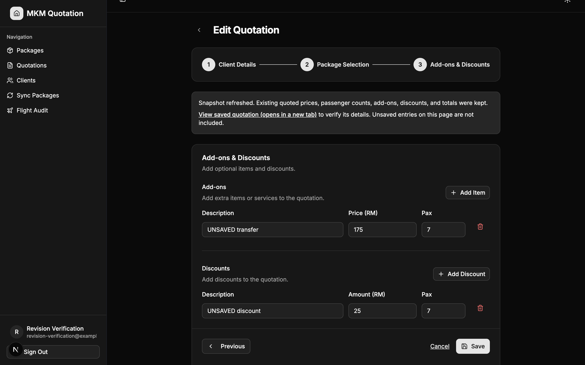
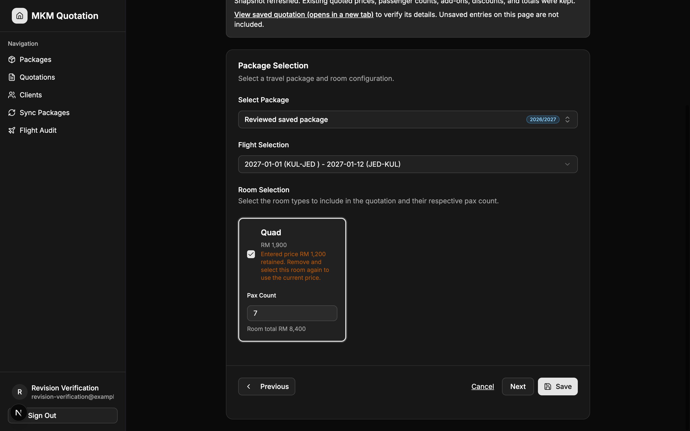

# Issue 32 supplemental acceptance evidence

Staff need snapshot refresh to apply the saved context they reviewed while retaining their unsaved draft and the original saved charges.

Tested application commit `225d907383dae24990257c7b19011823323c9545` at `http://localhost:3564`. This is the merge of PR #81. Its application, Convex, and test trees match PR head `78c0e1aa9c8db3ebec3a5e894350e844e3e3244a` exactly. No product code changed in this run.

## Receipts reused

The [prior exact-head receipt](https://github.com/hasififwat/hasififwat-mkm-quotation-management-system/blob/dd6871a0ea262b216a9b7bc47e7c3ba7b4abe5b5/README.md) contains the baseline at `dcd35dcc18719e69f6980d66864d09a7fc7fefa9` and corrected flow at `78c0e1aa9c8db3ebec3a5e894350e844e3e3244a`, both at `http://localhost:3554`. It covers the saved A to B race, saved quotation and package changes after review, HTTP 409 with byte-identical quotation/items/audit rows, explicit reviewed retry, and saved PDF reload. Those scenarios and their tested code match the merged implementation.

## Supplemental browser run

The isolated fixture started with RM 1,200 rooms for four passengers, an airport transfer at RM 100 for four passengers, a group discount at RM 50 for four passengers, and a RM 5,000 total. A public package update changed its name, hotel, and catalog room price to RM 1,900. The browser loaded that stale quotation.

The staff draft changed the note, room passenger count to seven, transfer description and price to `UNSAVED transfer` at RM 175 for seven, and discount description and amount to `UNSAVED discount` at RM 25 for seven. The room kept its entered RM 1,200 price despite the RM 1,900 catalog price.

The browser opened snapshot review. A second authenticated public package update changed the hotel to `SUPPLEMENT HOTEL REVIEW AGAIN` before confirmation. Confirmation showed conflict. The public saved-detail response before and after rejection was byte-identical. The prior receipt additionally proves equality of all audit rows on both conflict types.

The browser chose **Review latest saved quotation**, reviewed the new hotel, then chose **Confirm snapshot refresh**. Every input value remained identical to the draft captured before review. See [proof.json](proof.json). The successful server refresh also retained those inputs after the request completed.

The saved-detail response retained every item, quantity, price, subtotal, note, and total. See [before.json](before.json) and [after.json](after.json). A second browser tab opened the saved review and reloaded it. Its rendered PDF showed the confirmed hotel, RM 1,200 rooms for four, original transfer and discount, and RM 5,000 total. The unsaved draft was not saved by refresh.

[Browser conflict, reviewed retry, and retained draft video](draft-refresh.mp4).

[Second-view reload video](reload.mp4).

## Checks and cleanup

The focused refresh handler, route, and UI-request tests passed. See [scoped-tests.txt](scoped-tests.txt). The prior exact-head receipt records the full suite, TypeScript, build, and baseline-matched lint results. This evidence-only run did not repeat them.

Only a generated account and synthetic records in a disposable local SQLite Convex backend were used. Both owned browser tabs closed. The web process and backend stopped. Ports 3564, 14125, and 14126 had no listeners. Cleanup removed the source copy, account, signing keys, session tokens, storage, and database. See [cleanup.json](cleanup.json). No shared data, user checkout, or other session was changed.

The combined receipts satisfy the issue's acceptance evidence. The parent retains independent review and closure. This run did not deploy, merge, or close the issue.
