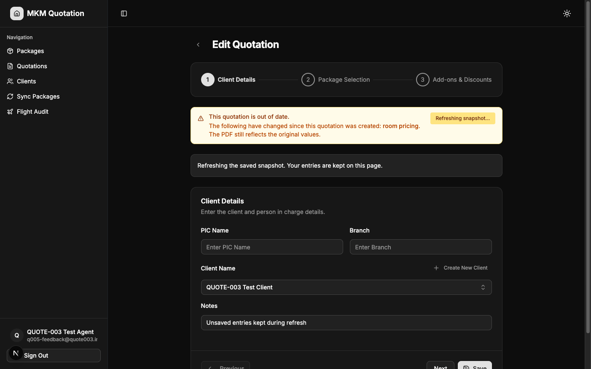
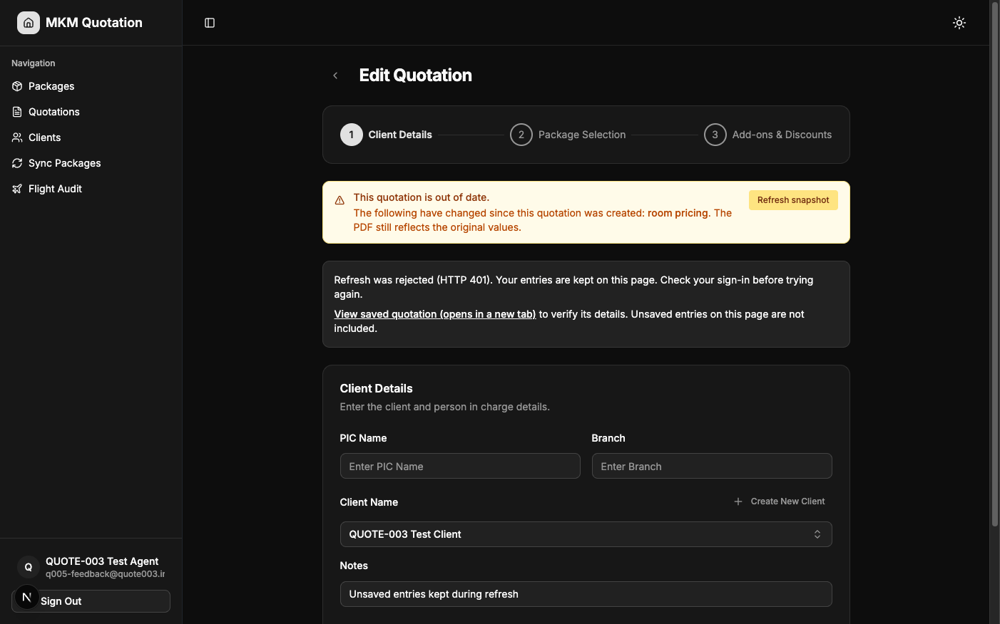
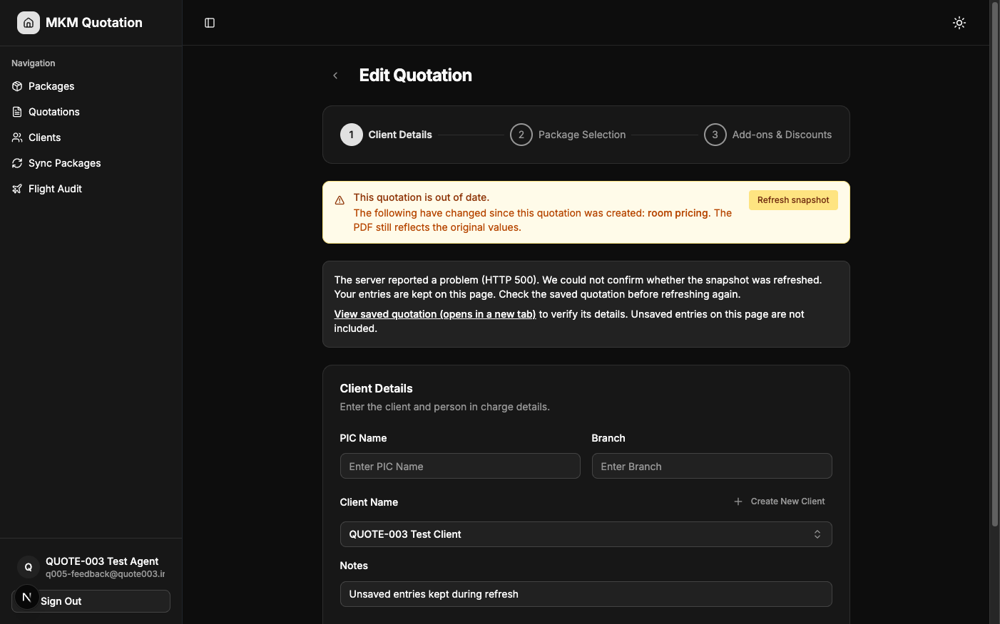
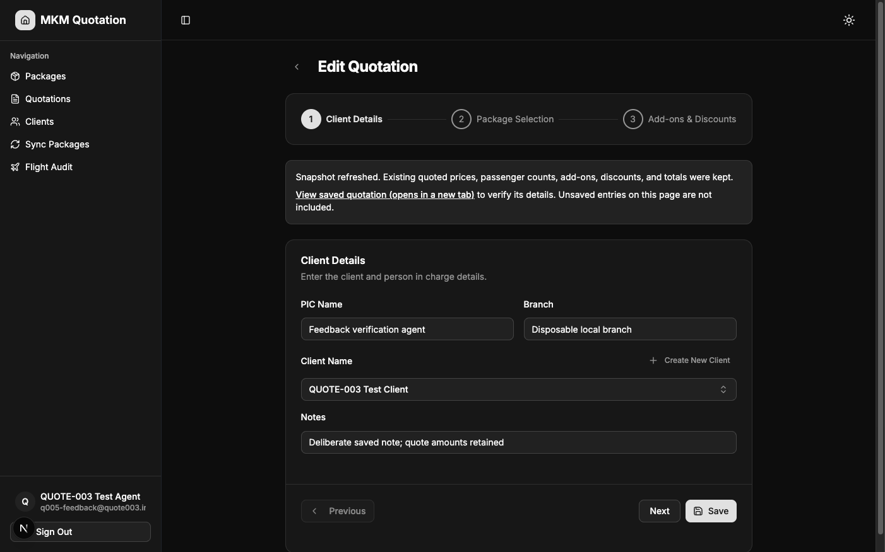
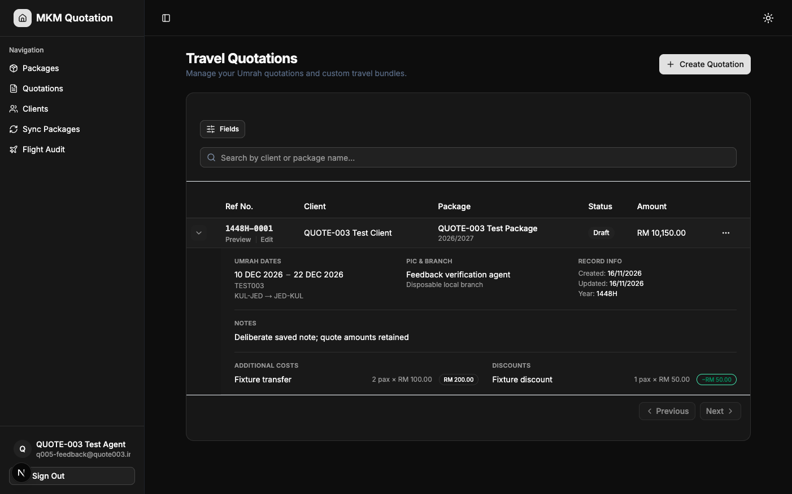

# QUOTE-005 refresh feedback proof

Staff need to understand snapshot refresh outcomes while the amounts already quoted to a customer remain unchanged. Fixes #31.

Tested code: `0318341379a22e8f32147d40f0011e0b87230d1a`, based on migration commit `fae2c23d738bce0cbadd2882634aab7f9b6f36e1`.
Preview: `http://q005-feedback.localhost:3330`. Disposable local instance only; now stopped and removed.

## Recordings

- [Original failure](before.mp4): actual authenticated editor. Double-click sends two delayed HTTP 500 refresh requests; no pending or useful failure feedback.
- [Corrected failures](failures.mp4): one request under double-click, disabled pending control, safe HTTP 401 message, HTTP 500 uncertainty, rejected fetch, and unknown response after a real local commit.
- [Real success, save, second saved view and reload](success.mp4): actual refresh without interception, stale warning clears, success feedback and unsaved fields remain; deliberate save followed by PDF review, reload, and expanded quotation listing.

Fault scenarios intercept only refresh fetch calls in the real page. The unknown-body case sends the real request before replacing its response. No mocked page or internal form setter substitutes for creation or persistence. The quotation was created through the real builder. Screenshots and representative frames from each recording were inspected before publishing.

## Persistence

The current catalog Quad price changed from RM 5,000 to RM 7,000, then RM 8,000. Saved PDF review and reload retain RM 5,000 × 2 passengers, RM 100 × 2 for the add-on, RM 50 × 1 discount, and RM 10,150 total. The expanded listing independently shows the saved PIC, branch, note, add-on, discount, and total.

## Checks and limits

20 focused refresh tests, 159 submission/package/auth tests, and 29 quotation authorization tests passed. Changed-file ESLint, `git diff --check`, and standalone TypeScript after `next typegen` passed. The production build passed, including its TypeScript phase, in the owned source snapshot with `turbopack.root=/` to resolve the worktree's external dependency symlink. Browser implementation files matched the pushed code byte for byte. Independent source review by gpt-6.1-sol found no actionable findings; the added-comment scan found no comments or suppressions.

| Finding | What goes wrong | What it takes to hit it | Rarity | Who is hurt | Bucket |
| --- | --- | --- | --- | --- | --- |
| Existing full-repository lint debt | Full ESLint exits with 20 errors and 35 warnings in unchanged code. Changed-file lint passes. | Run full repository lint on this base. | Reproducible on this checkout. | Maintainers relying on a green full-lint gate. | Existing maintenance debt |

The private backend used `DATABASE_UDF_USER_TIMEOUT_SECONDS=10` to let fixture authentication complete. This is a local functional-check setting, with no product configuration or performance claim. Required deslop/control-ui plugins were unavailable; project verification, lint, and independent source review were used. Versioned review and confirmation belong to #32.

Cleanup: the owned browser tab closed; owned services stopped; ports 3330, 3430, and 3431 are free; owned database, keys, credentials, and snapshots removed. Evidence is retained. No shared backend changes, merge, or deployment occurred.

[Machine-readable proof](proof.json) · [Cleanup](cleanup.json) · [Baseline](baseline.json) · [Decisions](decisions.tsv)
