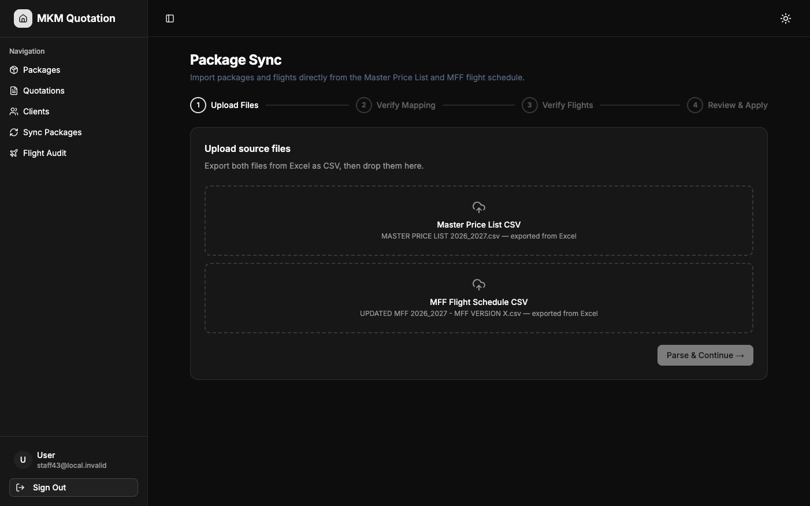
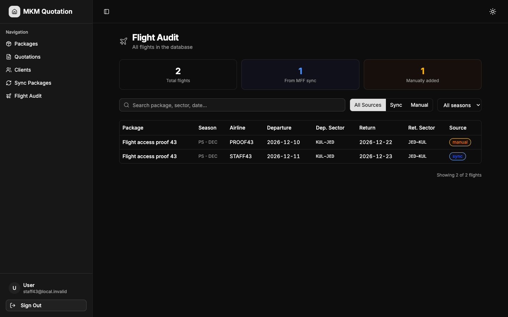
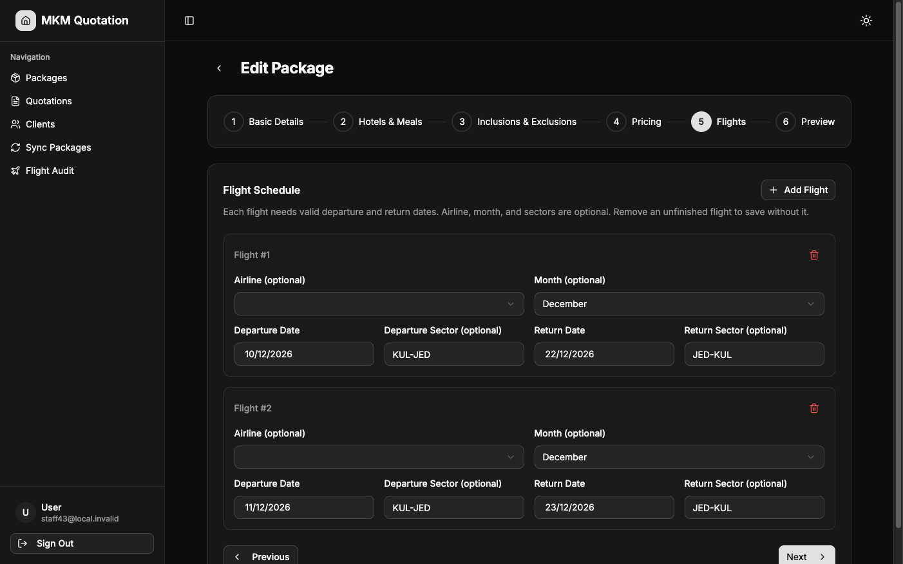

# Staff flight access proof for issue 43

Staff can keep using package and flight synchronization while anonymous callers lose access to all five public flight operations.

Tested fix commit `6ca784120f1c6fb0da46e10eb32ab542e6c690e5` on base `bab5e142207df4bac78e54956f44c12d389ec045`.
Failing regression commit `31ecdc00` precedes the fix.
Final preview URL `http://flight43.localhost:3510`.
Local backend URL `http://127.0.0.1:3520`, HTTP actions port 3521.
Only generated staff and synthetic package/flight rows were used. No shared backend was mutated or deployed.

## Actual transport reproduction

[Before](before-transport.json) records successful anonymous listAll, addFlight, setSourceManual, promoteToSync, and deleteFlight calls against the baseline functions in an actual disposable Convex backend.
[After](after-transport.json) records all five rejecting with `Not authenticated` after the fix was pushed only to that same local backend.
[Probe source](probe.mjs) shows the real ConvexHttpClient calls. Its paths refer to this run's private fixture directory. Credentials are deliberately excluded.

Authenticated operations exercised actual add, list, promotion, source maintenance, and deletion. The new flight remained manual after denied anonymous promotion/deletion, then staff promotion persisted as sync, and staff deletion removed it. Source maintenance's eligible legacy-row transition is covered by the handler regression; the live staff invocation had no eligible legacy rows.
[Saved rows](saved.json) records a further staff add and promotion used for browser persistence proof.

## Real application photographs

The upload page proves staff app continuity. It does not claim a full CSV import journey.

The actual Flight Audit page shows `STAFF43`, December 11–23, KUL-JED/JED-KUL and source sync after real authenticated backend writes.

The package editor's Flights step independently reads the saved December 11–23 flight. Its airline dropdown does not render the synthetic STAFF43 code because that code is outside its options. No package edit was saved.

The final full document navigation to the audit page preserves both rows and the sync source. Screenshots were captured through T3 shared preview and their rendered layouts were inspected. These images prove continuity and persisted reads. Transport evidence above proves access rejection. No page, response, React state, or saved result was mocked.

## Checks and review

[Failing regression](regression-before.log) has 13 tests, 3 pass, 10 fail before the fix. [Scoped auth checks](scoped-tests.log) pass all 47 tests after the fix. All 521 [repository script tests](all-tests.log) pass.
[Production build](build.log) and [typecheck](typecheck.log) pass. Changed-file lint and git diff --check pass.
[Full lint](full-lint.log) reports 20 errors and 34 warnings. [Baseline lint](baseline-lint.log) reports the same 20 errors and 35 warnings. The removed unused maintenance wrapper accounts for the one fewer warning. All errors are in unchanged files.

Fresh independent final source and comment review at the tested head found no actionable issues. The reviewer independently passed the 47 scoped tests and scoped lint. The coordinator also independently passed 15 tests and inspected the diff.

Model the Domain kept the existing flight/source shape. Boundary Discipline put identity checks before public handler data access. Prove It Works required real local transport and persisted application views. A local guard was chosen over a shared package-auth refactor to preserve the focused scope. The unavailable external deslop/control skills were handled with scoped diff/comment inspection and the installed project verification skill.

## Verification limits and cleanup

| Finding | What goes wrong | What it takes to hit it | Rarity | Who is hurt | Bucket |
| --- | --- | --- | --- | --- | --- |
| Existing full lint debt | Repository-wide lint remains red with 20 pre-existing errors. | Run full lint at the baseline or fixed head. | Reproduced in both runs. | Contributors relying on a green global lint gate. | Existing debt outside #43. |
| Local cleanup awaits approval | Disposable database, signing material, credentials, and local environment files remain on disk. | Inspect the retained private local verification fixture. | Known state of this run. | Local operator who owns cleanup. | Pending cleanup approval. |

The initial helper snapshot ran inside .next. A concurrent build invalidated it. That run was stopped, the build was rerun successfully, then final evidence used the production build at the exact fixed head. No build ran during final captures. The initial four PDF image type errors disappeared after Next generated its types. No product change was needed.

The interrupted compound cleanup command was not reissued. Its deletion portion remains blocked by approval at activity119. The task has no exposed API to cancel an approval item directly; the interrupted call is abandoned. No alternative deletion was attempted.

All three reserved ports 3510/3520/3521 are free after runtime stop. The frontend process had already ended when its session was checked. The backend was stopped after verifying its PID command includes the owned instance name and database path. The owned preview tab is no longer present. The earlier helper source snapshots were removed by their supported stop command before the later cleanup block.

Pending deletion targets are `/tmp/mkm-43-owned/db.sqlite` and any SQLite sidecars, `/tmp/mkm-43-owned/convex_local_storage`, `/tmp/mkm-43-owned/private-env.json`, `/tmp/mkm-43-owned/credentials.json`, `/tmp/mkm-43-owned/token`, `/tmp/mkm-43-owned/.env.local`, and this worktree's generated `.env.local`. Destroying the disposable database removes the synthetic account, auth sessions, package and flight rows, and backend signing configuration. The fixture directory is mode 700 and generated credential files are mode 600. Private values are excluded from this evidence branch. Cleanup is incomplete and no approval was inferred.
