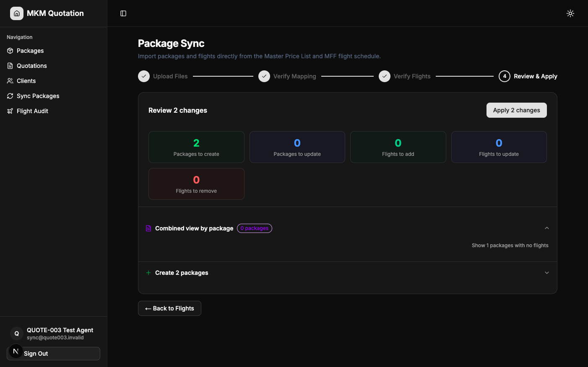
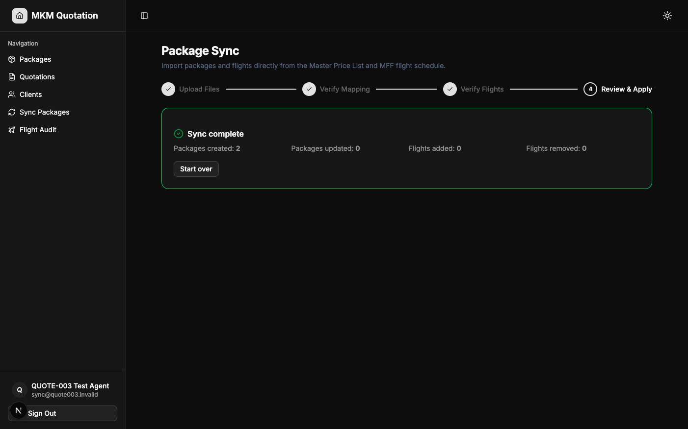
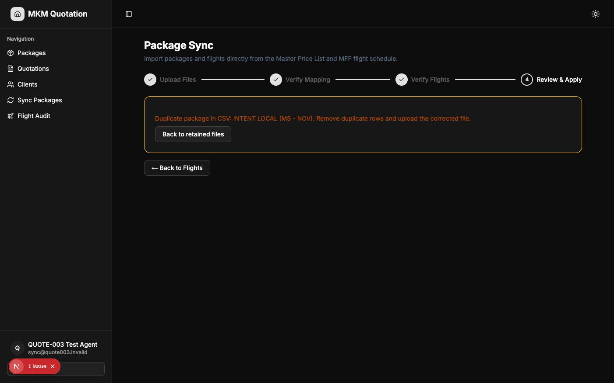
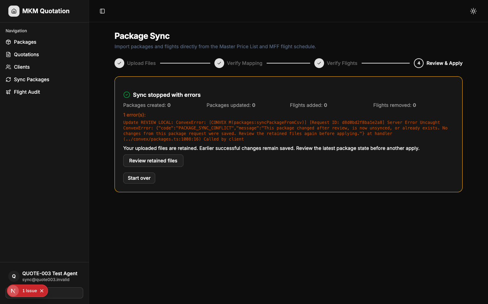
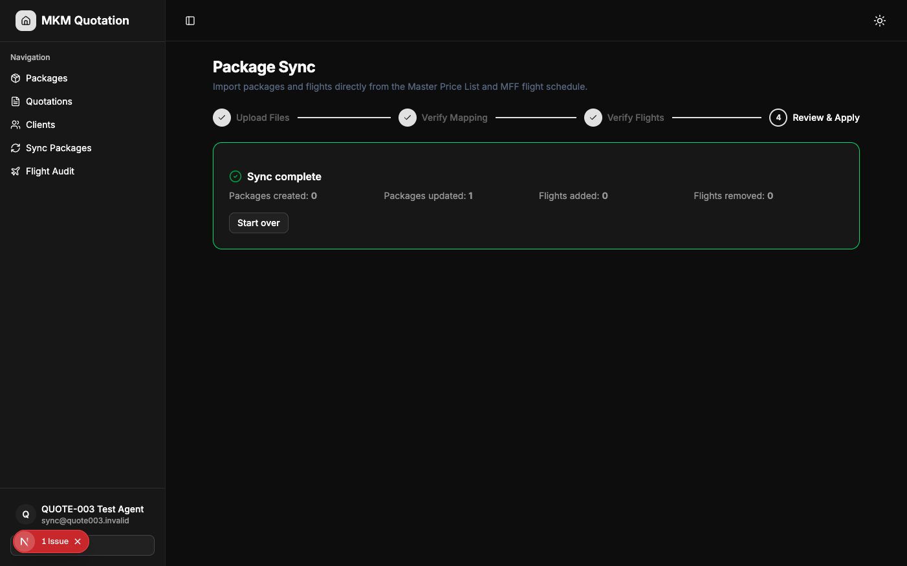
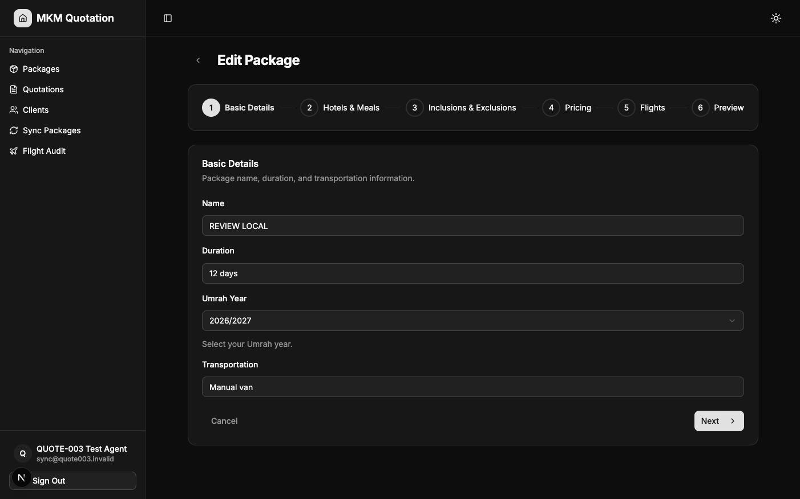

# Reviewed package apply evidence for issue 47

The actual Next.js app uses a disposable local Convex instance. No shared backend was deployed or mutated.

Baseline application commit `bab5e142207df4bac78e54956f44c12d389ec045`.
Failing regression commit `dfc8cc00`.
Final tested application commit `1e2ff632871ffc927b948f7af6f6d88f64771281`.
Final preview URL `http://sync47.localhost:3590/packages/sync`.
Backend ports 3600 and 3601. Browser fixtures and the generated staff identity are synthetic.

## Actual app media

Before media comes from the baseline source snapshot on `http://127.0.0.1:3590`. Two identical INTENT LOCAL CSV rows went through Upload, Verify Mapping, Verify Flights, Review and Apply. Both created packages. Final journeys use the dedicated sync47.localhost hostname. Earlier localhost authentication collided with shared-profile cookies. No cookies were cleared or other sessions signed out.

Fixed duplicate media shows corrective feedback and no Apply command. The final one-line empty-state correction removes the contradictory success text captured during an intermediate check.

For stale review, REVIEW LOCAL had an extra OTHER hotel so the actual parser planned a replacement. After staff entered Review, an authenticated local HTTP client changed QDP price from 2500 to 4321 through patchRoomPrices. Apply rejected the captured token, saved zero package changes, and retained the uploaded CSV contents. Staff clicked Review retained files, continued through both verification steps, and applied the fresh review. The actual app reported one updated package.

After recovery, a separate actual updatePackage request changed transport to Manual van and marked the package unsync. A fresh-token CSV request rejected that current unsync policy. The list then showed REVIEW LOCAL; a separate tab opened its package editor. Full reload preserved Manual van and the QDP input value 2500. The reload image proves the visible transport. QDP was verified from actual input values in the browser DOM, not from visible pricing media. Attempts to advance the editor's Next button did not change its visible step. No pricing-panel screenshot claim is made.

Browser screenshots were visually inspected. A temporary screenshot-frame outage interrupted capture; browser fallback was unavailable. Capture recovered through the owned shared-preview tabs. No page, setter, endpoint success or persistence response was mocked. The manual and child edits were deliberate local fixture interleavings through actual application mutations.

## Transaction proof and checks

[Baseline actual transport](before-live.json) records concurrent creates both committing and a captured update overwriting the independent room edit. The count is four because the concurrent create probe ran twice in that disposable instance.

[Final actual transport](verified-live.json) records two concurrent requests to the same local Convex mutation. One commits and one rejects. Exactly one matching package remains. A child-price edit then invalidates the reviewed token and 4321 remains saved. This proves actual transaction behavior under the exercised requests; it does not claim a particular observed OCC scheduling interleaving or a production failure frequency.

[Manual unsync proof](manual-live.json) records actual current-policy rejection with a fresh token and preserved Manual van.

Regression output before fix included `AssertionError [ERR_ASSERTION]: Missing expected rejection.` After fix, all 13 intent tests pass. All 519 repository script tests pass. The independent final source and comments review ran another 93 relevant tests successfully and found no blocking issue.

Installed Next type generation, TypeScript check, and production build pass. The build ran at 94880018; the final UI-only one-line empty-state correction has scoped lint and intent regression coverage plus actual browser proof. Changed-file lint has zero errors and three existing hook warnings. Full lint has 20 errors and 34 warnings. All error locations are outside changed files. No suppression was introduced.

Scope is package intents. Flight synchronization idempotency and the other import tickets remain separate. Apply still uses individual transactions per package. Earlier successful package writes remain saved if a later package conflicts. Uploaded files stay in page memory for re-review; reload draft recovery is outside this change.

## Cleanup

Both owned preview tabs were closed. The owned frontend and backend stopped. Ports 3590, 3600 and 3601 were confirmed free. Source snapshots, fixture database and storage, generated credentials, signing keys, and the temporary auth session were removed. [Cleanup record](cleanup.json) confirms the checks. Sanitized proof files remain in this evidence branch.
