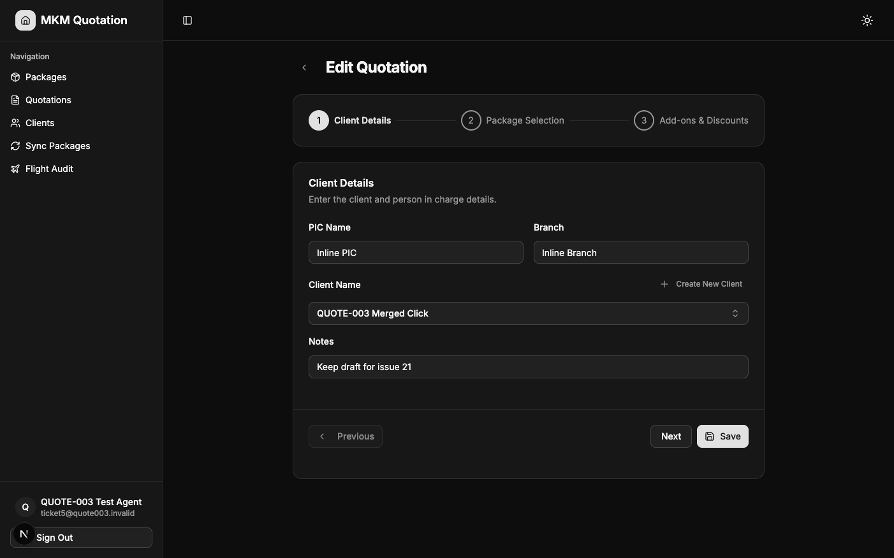
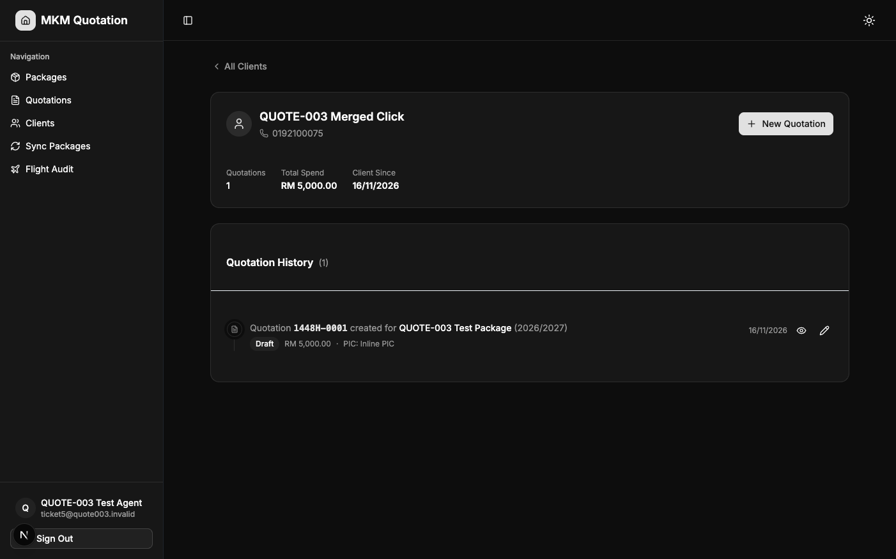
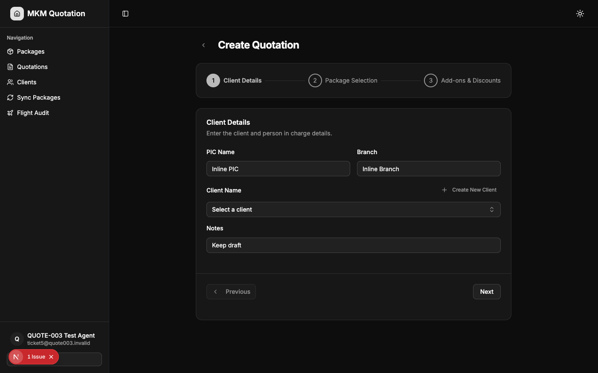

# Issue 21 verification

Final tested head ec94da2e5bb8413188897e393b17220bda61ec39 includes remote migration target 61e5b503b02b5e59cd7a0f83cc8127167cfbbc48.

Preview http://ticket5.localhost:3160 used an exclusive real local Convex backend on 3260/3261. No cloud writes.

[Final head video](final-head.mp4) shows Enter creation, click creation, duplicate reuse, switching back to the newly created client, Save, and reopening the saved quotation. The valid existing draft remains on its original URL during modal submissions. The saved recipient is QUOTE-003 Merged Click. PIC, branch, notes, package, flight, Quad room and one pax survive creation, reuse, save and reload. The client history second view after reload contains quotation 1448H-0001 for RM 5,000.

[Earlier full create/save video](create-save-85bb3390.mp4) was tested at 85bb3390ed1f43519004049e2bb93d83dcd95497. It covers fresh quotation creation, click and Enter clients, reuse, reselect, save and edit reload before the target advanced. [Parent baseline video](baseline-b95671a.mp4) is at b95671a373f7ca65c7ff571d66ce4648986c7b5b. The owner independently reproduced on ticket5 before editing.

The first three regression tests fail on isolated target source 7564fbab and pass after the fix. A fourth test covers Enter keydown isolation, added after the first runtime verification caught wizard navigation. All 49 inline-client, quotation-save and amount tests pass on final head. TypeScript, targeted ESLint and diff whitespace checks pass.

Independent source and comment review found no actionable issue. No comments or suppressions were added. The unavailable external deslop tool was replaced with direct diff review. The prescribed issue-report rule path is absent; supplied table columns were followed. The local Codex-only model policy excludes a different-family trail reviewer, so the trail was checked directly against tool evidence.

Cleanup stopped the owned tab, web server and backend, removed ticket5 disposable SQLite data, storage and source snapshots, and confirmed ports 3160, 3260 and 3261 free. Other instances and root checkout were untouched. See cleanup.json and decisions.tsv.
