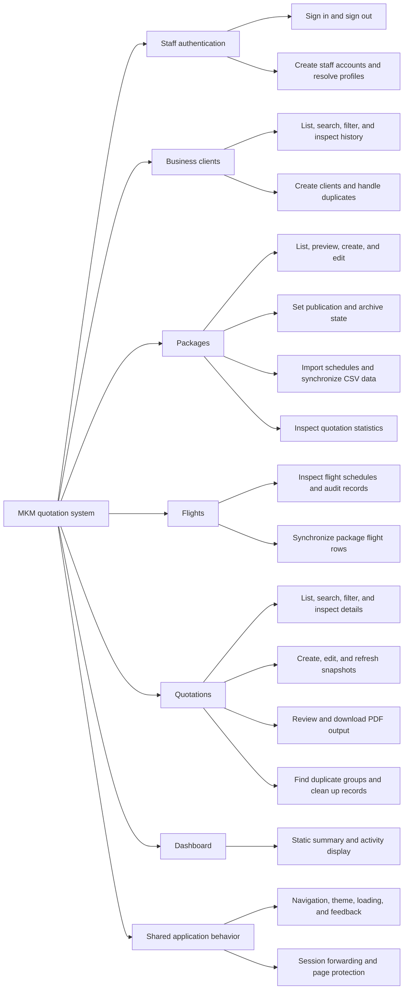
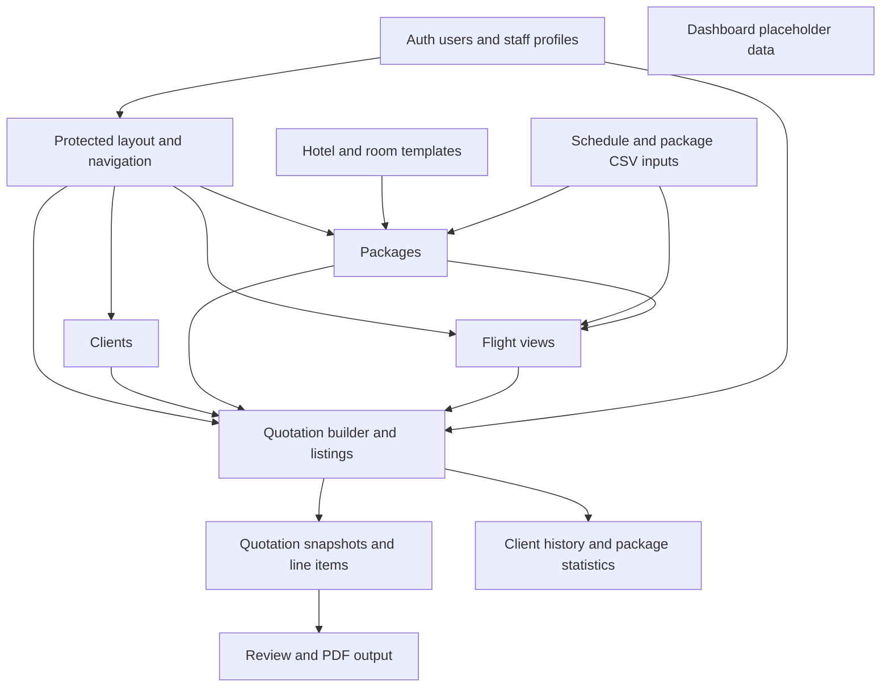

# MKM feature map

MKM supports staff who prepare Umrah quotations. Staff manage business clients, define packages with prices, hotels, and flights, then create quotations and review their PDF output. CSV workflows maintain packages and flight schedules. This map describes the implemented checkout and provides stable feature IDs for future investigations.

## Snapshot

The inspected commit is `e98314b847fd7813de30a068f8a23e0efa470d28`. Discovery ran on 2026-11-07 in Asia/Kuala_Lumpur. The initial working tree contained a modified `skills-lock.json` and untracked skill directories `.agents/skills/domain-modeling/`, `.agents/skills/grill-with-docs/`, and `.agents/skills/grilling/`. Those changes concern skill installation and do not change the mapped application behavior. They were left untouched. The files under `docs/feature-map/` were created by this documentation task.

Implementation descriptions are based on source tracing. Local fixture checks are recorded in [verification.md](verification.md). No login, live data mutation, browser journey, or PDF export was executed for this map. A visible button, a backend operation, and a verified user outcome are different evidence levels.

## Feature hierarchy

This diagram groups capabilities by purpose. Arrows mean containment, not calls or data flow. Detailed pages assign IDs to individual actions and identify controls that are incomplete or disconnected.

## Detailed references

| Area | ID prefix | Reference and boundaries |
| --- | --- | --- |
| Business clients | `CLIENT` | [Client management](clients.md). Customer records and quotation history. These records do not authenticate. |
| Staff accounts and identity | `AUTH` | [Authentication and profiles](authentication.md). Password login, account creation, profile lookup, and maintenance functions. |
| Packages | `PKG` | [Package management](packages.md). Rooms, hotels, meals, price controls, import, publication, archive, and statistics. |
| Flights | `FLIGHT` | [Flight management](flights.md). Package-linked schedules, audit, source flags, and synchronization. |
| Quotations | `QUOTE` | [Quotation management](quotations.md). Builder, stored items, revisions, snapshots, review, PDF, and duplicate cleanup. |
| Dashboard and inquiry model | `DASH`, `INQUIRY` | [Dashboard and inquiry model](dashboard.md). Distinguishes placeholder display from persisted business workflows. |
| Shared infrastructure | `APP` | [Shared infrastructure](infrastructure.md). Layout, theme, auth boundaries, data associations, and request flow. |

## Feature dependencies

Arrows in this diagram mean that one area consumes another area's data or service. They do not imply ownership or permission enforcement.

The [data relationship diagram](infrastructure.md#data-relationships) shows logical storage links. Workflow diagrams in the feature pages show execution order. The isolated dashboard node reflects the static data in its component, not a live aggregate of the other features.

## Investigation and coverage

[coverage.md](coverage.md) accounts for application pages, API routes, registered Convex operations, framework files, schema-only entities, and backend-only maintenance capabilities. [coverage.json](coverage.json) stores the route and operation mappings used by the [documentation checker](check.mjs).

[findings.md](findings.md) contains the consolidated issue and verification-gap table. [verification.md](verification.md) records the checks performed on this snapshot and their limits.

[maintenance.md](maintenance.md) describes how to scope an investigation by feature ID and update this map without reusing IDs. Existing [UI verification journeys](../../.agents/skills/verify-mkm-app/features/README.md) complement this map. They describe how to gather runtime evidence and do not establish that every mapped action has passed.
