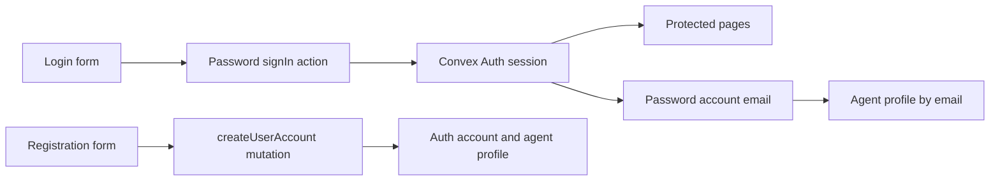

# Authentication and agent profiles

This reference describes source at `e98314b847fd7813de30a068f8a23e0efa470d28`. Behavior is code-traced unless a verification result is stated. Account credentials and Convex Auth users are separate from agent `profiles` and customer `clients`. `getMyProfile` connects an authenticated user's password account to an agent profile by email; the schema does not declare a role field. [Auth config](../../convex/auth.ts#L1), [profile query](../../convex/profiles.ts#L5), [schema](../../convex/schema.ts#L22).

The dependency details below were traced through the installed `@convex-dev/auth` 0.0.94 source. [Lockfile](../../pnpm-lock.yaml#L349). Links into `node_modules` require the dependency to be installed and are not tracked project files.

## AUTH-001: Sign in

| Reference | Behavior |
| --- | --- |
| Actor and route | Any visitor can open `/`, which renders `LoginForm`. The browser requires an email-shaped value and a password. [Route: `Login`](../../src/app/page.tsx#L1), [form](../../src/features/authentication/components/LoginForm.tsx#L18). |
| Action and outcomes | The form calls `signIn("password", { email, password, flow: "signIn" })`. When auth state becomes authenticated, an effect navigates to `/packages`. A caught error displays `Invalid email or password.` and reenables the form. On submission the controls show a pending state. [Form: `handleSubmit`](../../src/features/authentication/components/LoginForm.tsx#L25). |
| Backend | `convexAuth` exposes a public `auth.signIn` action and uses the default `Password` provider. The installed provider retrieves the matching password account for the sign-in flow. [Project config](../../convex/auth.ts#L1), [installed `Password.authorize`](../../node_modules/@convex-dev/auth/src/providers/Password.ts#L115), [installed `convexAuth.signIn`](../../node_modules/@convex-dev/auth/src/server/implementation/index.ts#L392). |
| Diagnosis | Separate native form validation from auth-action errors, and check the configured deployment, account, and session. The UI maps all caught sign-in failures to the same message. [Form](../../src/features/authentication/components/LoginForm.tsx#L30), [providers](../../src/app/providers.tsx#L10). |

## AUTH-002: Protected routes and session propagation

| Reference | Behavior |
| --- | --- |
| Pages | `src/proxy.ts` checks `/clients`, `/dashboard`, `/flights`, `/packages`, and `/quotations` prefixes. An anonymous request redirects to `/`. The `(protected)` client layout also waits for Convex auth, displays a spinner while loading, and redirects anonymous users. [Proxy](../../src/proxy.ts#L8), [layout: `ProtectedLayout`](../../src/app/%28protected%29/layout.tsx#L11). |
| API boundary | The proxy separately returns 401 JSON for anonymous `/api/packages` requests. `/api/clients/create` and quotation APIs are not part of that package matcher. An API or Convex operation must enforce its own access rule. [Proxy](../../src/proxy.ts#L15), [client POST](../../src/app/api/clients/create/route.ts#L7). |
| Providers | The root wraps content in `ConvexAuthNextjsServerProvider`, then `ConvexAuthNextjsProvider`, `ThemeProvider`, and the toaster. The browser client uses `NEXT_PUBLIC_CONVEX_URL`, falling back to `http://localhost:3210`. [Root layout](../../src/app/layout.tsx#L24), [providers](../../src/app/providers.tsx#L10). |
| Server client | Each `getServerConvexClient` call prefers `CONVEX_URL`, then `NEXT_PUBLIC_CONVEX_URL`, and throws if neither is set. It creates a new HTTP client and attaches `convexAuthNextjsToken()` only when a token exists. It can therefore issue an anonymous request. [Factory](../../src/lib/convex-server.ts#L7). |
| Diagnosis | A redirect proves the page guard, not that a direct Convex operation rejects anonymous callers. A browser-only direct `ConvexHttpClient` must be inspected separately from the provider and server client. [Client list](../../src/app/%28protected%29/clients/page.tsx#L32), [client operations](../../convex/clients.ts#L26). |

## AUTH-003: Create an agent account from the form

| Reference | Behavior |
| --- | --- |
| Actor and route | `/sign-up` displays **Create Agent Account** and is not in the protected page matcher. An existing authenticated identity is required by the form's mutation, with no further role check. [Route: `SignUp`](../../src/app/sign-up/page.tsx#L1), [proxy](../../src/proxy.ts#L8), [mutation](../../convex/profiles.ts#L35). |
| Inputs and validation | The form requires full name, branch, email, password, and confirmation; unit is optional. It checks that passwords match and are at least eight characters. The mutation's own validators require strings but do not implement these form checks. [Form: `RegistrationForm`](../../src/features/authentication/components/RegistrationForm.tsx#L30), [mutation: `createUserAccount`](../../convex/profiles.ts#L35). |
| Reads and writes | After checking identity, `createUserAccount` calls the auth library's `createAccount` for the password provider with email and name, then looks up `profiles` by exact email and inserts an agent profile only when absent. An existing profile is not updated. The direct `createAccount` helper follows a separate path from the Password provider's sign-up flow validation. The mutation does not enforce the eight-character form minimum. [Mutation](../../convex/profiles.ts#L43), [installed `createAccount`](../../node_modules/@convex-dev/auth/src/server/implementation/index.ts#L511), [installed Password validation](../../node_modules/@convex-dev/auth/src/providers/Password.ts#L122). |
| Outcomes | Anonymous calls throw `Not authenticated`. The form displays a caught error; success resets the form and states that the agent can sign in. The mutation does not sign out the caller. Actual account creation and subsequent sign-in were not exercised in this investigation. [Mutation](../../convex/profiles.ts#L43), [form](../../src/features/authentication/components/RegistrationForm.tsx#L56). |
| Diagnosis | Compare the active identity, exact email, existing account and profile, and browser validation against the direct mutation inputs. Inspect the Convex Auth account creation error and avoid exposing credentials in evidence. [Mutation](../../convex/profiles.ts#L35), [form](../../src/features/authentication/components/RegistrationForm.tsx#L30). |

## AUTH-004: Read the current agent profile

| Reference | Behavior |
| --- | --- |
| Actor and entry | The protected layout and quotation builder subscribe to `profiles.getMyProfile`. [Layout](../../src/app/%28protected%29/layout.tsx#L15), [builder](../../src/features/quotation/QuotationBuilder.tsx#L579). |
| Reads and output | `getAuthUserId` returning no user produces `null`. Otherwise the query finds the first password `authAccounts` row for the user, takes its `providerAccountId` as email, and looks up a unique profile by that email. It returns email and nullable `full_name`, `branch`, and `unit`. Duplicate matching profiles can cause `.unique()` to fail. [Query](../../convex/profiles.ts#L5). |
| Display and use | The sidebar shows the name and email, falling back to `User` and a blank email. The builder supplies the profile's name and branch as form defaults when it initializes. It does not reset those fields when the profile query later resolves. [Sidebar](../../src/layout/SidebarLayout.tsx#L139), [builder defaults](../../src/features/quotation/QuotationBuilder.tsx#L592). |
| Diagnosis | Distinguish a missing password account, a missing exact-email profile, duplicate profile emails, and a profile query still loading. Profile absence does not itself block `ProtectedLayout` once authenticated. [Query](../../convex/profiles.ts#L5), [layout](../../src/app/%28protected%29/layout.tsx#L15). |

## AUTH-005: Direct profile maintenance operations

| Reference | Behavior |
| --- | --- |
| Actor and permissions | Any direct Convex caller can invoke `createProfileForEmail`, `setProfileEmail`, `migrateQuotationCreators`, and `removeLegacySupabaseIds`. These public mutations do not check identity or roles. Repository search found no application caller for them. [Definitions](../../convex/profiles.ts#L78). |
| Create or relink | `createProfileForEmail` returns an existing exact-email profile ID or inserts the supplied email, full name, branch, optional unit, and current timestamp. `setProfileEmail` patches the specified profile ID without checking uniqueness or updating its timestamp. Both validate the declared argument types. [Mutations](../../convex/profiles.ts#L78). |
| Creator migration | `migrateQuotationCreators` scans all profiles and quotations, maps profile full names to IDs, includes one hard-coded name-to-email alias when that profile exists, and patches matching quotation `creator_id` based on `created_by`. Later profiles with the same name replace earlier entries in the in-memory map. The result contains linked, skipped, and total counts. Existing `creator_id` values can be replaced. [Mutation](../../convex/profiles.ts#L113), [quotation schema](../../convex/schema.ts#L124). |
| Legacy cleanup | `removeLegacySupabaseIds` scans profiles, replaces rows carrying a truthy legacy `supabase_id` with current listed fields, and returns total and cleaned counts. The present schema does not declare `supabase_id`. [Mutation](../../convex/profiles.ts#L143), [schema](../../convex/schema.ts#L90). |
| Diagnosis | For an unexpected name, branch, or creator association, inspect exact email matches, duplicate profile names, and the mutation's returned counts. These are not ordinary profile-edit UI flows in this checkout. [Query and mutations](../../convex/profiles.ts#L5). |

## AUTH-006: Sign out

| Reference | Behavior |
| --- | --- |
| Actor and action | The protected sidebar calls Convex `signOut()` and then pushes `/`. If `signOut()` rejects, the handler does not navigate or show an error. [Sidebar: `handleSignOut`](../../src/layout/SidebarLayout.tsx#L91). |
| `/logout` | Visiting `/logout` only replaces the route with `/`. It does not call `signOut` or clear a session. An authenticated visitor reaching `/` can be sent to `/packages` by the login form's auth effect. [Logout page](../../src/app/logout/page.tsx#L1), [login effect](../../src/features/authentication/components/LoginForm.tsx#L25). |

## AUTH-007: Convex Auth protocol and direct sign-up

| Reference | Behavior |
| --- | --- |
| Provider | `convex/auth.ts` configures the default password provider without a custom verification provider or registration restriction. The installed 0.0.94 `Password` implementation accepts `flow: "signUp"`, checks the default minimum password length of eight, creates an account, and does not require email verification without a `verify` option. The public `auth.signIn` action accepts provider and parameters. This path does not call the app's `profiles.createUserAccount` identity guard or insert its agent profile. [Project config](../../convex/auth.ts#L1), [installed provider](../../node_modules/@convex-dev/auth/src/providers/Password.ts#L102), [installed public action](../../node_modules/@convex-dev/auth/src/server/implementation/index.ts#L392), [installed sign-in dispatch](../../node_modules/@convex-dev/auth/src/server/implementation/signIn.ts#L31), [app mutation](../../convex/profiles.ts#L35). |
| Other flows | The installed provider has password reset and email verification branches, but they throw when the corresponding provider is not configured. The app config supplies neither option. [Project config](../../convex/auth.ts#L4), [installed provider](../../node_modules/@convex-dev/auth/src/providers/Password.ts#L166). |
| HTTP | `auth.addHttpRoutes(http)` registers `GET /.well-known/openid-configuration` and `GET /.well-known/jwks.json`. The installed helper registers `/api/auth/signin/` and `/api/auth/callback/` prefixes only when an OAuth or OIDC provider exists; this app configures Password alone. Discovery uses `CONVEX_SITE_URL`; the JWKS response uses `JWKS`. [Router](../../convex/http.ts#L1), [project provider](../../convex/auth.ts#L4), [installed `addHttpRoutes`](../../node_modules/@convex-dev/auth/src/server/implementation/index.ts#L167). |
| Verification limit | The provider and exported action were code-traced. A local probe called the installed provider with a stubbed auth store; it did not exercise the full public action. No live direct sign-up, token issuance, or deployment configuration was tested. [Project auth config](../../convex/auth.ts#L4). |

## AUTH-008: Appearance provider

| Reference | Behavior |
| --- | --- |
| Actor and entry | Login, signup, and the protected sidebar expose **Toggle theme**. [Login](../../src/app/page.tsx#L1), [signup](../../src/app/sign-up/page.tsx#L1), [sidebar](../../src/layout/SidebarLayout.tsx#L162). |
| Rules and writes | On mount, `ThemeProvider` takes `localStorage.theme` when present, otherwise the browser's dark preference. It toggles the root `dark` class. A toggle updates state, local storage, and that class. Before the mount effect, the provider renders no children. It does not write Convex data. [Provider](../../src/features/theme/provider/ThemeProvider.tsx#L25), [toggle](../../src/features/theme/components/ThemeToggle.tsx#L7). |

## Operation and route inventory

The profile operations are public exports. Their individual identity behavior is in the linked feature. [Profile definitions](../../convex/profiles.ts#L5).

| Operation | Type and visibility | Feature | Caller or purpose |
| --- | --- | --- | --- |
| `profiles.getMyProfile` | Public query; returns null anonymously | [AUTH-004](#auth-004) | Protected layout and quotation builder. [Query](../../convex/profiles.ts#L5). |
| `profiles.createUserAccount` | Public mutation; requires an identity | [AUTH-003](#auth-003) | Agent registration form. [Mutation](../../convex/profiles.ts#L35). |
| `profiles.createProfileForEmail` | Public mutation; no identity check | [AUTH-005](#auth-005) | Direct maintenance, no app caller found. [Mutation](../../convex/profiles.ts#L78). |
| `profiles.setProfileEmail` | Public mutation; no identity check | [AUTH-005](#auth-005) | Direct maintenance, no app caller found. [Mutation](../../convex/profiles.ts#L102). |
| `profiles.migrateQuotationCreators` | Public mutation; no identity check | [AUTH-005](#auth-005) | Direct maintenance, no app caller found. [Mutation](../../convex/profiles.ts#L113). |
| `profiles.removeLegacySupabaseIds` | Public mutation; no identity check | [AUTH-005](#auth-005) | Direct maintenance, no app caller found. [Mutation](../../convex/profiles.ts#L143). |
| `auth.signIn` | Public action | [AUTH-001](#auth-001), [AUTH-007](#auth-007) | Sign-in, provider flow, and session refresh. [Project export](../../convex/auth.ts#L4), [installed implementation](../../node_modules/@convex-dev/auth/src/server/implementation/index.ts#L392). |
| `auth.signOut` | Public action | [AUTH-006](#auth-006) | Invalidates the current session. [Project export](../../convex/auth.ts#L4), [installed implementation](../../node_modules/@convex-dev/auth/src/server/implementation/index.ts#L439). |
| `auth.store` | Internal mutation | [AUTH-007](#auth-007) | Library account and session operations, not a public client function. [Project export](../../convex/auth.ts#L4), [installed implementation](../../node_modules/@convex-dev/auth/src/server/implementation/index.ts#L449). |
| `auth.isAuthenticated` | Public query | [AUTH-002](#auth-002) | Returns whether the context has an identity. [Project export](../../convex/auth.ts#L4), [installed implementation](../../node_modules/@convex-dev/auth/src/server/implementation/index.ts#L460). |
| `auth` | Helper, not a registered Convex operation | [AUTH-007](#auth-007) | `addHttpRoutes` configures the router. [Router](../../convex/http.ts#L1). |
| `GET /.well-known/openid-configuration` | Convex HTTP action | [AUTH-007](#auth-007) | Public discovery metadata. [Installed route](../../node_modules/@convex-dev/auth/src/server/implementation/index.ts#L195). |
| `GET /.well-known/jwks.json` | Convex HTTP action | [AUTH-007](#auth-007) | Public signing keys. [Installed route](../../node_modules/@convex-dev/auth/src/server/implementation/index.ts#L220). |

## Verification and diagnosis coverage

The existing [server-auth test](../../scripts/convex-server-auth.test.mjs) passed all three cases in this investigation. It mocks session tokens and HTTP responses to check per-request token isolation, URL preference, and missing configuration. It does not prove deployed session security or profile authorization.

The [authentication journey](../../.agents/skills/verify-mkm-app/features/authentication.md) and [appearance journey](../../.agents/skills/verify-mkm-app/features/appearance.md) describe browser checks. Their [verification skill](../../.agents/skills/verify-mkm-app/SKILL.md) requires an account and disposable backend for authenticated mutation journeys. Those browser journeys were not run here. A local in-memory invocation of the actual profile handlers observed anonymous `setProfileEmail` and `createProfileForEmail` writes and `createUserAccount` rejecting an anonymous identity. That probe stubbed the auth library. A second in-memory probe called the installed Password provider and the real `createAccount` helper with a stubbed auth store. The provider accepted sign-up inputs with an eight-character password and no identity object. The actual `createUserAccount` handler passed a one-character password to that helper when an identity was supplied. Neither probe exercised storage, hashing, token issuance, Convex argument validation, or a live database.
