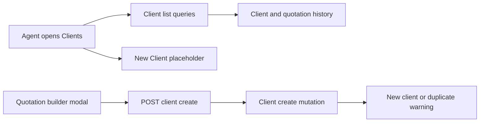

# Clients

This reference describes the checkout at `e98314b847fd7813de30a068f8a23e0efa470d28`. Behavior comes from code tracing. The in-memory probes and existing tests named below are narrower than a deployed or browser test.

A `clients` row represents a quotation customer. It has a name, an optional phone, and string timestamps. It is distinct from an authenticated `users` record and an agent `profiles` row. Quotations keep both a string `client_id` and a separate `client_name`. [Schema: `clients`, `profiles`, and `quotations`](../../convex/schema.ts#L22).

## Shared access and data rules

The proxy redirects anonymous visits to `/clients`, and the protected layout repeats the client-side check. Those guards do not protect direct Convex calls. Every exported operation in [`clients.ts`](../../convex/clients.ts#L26) uses a public `query` or `mutation` and has no identity check. The list constructs its own `ConvexHttpClient` without setting an auth token. The client POST is outside the proxy's package API matcher and its handler has no identity check. [Proxy: `isProtectedPage` and `isPackageApi`](../../src/proxy.ts#L8), [client page: `ClientsPage`](../../src/app/%28protected%29/clients/page.tsx#L32), [route: `POST`](../../src/app/api/clients/create/route.ts#L7).

Client histories join quotations by string client ID and use the current package row for the package name and year. They do not filter archived quotations or status. Counts and **Total Spend** sum all linked quotation amounts, including drafts, revisions, and archived quotations. These values are not payment records. A missing package appears as `Unknown Package`. Quotation numbers use the Hijri year, a four-digit sequence, and an `-R` suffix for positive revisions. [Queries: `buildQuotationNumber`, `listWithStats`, `listWithStatsPaginated`, and `getWithQuotations`](../../convex/clients.ts#L5), [detail: `ClientDetailPage`](../../src/features/clients/ClientDetailPage.tsx#L52).

## CLIENT-001: List, search, filter, and paginate clients

| Reference | Behavior |
| --- | --- |
| Actor and route | An authenticated agent follows **Clients** in the sidebar to `/clients`. [Sidebar: `menuItems`](../../src/layout/SidebarLayout.tsx#L28), [route: `ClientsPage`](../../src/app/%28protected%29/clients/page.tsx#L14). |
| Inputs and rules | The `q` URL parameter matches a case-insensitive substring of name or phone. Multiple `pic` values match any quotation's `pic_name`; search and agent conditions both apply. The agent menu comes from distinct quotation PIC names, not `profiles`. Search changes navigate after 400 ms; changing filters resets cursor and offset. [Loader: `ClientsPage`](../../src/app/%28protected%29/clients/page.tsx#L15), [controls: `ClientsListingPage`](../../src/features/clients/ClientsListingPage.tsx#L239), [query: `getAgentNames`](../../convex/clients.ts#L76). |
| Reads and ordering | With no filter, `listWithStatsPaginated` paginates clients in descending Convex default order and reads all quotations and packages for each page. With a filter, `listWithStats` reads all three tables, sorts clients by `created_at` descending, and the browser filters and slices them. The page size is 10. [Queries](../../convex/clients.ts#L26), [constant: `PAGE_SIZE`](../../convex/constants.ts#L1), [loader](../../src/app/%28protected%29/clients/page.tsx#L36). |
| Outcome and failure | Rows show name, phone, quotation count, last quotation date, and client-since date. The filtered path shows total matches. Unfiltered **Previous** calls browser history, while filtered pagination changes `offset`. The effect has `finally` but no catch or error UI; after a query failure, loading ends and the existing or empty rows remain. [Controls and table: `ClientsListingPage`](../../src/features/clients/ClientsListingPage.tsx#L283), [loader](../../src/app/%28protected%29/clients/page.tsx#L87). |
| Diagnosis | Compare `q`, repeated `pic`, `cursor`, and `offset` with the network query and the linked quotation PIC. Check direct HTTP client configuration and whether a failure left prior rows on screen. [Loader](../../src/app/%28protected%29/clients/page.tsx#L32). |

## CLIENT-002: Expand quotation history

| Reference | Behavior |
| --- | --- |
| Actor and action | An agent expands one client row at a time in `/clients`. The row shows quotation number, package, PIC, status, amount, and date. Preview and Edit link to quotation routes. An empty history offers **Create quotation**. [UI: `ClientsListingPage` and `QuotationRow`](../../src/features/clients/ClientsListingPage.tsx#L65), [expanded row](../../src/features/clients/ClientsListingPage.tsx#L495). |
| Copy | Holding a non-link part of a quotation row for 1,500 ms writes its formatted details to the clipboard and shows a success or failure toast. Pointer release, cancellation, or leave cancels the hold. [UI: `QuotationRow`](../../src/features/clients/ClientsListingPage.tsx#L67). |
| Data and boundary | Data is included in CLIENT-001's list query. Its package labels and all-status quotation rules are described above. **Create quotation** passes `client_id` in the URL, but the create page and builder do not read that parameter or initialize the field from it. [Link](../../src/features/clients/ClientsListingPage.tsx#L513), [route: `QuotationCreatePage`](../../src/app/%28protected%29/quotations/create/page.tsx#L15), [builder: `QuotationBuilder` defaults](../../src/features/quotation/QuotationBuilder.tsx#L592). |

## CLIENT-003: View a client and quotation timeline

| Reference | Behavior |
| --- | --- |
| Actor and route | An authenticated agent can open `/clients/[cid]`; the quotation table also links client IDs to this route. [Route: `ClientDetailPageRoute`](../../src/app/%28protected%29/clients/%5Bcid%5D/page.tsx#L15), [quotation table link](../../src/features/quotation/components/QuotationTable/data-table.tsx#L258). |
| Reads and outcomes | `getWithQuotations` scans clients for the string ID, fetches quotations using `by_client_id`, and reads packages. A missing client redirects to `/clients`. The page displays the client, sum of quotation amounts, a timeline, review and edit links, and a create quotation link. [Query](../../convex/clients.ts#L136), [detail UI](../../src/features/clients/ClientDetailPage.tsx#L52). |
| Boundary and failure | The server client forwards a session token when present. The Convex query itself has no identity check. The creation links carry `client_id`, but the destination ignores it, as in CLIENT-002. Query or configuration errors are not handled in this route. [Server client: `getServerConvexClient`](../../src/lib/convex-server.ts#L7), [route](../../src/app/%28protected%29/clients/%5Bcid%5D/page.tsx#L15), [builder](../../src/features/quotation/QuotationBuilder.tsx#L592). |

## CLIENT-004: Create a client in the quotation builder

| Reference | Behavior |
| --- | --- |
| Actor and entry | An agent opens **Create New Client** beside the client selector in the create or edit quotation builder. The modal marks name and phone as required. [Modal: `CreateClientModal`](../../src/features/quotation/components/CreateClientModal.tsx#L21), [builder](../../src/features/quotation/QuotationBuilder.tsx#L860). |
| Validation and writes | The modal sends `FormData` to `POST /api/clients/create`. The route trims both strings and requires a nonblank name; phone is optional at this boundary. It passes `force` only when the form value is `true`. The public `clients.create` mutation validates types, trims values, and inserts a row with current ISO timestamps; it does not reject a blank name or require a phone when called directly. [Route: `POST`](../../src/app/api/clients/create/route.ts#L7), [mutation: `create`](../../convex/clients.ts#L329). |
| Duplicate handling | `normalisePhone` strips nondigits and changes a `60` prefix to `0` only when the digits have length greater than 10. For a nonempty normalized phone and absent `force`, `create` returns the first matching client without writing. The modal offers **Use** that client or **Create Anyway**, which sets `force`. Editing the phone after the warning does not clear that warning or its force flag. [Mutation: `normalisePhone` and `create`](../../convex/clients.ts#L16), [modal: `handleSubmit`, `handleUseExisting`](../../src/features/quotation/components/CreateClientModal.tsx#L31). |
| Outcome and failure | A duplicate response is HTTP 200 with `success: false`, `alreadyExists`, and client details. Success is HTTP 200 with `clientId`; an empty name returns 400 and a caught mutation error returns 500. Client initialization and form parsing occur outside the catch. The modal logs nonduplicate errors to the console rather than presenting them. [Route](../../src/app/api/clients/create/route.ts#L7), [modal](../../src/features/quotation/components/CreateClientModal.tsx#L38). |
| Selection boundary | On success the builder sets the form's client ID. `clientOptions` still comes from the initially loaded `allClients`, and `SearchableDropdown` displays its placeholder when the selected ID is absent from those options. A newly created client therefore has an ID in the form without a corresponding visible option until the options reload. [Builder: `clientOptions` and callback](../../src/features/quotation/QuotationBuilder.tsx#L610), [dropdown: `selectedOption`](../../src/components/SearchableDropdown.tsx#L71), [create route loader](../../src/app/%28protected%29/quotations/create/page.tsx#L15). |
| Diagnosis | Inspect POST response, duplicate phone normalization, modal warning state, and whether the returned ID is in the builder's initial options. The handler is callable without a session under the shared access rules. [Route](../../src/app/api/clients/create/route.ts#L7), [proxy](../../src/proxy.ts#L8). |

## CLIENT-005: Standalone new-client entry

| Reference | Behavior |
| --- | --- |
| Actor and route | **New Client** in the client list links to `/clients/create`. [Control](../../src/features/clients/ClientsListingPage.tsx#L323). |
| Outcome | `ClientCreatePage` renders only `Client Create Page`. It has no form or mutation. The builder modal in CLIENT-004 is a separate entry point. [Route](../../src/app/%28protected%29/clients/create/page.tsx#L1). |

## CLIENT-006: Detect and merge duplicate clients

| Reference | Behavior |
| --- | --- |
| Actor and availability | A direct Convex caller can invoke the public operations. Repository search found no application caller or client UI for either operation. Neither checks identity or a role. [Queries and mutation: `findDuplicateClients`, `mergeClients`](../../convex/clients.ts#L197). |
| Detection | The query reads all clients and quotations. It groups by trimmed, lowercase name with collapsed whitespace, keeps groups with more than one client, and sorts groups and members by quotation count. `phones_consistent` ignores blank normalized phones and is true for zero or one distinct remaining value. Phone matching does not form the groups. [Query](../../convex/clients.ts#L197). |
| Merge input and writes | `canonicalId` is a string and `duplicateIds` is an array of strings. The mutation checks that each referenced client exists, changes matching quotations' `client_id`, deletes each duplicate, and touches the canonical `updated_at`. It returns IDs and counts. The mutation does not require matching names or phones and does not update quotation `client_name` or inquiry `client_id`. Missing IDs throw. [Mutation](../../convex/clients.ts#L275), [schema: `inquiries` and `quotations`](../../convex/schema.ts#L8). |
| Diagnosis | Compare quotation `client_id` with stored `client_name` and inspect any inquiry references before a merge. An empty duplicate array still updates the canonical timestamp. These direct operations have no in-app confirmation path in the searched code. [Mutation](../../convex/clients.ts#L275). |

## Operation and route inventory

All eight operations below are exported public Convex functions in [`clients.ts`](../../convex/clients.ts#L26). No client update or standalone delete operation is exported. `mergeClients` deletes duplicates as part of its mutation.

| Operation | Type and visibility | Feature | Application caller |
| --- | --- | --- | --- |
| `clients.listWithStats` | Public query | [CLIENT-001](#client-001), [CLIENT-002](#client-002) | Filtered client list. [Caller](../../src/app/%28protected%29/clients/page.tsx#L41). |
| `clients.getAgentNames` | Public query | [CLIENT-001](#client-001) | Client list agent menu. [Caller](../../src/app/%28protected%29/clients/page.tsx#L40). |
| `clients.listWithStatsPaginated` | Public query | [CLIENT-001](#client-001), [CLIENT-002](#client-002) | Unfiltered client list. [Caller](../../src/app/%28protected%29/clients/page.tsx#L43). |
| `clients.getWithQuotations` | Public query | [CLIENT-003](#client-003) | Client detail route. [Caller](../../src/app/%28protected%29/clients/%5Bcid%5D/page.tsx#L17). |
| `clients.list` | Public query | [CLIENT-004](#client-004) | Quotation create and edit loaders. [Create](../../src/app/%28protected%29/quotations/create/page.tsx#L15), [edit](../../src/app/%28protected%29/quotations/edit/%5Bqid%5D/page.tsx#L20). |
| `clients.findDuplicateClients` | Public query | [CLIENT-006](#client-006) | No application caller found. [Definition](../../convex/clients.ts#L197). |
| `clients.mergeClients` | Public mutation | [CLIENT-006](#client-006) | No application caller found. [Definition](../../convex/clients.ts#L275). |
| `clients.create` | Public mutation | [CLIENT-004](#client-004) | Client POST handler. [Caller](../../src/app/api/clients/create/route.ts#L23). |
| `POST /api/clients/create` | Public Next.js route handler, no identity check | [CLIENT-004](#client-004) | Builder modal. [Route](../../src/app/api/clients/create/route.ts#L7). |

## Verification and diagnosis coverage

The existing [client verification journey](../../.agents/skills/verify-mkm-app/features/clients.md) covers the intended list, search, expansion, placeholder, and modal paths. Its [skill](../../.agents/skills/verify-mkm-app/SKILL.md) requires an authenticated agent and disposable backend fixtures for data journeys. It is a procedure, not a recorded pass for this snapshot.

A local in-memory probe executed the actual exported handlers with fixture data and no auth object. It observed anonymous `create`, `setProfileEmail`, and `createProfileForEmail` handler writes; phone duplicate detection; inclusion of an archived quotation in client totals; and a merge that changed quotation `client_id` while leaving quotation `client_name` and inquiry `client_id` unchanged. It did not exercise Convex argument validation, transaction semantics, deployment policy, or a browser. The probe was not saved as a repository test. The existing [server-auth test](../../scripts/convex-server-auth.test.mjs) tests token forwarding, not client-operation authorization.
