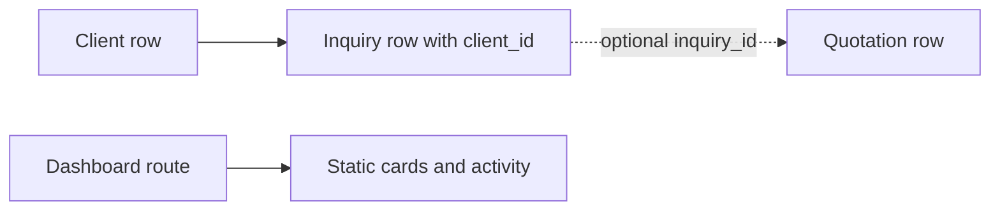

# Dashboard and inquiries

This reference describes source at `e98314b847fd7813de30a068f8a23e0efa470d28`. It is based on code tracing, not a browser or live-database check.

## DASH-001: View the dashboard

| Reference | Behavior |
| --- | --- |
| Actor and route | An authenticated agent can open `/dashboard`. The route renders `Dashboard` inside the protected layout. The dashboard item in the sidebar's `menuItems` is commented out, so the sidebar does not link to it. [Route](../../src/app/%28protected%29/dashboard/page.tsx#L1), [sidebar](../../src/layout/SidebarLayout.tsx#L28), [protected layout](../../src/app/%28protected%29/layout.tsx#L11). |
| Inputs and reads | The dashboard component accepts no inputs and makes no data query. The enclosing layout separately queries the current profile for the sidebar. [Component](../../src/features/dashboard/components/Dashboard.tsx#L12), [layout](../../src/app/%28protected%29/layout.tsx#L15). |
| Outcome | The four cards render hard-coded values: total users `2,543`, active projects `45`, analytics `89.2%`, and settings `12`. The recent-activity items and their relative times are hard-coded as well. The cards and activity entries have no action handlers or links. They are placeholder content, not live account metrics or a live activity log. [Component: `Dashboard`](../../src/features/dashboard/components/Dashboard.tsx#L23). |
| Permissions and writes | The page proxy and client layout enforce page-level authentication. The dashboard itself performs no data writes and defines no additional role rule. [Proxy](../../src/proxy.ts#L8), [component](../../src/features/dashboard/components/Dashboard.tsx#L12). |
| Diagnosis and verification | Check the route, protected layout, and literal component values before investigating backend statistics. The existing [verification map](../../.agents/skills/verify-mkm-app/features/README.md) has no dashboard journey, and this investigation did not run the UI. [Component](../../src/features/dashboard/components/Dashboard.tsx#L12). |

## INQUIRY-001: Inquiry schema without application operations

| Reference | Behavior |
| --- | --- |
| Data model | The `inquiries` table requires a `client_id` that is either a client ID or string, a status of `open`, `won`, or `lost`, a title, and string `created_at` and `updated_at` values. It indexes client ID and status. [Schema: `inquiries`](../../convex/schema.ts#L8). |
| Association | Quotations have an optional `inquiry_id` accepting an inquiry ID or string. The schema defines the field but no application code in `src` or `convex` reads or writes it beyond the schema declaration. [Schema: `quotations`](../../convex/schema.ts#L98). |
| Operations and UI | [`convex/inquiries.ts`](../../convex/inquiries.ts) is empty. Repository search found no inquiry queries, mutations, actions, HTTP handlers, routes, or UI in the application source. The enum does not implement a transition policy. There are zero registered inquiry operations to inventory at this snapshot. [Schema](../../convex/schema.ts#L8), [empty module](../../convex/inquiries.ts). |
| Client merge boundary | `clients.mergeClients` relinks quotation `client_id` and deletes duplicate clients, but does not update inquiries that refer to a deleted duplicate. Whether such inquiry rows exist in a deployment is unknown. [Mutation](../../convex/clients.ts#L275), [schema](../../convex/schema.ts#L8). |
| Diagnosis and verification | For an inquiry-related report, first establish whether data or operations exist outside this checkout. There is no inquiry-specific automated test or browser journey in the inspected project tests and [verification map](../../.agents/skills/verify-mkm-app/features/README.md). No live records were inspected. |

## Operation and route inventory

| Operation or route | Visibility | Feature | Source |
| --- | --- | --- | --- |
| `/dashboard` page | Protected page, no route handler | [DASH-001](#dash-001) | [Dashboard page](../../src/app/%28protected%29/dashboard/page.tsx#L1), [proxy](../../src/proxy.ts#L8). |
| `convex/inquiries.ts` | No registered or exported operations | [INQUIRY-001](#inquiry-001) | [Empty module](../../convex/inquiries.ts). |
