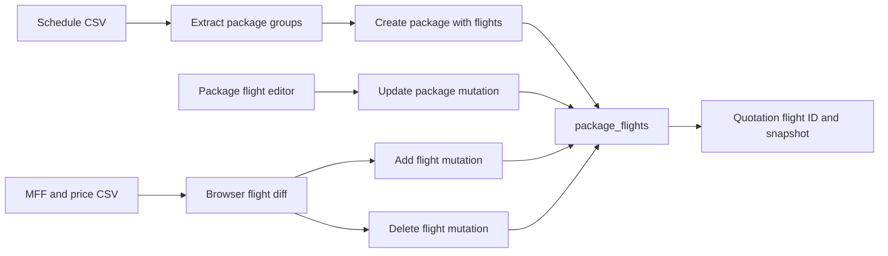

# Flight feature map

This reference covers the flight routes, package flight components, and every export in `convex/packageFlights.ts` at commit `e98314b847fd7813de30a068f8a23e0efa470d28`. Behavior is traced from source unless a local fixture check is explicitly identified. No browser journey or live data write was performed.

## Shared rules and data

A flight is a row in [`package_flights`](../../convex/schema.ts#L54), with a package reference, month, departure and return dates and sectors, optional outbound and return flight values, and optional `sync` or `manual` source. Dates are stored as strings. [`listAll`](../../convex/packageFlights.ts#L69) joins package name and season in memory and returns empty strings for a missing package and `manual` for a missing source.

The [`ProtectedLayout`](../../src/app/(protected)/layout.tsx) protects the normal browser routes, but **none** of the five public operations in [`packageFlights.ts`](../../convex/packageFlights.ts) checks a Convex identity, role, or package ownership. `addFlight` validates a Convex package ID's shape but does not check that its referenced package exists. `deleteFlight` deletes by flight ID without checking quotations. The package module has a separate identity check for its own reads and writes. See [`requirePackageAccess`](../../convex/packages.ts#L5).

The call paths are defined by [`useExtractPackage`](../../src/hooks/useExtractPackage.tsx), [`createPackageWithFlight`](../../convex/packages.ts#L706), [`updatePackage`](../../convex/packages.ts#L353), [`PackageSyncPage`](../../src/app/(protected)/packages/sync/page.tsx#L1057), and [`quotations.ts`](../../convex/quotations.ts).

## Features

### FLIGHT-001. Review flight audit

| Field | Reference |
| --- | --- |
| Entry and actor | Signed-in staff open `/flights/audit` from [`SidebarLayout`](../../src/layout/SidebarLayout.tsx). [`FlightAuditPage`](../../src/app/(protected)/flights/audit/page.tsx) subscribes to `packageFlights.listAll`. The query itself is public and anonymous-callable. |
| Inputs and reads | Search matches package name, either sector, airline, or departure date. Source and season filters apply in browser state. Counts are for all returned flights rather than filtered rows. |
| Outcome and failure | Rows sort by package name and departure-date string, with source badges and tooltips. Because the page uses `useQuery(...) ?? []`, its loading state appears as zero counts and "No flights found." Orphaned package references display empty name and season. |
| Diagnosis | Compare the `package_id`, source, and package season returned by [`listAll`](../../convex/packageFlights.ts#L69) with the audit filters. Legacy absent source is displayed as manual. The tooltip says manual flights are unaffected by sync, but a matching manual flight can be promoted to sync during apply. See [`parseMffCsv`](../../src/features/packages/sync/parsers.ts#L594). |

### FLIGHT-002. Edit flights inside a package

| Field | Reference |
| --- | --- |
| Entry and actor | Signed-in staff use the Flights step of `/packages/create` or `/packages/edit/[pid]`. [`FlightDetails`](../../src/features/packages/components/Form/FlightDetails.tsx) adds or removes rows and exposes airline, month, dates, and sectors. Sector inputs have a ten-character UI limit. |
| Validation | [`FlightImportSchema`](../../src/features/flights/schema.ts) requires string fields but permits empty strings; the mutation validators also require strings without date ordering or nonempty constraints. [`PackageBuilder`](../../src/features/packages/PackageBuilder.tsx) does not run the complete schema at form submission. |
| Writes | [`normalizePackageMutationPayload`](../../src/features/packages/utils/normalizePackageMutationPayload.ts) sends the stored ID and maps the form's `code` to `flight`. [`createPackage`](../../convex/packages.ts#L244) inserts rows. [`updatePackage`](../../convex/packages.ts#L353) patches IDs that already belong to the package, inserts other rows, and deletes existing flights omitted from the payload. Existing IDs remain stable on patch, but deleted IDs are not remapped in quotations. |
| Data boundaries | The editor does not expose or send `return_flight` or flight `source`. A patch leaves those stored fields unchanged. A new row leaves them absent, and `listAll` later reports its source as manual. Editing an existing sync flight does not change its `sync` source. |
| Outcome and failure | Saving uses the package POST routes and navigates on success; failures are console-only. See [PKG-002](packages.md#pkg-002). A quotation update with an omitted/deleted flight ID fails with `Flight not found`; a saved snapshot may still supply historical display data. See [`quotations.update`](../../convex/quotations.ts#L1090) and [`getQuotationFullDetails`](../../convex/quotations.ts#L926). |
| Diagnosis | Compare the flight `_id` before and after edit, the submitted flight array, and quotation `flight_id` and `flight_snapshot`. [`repairStaleFlightIds`](../../convex/quotations.ts#L1515) exists as a separate public maintenance mutation and selects the first remaining flight for the package, not necessarily the original dates. |

### FLIGHT-003. Import a schedule into packages

| Field | Reference |
| --- | --- |
| Entry and actor | Signed-in staff use `/packages/create-from-schedule`, described in [PKG-005](packages.md#pkg-005). [`useExtractPackage`](../../src/hooks/useExtractPackage.tsx) parses uploaded header-based CSV locally and groups flights by season and package. |
| Inputs and rules | Both departure and return dates, a package, month, and season are required. Sector and airline may be empty. Aliases normalize known package names, month names, and selected date formats; `JUALAN AGENT` is skipped. Slash-separated package names produce multiple rows. Filename year defaults to `2026/2027` when the expected pattern is absent. |
| Writes | [`createPackageWithFlight`](../../convex/packages.ts#L706) matches package name, year, and season exactly. Within each matched package it matches flights by departure and return dates and patches the existing ID or inserts a new row. It neither removes missing flights nor imports a return flight number. A patch also resets `created_at` to the import time. |
| Outcome and failure | The page lists parsed flights before selection. [`SelectPackageButton`](../../src/features/packages/components/SelectPackageButton.tsx) logs failed requests but has no visible completion or error state. Existence flags are subject to the unauthenticated lookup described in [PKG-005](packages.md#pkg-005). |
| Diagnosis | Inspect the source CSV headers, date normalization, grouping key, selected package year, and the existing row's date pair. Duplicated identical date pairs in one input are compared with the flight collection loaded before the loop, rather than against newly inserted rows. |

### FLIGHT-004. Reconcile flights from MFF CSV

| Field | Reference |
| --- | --- |
| Entry and inputs | `/packages/sync` accepts a master price list and an MFF schedule CSV. [`PackageSyncPage`](../../src/app/(protected)/packages/sync/page.tsx#L1057) derives season ranges from parsed price-list rows and compares the MFF data against `listAll`. Only the price-list upload is required by the first step. |
| Parsing | [`parseMffCsv`](../../src/features/packages/sync/parsers.ts#L594) skips the first ten lines, reads fixed CSV columns, maps a fixed list of MFF package names, ignores selected patterns and unknown names, parses `d-MMM-yyyy` style dates, and assigns a season by departure date. It matches the first package by normalized name and season, then a flight by package ID, departure date, and return date. The database map holds one flight per such key. |
| Classification | A missing package becomes `no_db_package`; a missing flight becomes `added`. A matched manual flight is `unchanged` with a promotion marker. A matched sync flight is `edited` when normalized sectors or airline differ. Unmatched sync flights become `removed`; unmatched manual flights are kept. `buildSyncPlan` excludes removed rows whose package season equals the literal `2026/2027`. See [`buildSyncPlan`](../../src/features/packages/sync/parsers.ts#L242). |
| Apply and writes | [`handleApply`](../../src/app/(protected)/packages/sync/page.tsx#L1106) creates packages, updates packages, promotes packages, adds flights, deletes flights, then promotes flights, using separate mutations. An edited flight is added as a new row and its old row is deleted. The add stores the airline name as `flight` and does not pass `ret_flight`. Unresolvable package references are reported as errors. Manual source promotion only occurs if another counted change exposes the Apply button. |
| Failure states | Each operation has its own catch; later removals still run after an add failure. A nonempty malformed or unsupported MFF CSV can parse no valid MFF rows and classify existing sync flights as removed, except the literal legacy-season exemption. Review shows planned removals, but there is no parser-level completeness gate. A replacement deletes the old flight ID even after a successful add, leaving quotation IDs stale. See [`parseMffCsv`](../../src/features/packages/sync/parsers.ts#L594), [`handleApply`](../../src/app/(protected)/packages/sync/page.tsx#L1106), and [`quotations.update`](../../convex/quotations.ts#L1090). |
| Diagnosis | Inspect mapping ranges, MFF row count and aliases, computed diff, individual apply errors, stored flight source, and quotation snapshots. `handleApply` is not one atomic transaction. [`compare-mff-flights.js`](../../scripts/compare-mff-flights.js) is a separate operator comparison script, not the browser parser. |

### FLIGHT-005. Preview the legacy flight master CSV

| Field | Reference |
| --- | --- |
| Entry and actor | Signed-in staff can navigate directly to `/flights`. This route is absent from the current [`SidebarLayout`](../../src/layout/SidebarLayout.tsx). [`FlightListPage`](../../src/app/(protected)/flights/page.tsx) renders [`FlightMaster`](../../src/features/flights/FlightMaster.tsx). |
| Inputs and behavior | The Import Schedule button parses CSV with Papa Parse, assumes a header at row index 5 and sector columns at indexes 7 and 13, splits slash-separated packages, excludes `JUALAN AGENT`, maps several aliases, filters missing required values, and displays a local table. Its year key is fixed at `2026/2027`. |
| Outcome and boundary | [`FlightListings`](../../src/features/flights/FlightListings.tsx) only renders the local array. There is no active Convex write or clear control in `FlightMaster`; the clear function and previous upload call are unused. A malformed short file can fail while accessing the assumed header. |
| Diagnosis | Inspect the source CSV layout, `FlightMaster._handleFileUpload`, and the browser console. This preview does not populate the audit or package flights. |

### FLIGHT-006. Direct flight maintenance

| Field | Reference |
| --- | --- |
| Actor and entry | Any caller with access to the Convex deployment can call the five public [`packageFlights` operations](../../convex/packageFlights.ts), because their handlers perform no identity check. The sync and audit UI use four of them. No app UI caller was found for `setSourceManual`. |
| Reads and writes | `addFlight` inserts the supplied package ID, month, dates, sectors, optional outbound and return flight strings, and source, defaulting source to manual. `deleteFlight` deletes the supplied ID. `setSourceManual` fills absent sources in all rows and returns the count. `promoteToSync` changes only rows explicitly marked manual; rows with absent source are not promoted by that mutation. `listAll` reads all flights and packages. |
| Diagnosis | Check the raw stored source rather than only `listAll`'s defaulted value. Check referenced quotations before deletion and inspect whether the package ID actually resolves. |

## Convex operation inventory

Every entry is exported as a **public** Convex operation from [`convex/packageFlights.ts`](../../convex/packageFlights.ts), and none requires an identity inside the handler. There are no flight-specific HTTP route handlers in this checkout. The schedule HTTP handler is inventoried in [PKG-005](packages.md#pkg-005).

| Operation | Kind | Feature and connection |
| --- | --- | --- |
| [`addFlight`](../../convex/packageFlights.ts#L5) | mutation | [FLIGHT-004](#flight-004), [FLIGHT-006](#flight-006). Sync UI and direct callers. |
| [`deleteFlight`](../../convex/packageFlights.ts#L35) | mutation | [FLIGHT-004](#flight-004), [FLIGHT-006](#flight-006). Sync UI and direct callers. |
| [`setSourceManual`](../../convex/packageFlights.ts#L42) | mutation | [FLIGHT-006](#flight-006). Backend maintenance, no app UI caller found. |
| [`promoteToSync`](../../convex/packageFlights.ts#L57) | mutation | [FLIGHT-004](#flight-004), [FLIGHT-006](#flight-006). Sync UI and direct callers. |
| [`listAll`](../../convex/packageFlights.ts#L69) | query | [FLIGHT-001](#flight-001), [FLIGHT-004](#flight-004), [FLIGHT-006](#flight-006). Audit, sync, and operator scripts. |

The package operations that also write flights are [`createPackage`](../../convex/packages.ts#L244), [`updatePackage`](../../convex/packages.ts#L353), and [`createPackageWithFlight`](../../convex/packages.ts#L706). They are inventoried in [packages.md](packages.md#convex-operation-inventory). They require an identity, unlike `packageFlights`.

## Verification and boundaries

The existing [`packages-authorization.test.mjs`](../../scripts/packages-authorization.test.mjs) covers the `packages.ts` exports, not the five `packageFlights.ts` operations. During this investigation, an in-memory invocation of the actual registered `deleteFlight` handler with an anonymous fixture deleted the supplied fixture ID, and an anonymous `listAll` invocation read both fixture tables. This confirms handler behavior in isolation; it is not a live deployment or authorization configuration test.

The [`verify-mkm-app` skill](../../.agents/skills/verify-mkm-app/SKILL.md) provides browser and disposable-backend rules. Its [feature index](../../.agents/skills/verify-mkm-app/features/README.md) states that flight management and schedule imports beyond opening the page need additional verification entries. No flight UI or persistence journey was executed. The MFF CSV parser has fixed names and season ranges, so behavior with real files and unknown future formats remains a data-dependent uncertainty.
