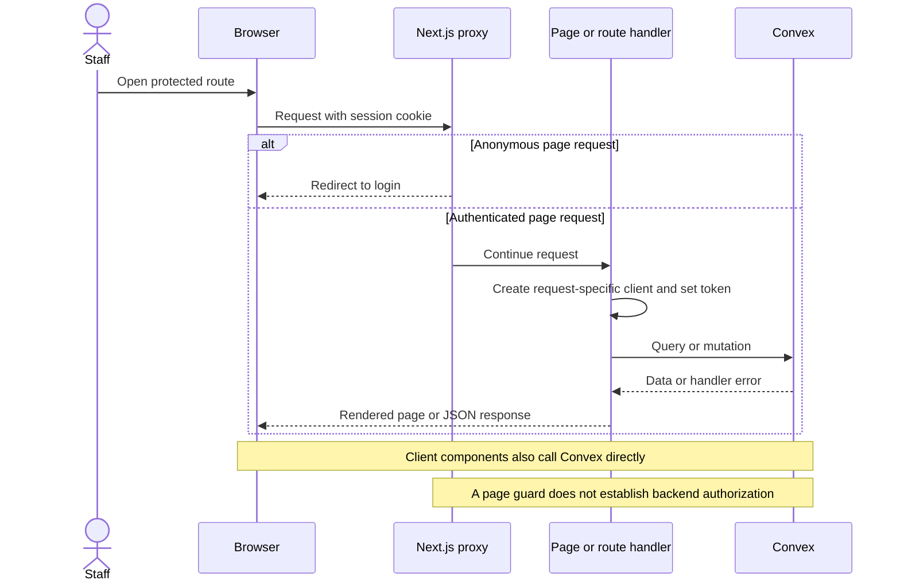
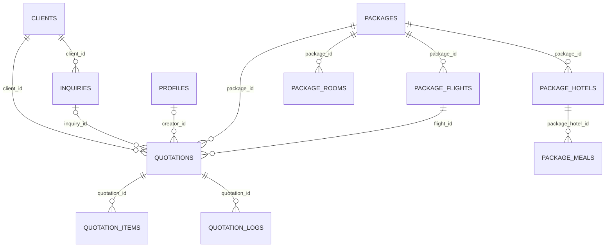

# Shared infrastructure

This reference describes behavior traced from source at the [recorded snapshot](README.md#snapshot). No application UI journey was executed for this map.

## Capabilities

| ID | Capability and actor | Entry, input, and outcome | Implementation and failure behavior |
| --- | --- | --- | --- |
| APP-01 | Navigate the authenticated workspace. Signed-in staff. | Sidebar links open Packages, Quotations, Clients, Sync Packages, and Flight Audit. The mobile sidebar closes after selecting a link. | [SidebarLayout and menuItems](../../src/layout/SidebarLayout.tsx). Dashboard has a route but its sidebar entry is commented out. [SidebarProvider](../../src/components/ui/sidebar.tsx) manages responsive navigation state. |
| APP-02 | Select light or dark appearance. Anonymous visitors and staff. | `Toggle theme` is available on login, account creation, and the protected header. The choice persists under `localStorage.theme`. Without a saved choice, the provider uses the system preference. | [ThemeProvider](../../src/features/theme/provider/ThemeProvider.tsx) toggles the document's `dark` class. [ThemeToggle](../../src/features/theme/components/ThemeToggle.tsx) calls the provider. Children render only after mount. Storage errors have no dedicated recovery branch. |
| APP-03 | Render protected pages and forward server credentials. Staff and server requests. | Page protection covers `/clients`, `/dashboard`, `/flights`, `/packages`, and `/quotations`. Anonymous page requests redirect to `/`. Anonymous package API requests receive JSON 401. | [proxy.ts](../../src/proxy.ts), [protected layout](../../src/app/(protected)/layout.tsx), and [getServerConvexClient](../../src/lib/convex-server.ts). Each server call gets its own Convex client and current cookie token. Server URL selection is `CONVEX_URL` then `NEXT_PUBLIC_CONVEX_URL`. A missing URL throws. Other API prefixes have no equivalent explicit proxy check. Backend permissions are documented separately for each feature. |
| APP-04 | Initialize the application and show feedback. All visitors. | Root layout supplies title metadata and auth providers. Client providers supply Convex subscriptions, theme state, and toast notifications. | [root layout](../../src/app/layout.tsx), [Providers](../../src/app/providers.tsx), and [sonner](../../src/components/ui/sonner.tsx). Browser configuration falls back to `http://localhost:3210` if its public URL is absent. A mismatched browser and server deployment URL can give different datasets. |
| APP-05 | Show loading and missing-route states. All visitors. | Protected loading renders a shared placeholder. Missing routes show 404 with a home link. | [loading.tsx](../../src/app/(protected)/loading.tsx) and [not-found.tsx](../../src/app/not-found.tsx). These are framework special files, not additional application routes. |

## Request flow

Source ownership is split between [proxy.ts](../../src/proxy.ts), [convex-server.ts](../../src/lib/convex-server.ts), and each handler under [convex](../../convex). Some client listings instantiate their own HTTP clients. The [coverage reference](coverage.md) records those entry points rather than assuming every query uses the shared server helper.

## Data relationships

The [Convex schema](../../convex/schema.ts) defines these logical links. Several foreign-key fields accept strings, so this diagram describes intended associations rather than enforced relational constraints.

`authTables` supplies login users, accounts, sessions, and related auth tables. A business client is a customer record. A profile is a staff identity used for attribution. They are separate entities. Profile lookup connects a password account's email to `profiles.by_email`; it is not a direct client-to-user relationship. See [authentication](authentication.md).

`hotel_templates` and `room_templates` supply package defaults. They are not represented as an independently editable UI feature. Quotation snapshots preserve package, flight, hotel, and room information inside quotation rows. See [packages](packages.md) and [quotations](quotations.md).

## Configuration and diagnosis

| Symptom or boundary | Starting point | Existing evidence |
| --- | --- | --- |
| Server queries lose identity or see a different deployment | [getServerConvexClient](../../src/lib/convex-server.ts), [proxy](../../src/proxy.ts), and [README environment configuration](../../README.md) | [convex-server-auth.test.mjs](../../scripts/convex-server-auth.test.mjs) exercises request-specific tokens and URL selection with mocked transport. |
| Anonymous or stale session opens a protected page | [protected layout](../../src/app/(protected)/layout.tsx), [proxy](../../src/proxy.ts), [Convex auth configuration](../../convex/auth.config.ts) | [authentication journey](../../.agents/skills/verify-mkm-app/features/authentication.md) defines the UI checks. A journey definition is not a passing result. |
| Blank content before hydration or unexpected theme | [ThemeProvider](../../src/features/theme/provider/ThemeProvider.tsx) and [Providers](../../src/app/providers.tsx) | [appearance journey](../../.agents/skills/verify-mkm-app/features/appearance.md) defines toggle and reload checks. |
| PDF fails in the browser | [next.config.ts](../../next.config.ts) Buffer alias and [quotation PDF components](../../src/features/quotation/components/PDFPreview.tsx) | No PDF content assertion was executed for this map. |
| Common form, calendar, dropdown, table, or toast behavior fails in several features | [shared UI components](../../src/components/ui), [DatePicker](../../src/components/DatePicker.tsx), and [SearchableDropdown](../../src/components/SearchableDropdown.tsx) | Feature-specific consumers and their validation belong in the individual feature documents. |

[convex.config.ts](../../convex/convex.config.ts) registers the aggregate component. Registration alone does not establish an application feature. Generated API and data-model bindings under `convex/_generated` describe access to functions and tables; they are not independent operations. [convex/constants.ts](../../convex/constants.ts) defines the shared page size of 10.

## Verification boundary

The [verification record](verification.md) separates executed local checks from static tracing. The [existing app verification skill](../../.agents/skills/verify-mkm-app/SKILL.md) launches an isolated web snapshot, but its configured Convex backend is not isolated. No web server, deployment, or live mutation was started for this feature map. Consolidated findings and unverified deployment assumptions are in [findings.md](findings.md).
