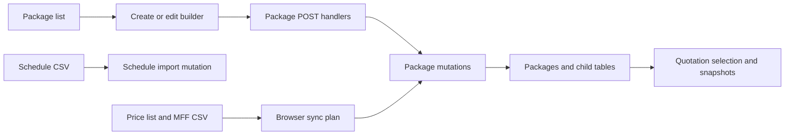

# Package feature map

This reference covers the package routes, the package Convex module, and its HTTP adapters at commit `e98314b847fd7813de30a068f8a23e0efa470d28`. The descriptions come from source tracing and the local checks named below. They do not establish a browser journey or a live database result.

## Shared rules and data

The actor for the protected pages is a signed-in staff user. [`ProtectedLayout`](../../src/app/(protected)/layout.tsx) redirects an unauthenticated browser to `/`. Each exported function in [`packages.ts`](../../convex/packages.ts#L5) calls `requirePackageAccess`, which checks for a Convex identity but does not check a profile, role, or package ownership. The three package HTTP handlers use [`getServerConvexClient`](../../src/lib/convex-server.ts) to attach the request token when one exists. The mutations still reject an anonymous caller.

[`schema.ts`](../../convex/schema.ts#L30) stores a package separately from its rooms, flights, hotels, and hotel meals. IDs are references, and child references also accept legacy strings. `source` on a package is `manual`, `sync`, or `unsync`, or absent on older rows. The normal listing treats absent source as manual. [`updatePackage`](../../convex/packages.ts#L353) changes `sync` to `unsync` when transport, hotel names or meals, or room prices or enabled flags change. It does not make that transition for inclusion or exclusion edits. The comparison does not include hotel enabled flags, placeholder text, or flight edits.

The arrows summarize calls traced through [`PackageBuilder`](../../src/features/packages/PackageBuilder.tsx), [`SelectPackageButton`](../../src/features/packages/components/SelectPackageButton.tsx), [`PackageSyncPage`](../../src/app/(protected)/packages/sync/page.tsx#L1057), and [`QuotationCreatePage`](../../src/app/(protected)/quotations/create/page.tsx).

## Features

### PKG-001. Browse and preview packages

| Field | Reference |
| --- | --- |
| Actor and entry | Signed-in staff open `/packages`, also linked in [`SidebarLayout`](../../src/layout/SidebarLayout.tsx). [`PackageListPage`](../../src/app/(protected)/packages/page.tsx) queries `listWithRooms` using the debounced `q` URL parameter. |
| Inputs and behavior | [`PackageList`](../../src/features/packages/PackageList.tsx) filters loaded rows by season and published status. [`DataTable`](../../src/features/packages/components/PackageListTable/data-table.tsx) groups by season, sorts columns, opens edit and preview, and shows completion and source badges. [`listWithRooms`](../../convex/packages.ts#L60) excludes archived packages, searches names case-insensitively, and joins rooms, flights, hotels, and meals. It returns both published and unpublished rows. |
| Outcome and failure | Loading and empty states are rendered by `DataTable`. [`PackagePreviewModal`](../../src/features/packages/PackagePreviewModal.tsx) selects flight dates and displays or copies formatted text including enabled rooms and hotels. Clipboard writes are not awaited and have no failure message. The preview maps only `Quad` and `Triple` specially; other room types display as two-person rooms. Sync creates `QDP`, `TPL`, `DBL`, and `SGL` room types, while the price script maps `QDP` to Quad and `TPL` to Triple. See [`buildRooms`](../../src/features/packages/sync/parsers.ts#L96) and [`update-prices.js`](../../scripts/update-prices.js). |
| Diagnosis | Start with `q`, `listWithRooms`, and the child records' package IDs. The same query supplies the [quotation creation page](../../src/app/(protected)/quotations/create/page.tsx). |

### PKG-002. Create and edit a package

| Field | Reference |
| --- | --- |
| Entry and reads | `/packages/create` loads `listWithRooms` and `getPackageTemplate`, then initializes an unpublished empty package. `/packages/edit/[pid]` loads `getById` and the package list; a missing package redirects to `/packages`. See [`PackageCreatePage`](../../src/app/(protected)/packages/create/page.tsx) and [`PackageEditPage`](../../src/app/(protected)/packages/edit/[pid]/page.tsx). |
| Inputs | [`PackageBuilder`](../../src/features/packages/PackageBuilder.tsx) has basic, hotels and meals, inclusions and exclusions, room pricing, flights, and preview steps. Its import dialog copies hotels, rooms, inclusions, or exclusions from another listed package. [`BasicDetails`](../../src/features/packages/components/Form/BasicDetails.tsx), [`HotelDetails`](../../src/features/packages/components/Form/HotelDetails.tsx), [`RoomDetails`](../../src/features/packages/components/Form/RoomDetails.tsx), and [`FlightDetails`](../../src/features/packages/components/Form/FlightDetails.tsx) own the controls. |
| Validation | [`packageSchema`](../../src/features/packages/schema.ts) parses numeric room-price text and validates the complete manual submission before save. Blank prices remain invalid; intentional zero and up to two decimal places are accepted. Shared [price and flight-date rules](../../src/domain/submission-validation.ts) reject negative or nonfinite prices and invalid or reversed travel dates. Month, airline and sectors remain optional under the operator-selected dates-only rule. The builder opens the first affected step, focuses its field and retains the draft. HTTP create/update parse before normalization. Relevant package and quotation mutations enforce these rules before writes, including direct calls. See the [verification record](../verification/issue-11-complete-submission.md) for local-handler and undeployed-backend limits. |
| Writes and identity | [`normalizePackageMutationPayload`](../../src/features/packages/utils/normalizePackageMutationPayload.ts) maps form rooms and flights to mutation fields. `createPackage` inserts the parent and all child rows in one mutation. `updatePackage` replaces hotel, meal, and room rows, patches retained flight IDs, inserts new flights, and deletes removed flights. See [`createPackage`](../../convex/packages.ts#L244) and [`updatePackage`](../../convex/packages.ts#L353). The normal form does not carry a season field; creation defaults season to year, and editing preserves the existing season when no season is sent. |
| Outcome and failure | Preview alone admits submission. Both Previous controls are explicit buttons. A synchronous callback guard and disabled pending Save prevent repeated dispatch. Success stays visible with the canonical saved-record link. HTTP 400 permits correction; other HTTP failures, network rejection and malformed success produce an unknown outcome that blocks another save in the mounted builder. The full raw draft remains available for download and Packages opens in another tab for reconciliation. Reload ends this session guarantee. See the [recovery contract and evidence](../verification/issue-11-recoverable-save.md). |
| Diagnosis | Follow `transformConvexPackage` on load, `getValues()` on submit, `normalizePackageMutationPayload`, and the relevant mutation. Inspect the persisted child rows as well as the parent. See [`transformConvexPackage`](../../src/features/packages/utils/transformConvexPackage.ts). |

### PKG-003. Publish or archive

| Field | Reference |
| --- | --- |
| Entry and action | The package table offers Publish, Unpublish, Edit, and Archive. Archive asks for confirmation. See [`DataTable`](../../src/features/packages/components/PackageListTable/data-table.tsx). |
| Rules and writes | [`updatePackageStatus`](../../convex/packages.ts#L682) accepts only `published` or `unpublished`; [`archivePackage`](../../convex/packages.ts#L1220) sets `archived: true`. Both require identity, reject missing packages, and update `updated_at`. Archiving leaves child rows and quotations intact. There is no unarchive action in this table. |
| Outcome and failure | Archived packages disappear from `listWithRooms`. Status does not itself filter `listWithRooms`, including its quotation caller. Mutation errors are logged without an in-page error. See [`listWithRooms`](../../convex/packages.ts#L60), [`DataTable`](../../src/features/packages/components/PackageListTable/data-table.tsx), and [`QuotationCreatePage`](../../src/app/(protected)/quotations/create/page.tsx). |

### PKG-004. Package usage statistics

| Field | Reference |
| --- | --- |
| Entry and actor | Signed-in staff can navigate directly to `/packages/stats`. [`PackageStatsPage`](../../src/app/(protected)/packages/stats/page.tsx) displays package counts, publication counts, total quotations, and per-status counts. A package name links to `/quotations?package_id=...`. |
| Data and outcome | [`listWithQuotationCounts`](../../convex/packages.ts#L24) joins all packages with all quotations by package ID and sorts by total count. Neither collection is filtered for `archived`, so the figures include archived records. Status buckets are draft, sent, accepted, rejected, revised, and superseded. |
| Diagnosis | Compare `package_id`, archived flags, and quotation status against the query before comparing totals to a filtered listing. |

### PKG-005. Create packages from a schedule CSV

| Field | Reference |
| --- | --- |
| Entry and inputs | `/packages/create-from-schedule` loads room templates and renders a drag-and-drop or file-picker CSV control, a sample download, extracted groups, seasonal prices, and package selection. See [`PackageCreateFromSchedulePage`](../../src/app/(protected)/packages/create-from-schedule/page.tsx), [`CreateFromScheduleClient`](../../src/app/(protected)/packages/create-from-schedule/create-from-schedule-client.tsx), and the [sample CSV](../../public/flight-schedule-sample-2026_2027.csv). |
| Parsing | [`useExtractPackage`](../../src/hooks/useExtractPackage.tsx) uses header aliases, package aliases, normalized months and dates, and splits slash-separated package names. It requires package, month, season, and both departure and return dates; it skips `JUALAN AGENT`. The year comes from the filename or defaults to `2026/2027`. Ambiguous slash dates use day first. Rows group by season and canonical package name. |
| Prices and selection | [`SetSeasonalPriceButton`](../../src/features/packages/components/SetSeasonalPriceButton.tsx) stores per-season template room prices in component context. [`SelectPackageButton`](../../src/features/packages/components/SelectPackageButton.tsx) validates the selected-package form, offers only year `2026/2027`, and posts selected groups with their season prices. An empty selection is permitted by the array schema. |
| Writes | [`POST create-with-flight`](../../src/app/api/packages/create-with-flight/route.ts) calls [`createPackageWithFlight`](../../convex/packages.ts#L706). The mutation matches an existing package by exact name, year, and season. A new package gets default duration, unpublished status, templates or supplied room prices, and imported flights. An existing package keeps its non-flight fields and upserts flights by departure and return dates. It does not delete flights absent from the CSV. |
| Outcome and failure | The selector logs failed requests but shows no success or failure state and does not navigate. The existence badge lookup in `markExistingPackages` constructs a new unauthenticated `ConvexHttpClient`, so the identity-protected query rejects and the catch returns unmarked groups. The server mutation still matches existing packages when the POST has a session. See [`useExtractPackage`](../../src/hooks/useExtractPackage.tsx) and [`checkExistingPackagesForYear`](../../convex/packages.ts#L210). |
| Diagnosis | Compare parsed name, season, filename year, selected form year, and departure/return dates. Check browser console and the POST response. See also [flight import](flights.md#flight-003). |

### PKG-006. Preview and apply price-list sync

| Field | Reference |
| --- | --- |
| Entry and actor | Signed-in staff open `/packages/sync` from the sidebar. [`PackageSyncPage`](../../src/app/(protected)/packages/sync/page.tsx#L1057) reads package hotels and meals plus all flights, loads CSV files into browser state, then presents mapping, flight diff, review, and apply steps. Only the price-list file is required to continue. |
| Parsing and rules | [`parsePriceListCsv`](../../src/features/packages/sync/parsers.ts#L433) uses fixed spreadsheet column positions and hard-coded 2026/2027 season ranges. It matches canonical name and season against the first matching DB package. New packages get CSV prices, hotels, meals, and transport. For matched packages, the parser copies current DB transport, hotel names, and meals into the mapping; `computeChanges` compares only those fields, not room prices. `buildSyncPlan` excludes PLATINUM, skips `unsync` overwrites, and may promote `manual` matches. |
| Writes | [`handleApply`](../../src/app/(protected)/packages/sync/page.tsx#L1106) creates or updates packages sequentially, then promotes sources and applies flight adds, removals, and promotions. [`syncPackageFromCsv`](../../convex/packages.ts#L943) creates an unpublished `sync` package, optionally copying inclusions and exclusions from a same-name package, or updates transport and replaces all hotel, meal, and room rows for an existing ID. Existing package name, season, year, duration, status, source, and flights are not changed by that update. |
| Outcome and failure | Each operation is a separate mutation. The loop records errors and continues, so the final result can be partial. The Apply button appears only when create, update, add, or remove counts are nonzero; source promotions alone are excluded from `totalChanges`. A matched package price-only change does not create an update plan because room prices are absent from `computeChanges`. |
| Diagnosis | Inspect `parsePriceListCsv`, `buildSyncPlan`, the review counts, result errors, and the individual mutation. Flight-specific matching and replacement are described in [FLIGHT-004](flights.md#flight-004). The exported `parsePackageMappingCsv` and `parseFlightDiffCsv` helpers have no app callers; the page uses the raw-file parsers instead. See [`parsers.ts`](../../src/features/packages/sync/parsers.ts) and [`PackageSyncPage`](../../src/app/(protected)/packages/sync/page.tsx#L1083). |

### PKG-007. Backend maintenance and reporting

| Field | Reference |
| --- | --- |
| Actor and entry | Authenticated callers can invoke public Convex operations directly. No application UI caller was found for `list`, `listWithRoomPricesOnly`, `patchRoomPrices`, `patchSeason`, `backfillMissingHotelsFromTemplates`, `reconcilePackageHotelsFromTemplates`, or `setPackagesSourceManual`. [`compare-prices.js`](../../scripts/compare-prices.js), [`update-prices.js`](../../scripts/update-prices.js), and [`fix-package-seasons.js`](../../scripts/fix-package-seasons.js) are separate operator scripts. Some scripts invoke `convex run --push` when applying changes. |
| Rules and outcomes | [`patchRoomPrices`](../../convex/packages.ts#L639) patches the first room matching each type and returns `not_found` per missing type. [`patchSeason`](../../convex/packages.ts#L668) trims the season. [`setPackagesSourceManual`](../../convex/packages.ts#L1231) fills only missing sources. These operations do not update `updated_at` or change sync ownership. |
| Hotel maintenance | [`backfillMissingHotelsFromTemplates`](../../convex/packages.ts#L865) and [`reconcilePackageHotelsFromTemplates`](../../convex/packages.ts#L1073) default `dryRun` to false. Reconcile inserts missing template types and removes duplicates with their meals; it chooses the retained row using optional cutoff, meal count, creation time, then ID. Backfill skips all string package IDs when building its existing-type set, although Convex IDs are strings. It can therefore insert duplicate hotel types even when a hotel already exists. |
| Diagnosis | Inspect operation arguments and returned counts before applying maintenance. Trace current data and use a disposable deployment for mutation verification. |

## HTTP handler inventory

All routes below export `POST` only. They forward to public Convex mutations using a request-scoped server client. An identity is required by those package mutations. This list covers every route handler in this slice.

| Handler | Feature | Inputs and result |
| --- | --- | --- |
| [`POST /api/packages/create`](../../src/app/api/packages/create/route.ts) | [PKG-002](#pkg-002) | Normalizes JSON form values, calls `createPackage`, and returns `{ success: true, packageId }` or a caught mutation error with HTTP 500. Client construction, JSON parsing, and normalization occur before the `try`. |
| [`POST /api/packages/update`](../../src/app/api/packages/update/route.ts) | [PKG-002](#pkg-002) | Returns HTTP 400 when `_id` is absent; otherwise normalizes and calls `updatePackage` and returns `{ success: true, packageId }`. The caught mutation error returns 500. Client construction and JSON parsing precede the `try`. |
| [`POST /api/packages/create-with-flight`](../../src/app/api/packages/create-with-flight/route.ts) | [PKG-005](#pkg-005) | Passes JSON as `payload` to `createPackageWithFlight`; mutation or JSON errors return 500. Client construction precedes the `try`. |

## Convex operation inventory

Every entry is exported as a **public** `query` or `mutation` from [`convex/packages.ts`](../../convex/packages.ts). Each calls `requirePackageAccess`; public visibility does not bypass that identity check. "Backend only" means no app UI caller was found in this checkout, not that a direct caller is prohibited. CLI scripts are noted separately.

| Operation | Kind | Feature and connection |
| --- | --- | --- |
| [`list`](../../convex/packages.ts#L14) | query | [PKG-007](#pkg-007). Backend and operator scripts; all package rows. |
| [`listWithQuotationCounts`](../../convex/packages.ts#L24) | query | [PKG-004](#pkg-004). Stats UI. |
| [`listWithRooms`](../../convex/packages.ts#L60) | query | [PKG-001](#pkg-001), [PKG-002](#pkg-002). List, builder, and quotation UI. |
| [`getById`](../../convex/packages.ts#L141) | query | [PKG-002](#pkg-002). Edit loader; returns null for a missing ID. |
| [`getPackageTemplate`](../../convex/packages.ts#L194) | query | [PKG-002](#pkg-002), [PKG-005](#pkg-005). Builder and schedule loader. |
| [`checkExistingPackagesForYear`](../../convex/packages.ts#L210) | query | [PKG-005](#pkg-005). Schedule badge lookup, currently without client auth. |
| [`createPackage`](../../convex/packages.ts#L244) | mutation | [PKG-002](#pkg-002). Create HTTP handler. |
| [`updatePackage`](../../convex/packages.ts#L353) | mutation | [PKG-002](#pkg-002). Update HTTP handler. |
| [`listWithRoomPricesOnly`](../../convex/packages.ts#L577) | query | [PKG-007](#pkg-007). Backend and price-update script. |
| [`listWithHotelsAndMeals`](../../convex/packages.ts#L603) | query | [PKG-006](#pkg-006). Sync UI and extraction script. |
| [`patchRoomPrices`](../../convex/packages.ts#L639) | mutation | [PKG-007](#pkg-007). Backend and price-update script. |
| [`patchSeason`](../../convex/packages.ts#L668) | mutation | [PKG-007](#pkg-007). Backend and season-fix script. |
| [`updatePackageStatus`](../../convex/packages.ts#L682) | mutation | [PKG-003](#pkg-003). Package table. |
| [`createPackageWithFlight`](../../convex/packages.ts#L706) | mutation | [PKG-005](#pkg-005). Schedule-import HTTP handler. |
| [`backfillMissingHotelsFromTemplates`](../../convex/packages.ts#L865) | mutation | [PKG-007](#pkg-007). Backend maintenance. |
| [`syncPackageFromCsv`](../../convex/packages.ts#L943) | mutation | [PKG-006](#pkg-006). Sync UI. |
| [`reconcilePackageHotelsFromTemplates`](../../convex/packages.ts#L1073) | mutation | [PKG-007](#pkg-007). Backend maintenance. |
| [`archivePackage`](../../convex/packages.ts#L1220) | mutation | [PKG-003](#pkg-003). Package table. |
| [`setPackagesSourceManual`](../../convex/packages.ts#L1231) | mutation | [PKG-007](#pkg-007). Backend maintenance. |
| [`promotePackageToSync`](../../convex/packages.ts#L1247) | mutation | [PKG-006](#pkg-006). Sync UI. |

## Verification and boundaries

[`scripts/packages-authorization.test.mjs`](../../scripts/packages-authorization.test.mjs) invokes actual registered package handlers against in-memory fixtures, covering anonymous rejection for each export and selected authenticated listing, status, and archive behavior. [`scripts/convex-server-auth.test.mjs`](../../scripts/convex-server-auth.test.mjs) checks token isolation and configuration. `node --test scripts/packages-authorization.test.mjs scripts/convex-server-auth.test.mjs` passed 32 tests in this investigation. Those tests do not prove the UI, an actual Convex deployment, the CSV sync, or package child-write behavior.

The [`verify-mkm-app` package journey](../../.agents/skills/verify-mkm-app/features/packages.md) documents the browser checks for list, search, and opening both creation paths. Its [skill](../../.agents/skills/verify-mkm-app/SKILL.md) requires an authenticated agent and disposable fixtures for mutations. No browser journey or live writes were performed here. CLI scripts were inspected but not run because they access the configured deployment and some can push or write.
