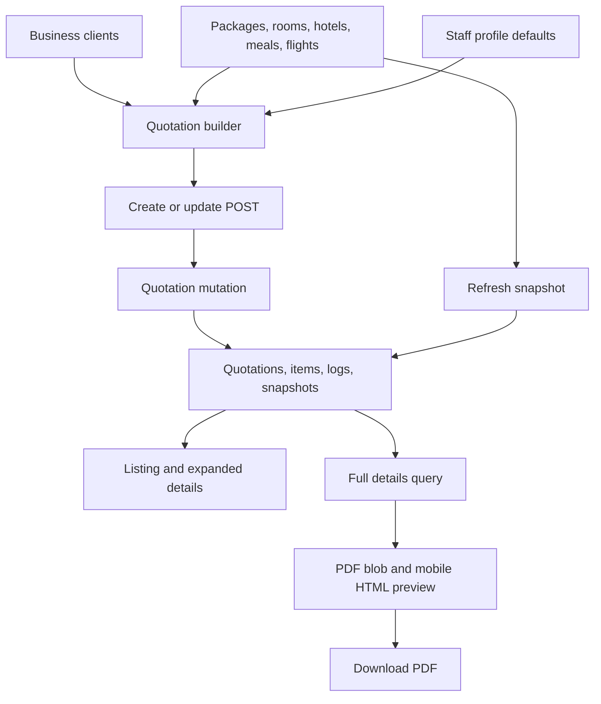

# Quotation management

Quotations combine a business client, a package, a package flight, room quantities and prices, add-ons, and discounts. Staff create or edit these records, inspect saved details, and download a PDF. This reference describes source at `e98314b847fd7813de30a068f8a23e0efa470d28`. Source tracing establishes the paths below. No browser journey, live mutation, or PDF export was executed for this map.

## Boundaries and data flow

The quotation pages require a session through [`src/proxy.ts`](../../src/proxy.ts). All 14 registered operations in [`convex/quotations.ts`](../../convex/quotations.ts) are public queries or mutations without identity or ownership checks. The proxy protects package API routes, but does not protect `/api/quotations/*`. Forwarding a session through [`getServerConvexClient`](../../src/lib/convex-server.ts) does not add an authorization check to these handlers. The intended UI actor is signed-in staff. Direct backend callers do not have that restriction in this checkout.

The arrows describe calls and data dependencies traced through [`QuotationBuilder`](../../src/features/quotation/QuotationBuilder.tsx#L562), [`create`](../../convex/quotations.ts#L472), [`getQuotationFullDetails`](../../convex/quotations.ts#L827), and [`PdfPreviewPane`](../../src/app/(protected)/quotations/review/[qid]/pdf-preview-pane.tsx). Snapshot refresh changes package context without recalculating saved quotation items.

## Features

### QUOTE-001. Browse, search, sort, and paginate

| Field | Reference |
| --- | --- |
| Entry and actor | Staff open `/quotations` from navigation. [`QuotationsPage`](../../src/app/(protected)/quotations/page.tsx) owns URL state and creates its own `ConvexHttpClient` without a token. These quotation queries currently accept anonymous callers. |
| Inputs and reads | Without `q` or `package_id`, `listPaginated` uses a cursor and `PAGE_SIZE = 10`. The `sort` and `dir` URL parameters support `updated_at` and `created_at`, ascending or descending. The rendered headers have no sorting controls. With either filter, the page calls `list`, filters and sorts all returned rows in the browser, and slices by `offset`. Search matches client or live package name, case-insensitively. See [`list`](../../convex/quotations.ts#L209), [`listPaginated`](../../convex/quotations.ts#L370), and [`PAGE_SIZE`](../../convex/constants.ts). |
| Controls and output | The **Fields** popover searches column names and toggles visibility, including Hide All and Show All. [`DataTable`](../../src/features/quotation/components/QuotationTable/data-table.tsx) renders status, amounts, package details, dates, stale indicators, and links to review and edit. Column visibility stays in component state. Previous uses browser history for cursor pages and subtracts the offset for search pages. |
| Limits and failure | Archived quotations are excluded. The `package_id` deep link from package statistics checks `q.package_id`, but `list` returns the ID at `q.package.id`. A nonempty package filter therefore excludes all rows. The load function has a `finally` without a `catch`, so a rejected query has no dedicated error display. Neither path is a subscription to quotation rows. |
| Diagnosis | Relevant values are `q`, `package_id`, `cursor`, `offset`, `sort`, and `dir`. The query joins live package and flight rows, so list labels can differ from snapshot-based review. `count` provides a separate active-row count with optional name search, but has no app caller. |

### QUOTE-002. Expand details and archive

| Field | Reference |
| --- | --- |
| Entry and reads | A table row expands [`QuotationExpandedRow`](../../src/features/quotation/components/QuotationTable/QuotationExpandedRow.tsx), which subscribes to `getItemsByQuotationId`. It displays flight dates and sectors, PIC, branch, timestamps, Hijri year, notes, add-ons, and discounts. Flight display prefers the stored snapshot. |
| Archive write | The row menu asks for confirmation before calling [`archiveQuotation`](../../convex/quotations.ts#L1591). It checks that the quotation exists, sets `archived: true`, updates `updated_at`, and returns the ID. It retains items, logs, and snapshots. No unarchive action is present. |
| Outcome and failure | The table calls `router.refresh()` after archive and logs mutation failures to the console. The listing data comes from a client effect whose dependencies are URL values. There is no explicit local removal or query reload after archive, so immediate row disappearance is not established by this path. Direct edit and review queries do not exclude archived quotations. |
| Diagnosis | The record's `archived` field controls later list queries. Expanded rows fetch items separately from the initial list and show a loading indicator until that query resolves. |

### QUOTE-003. Create a quotation

| Field | Reference |
| --- | --- |
| Entry and reads | `/quotations/create` loads `packages.listWithRooms` and `clients.list` with the request-scoped client, then renders [`QuotationBuilder`](../../src/features/quotation/QuotationBuilder.tsx#L562). The package query excludes archived packages but includes unpublished packages. See [`QuotationCreatePage`](../../src/app/(protected)/quotations/create/page.tsx) and [PKG-001](packages.md#pkg-001). |
| Client details | The first step captures editable PIC, branch, client, and notes. `profiles.getMyProfile` supplies initial PIC and branch defaults. There is no reset effect when the asynchronous profile arrives, so an initially unavailable profile can leave both blank. [`CreateClientModal`](../../src/features/quotation/components/CreateClientModal.tsx) can create a client, use an existing phone match, or force creation. Its callback sets `client_id` but does not refresh the builder's `allClients` options. See [client management](clients.md). |
| Package and rooms | The second step selects a package and one of its flights. A package change clears selected rooms and flight. `HotelSelection` is the room selector despite its name. It offers enabled rooms, initializes price from the package and pax to one, and permits pax edits. It displays the package price without a price editor. The backend payload accepts custom room prices. See [`HotelSelection`](../../src/features/quotation/QuotationBuilder.tsx#L87) and [`FlightSelection`](../../src/features/quotation/QuotationBuilder.tsx#L519). |
| Extras and validation | The third step adds or removes named add-ons and discounts with price and pax. Next and step navigation validate prior required fields. Final submission uses `handleSubmit` with [`quotationFormSchema`](../../src/features/quotation/schema.ts#L12). Client, package, and flight IDs must be nonempty, and at least one room is required. Pax must be at least one. Add-on and discount prices must be nonnegative, but room prices have no minimum. PIC and branch are optional strings and permit empty values. |
| Status | The schema defaults to `draft`. Both mutations accept `draft`, `sent`, `accepted`, `rejected`, `revised`, and `superseded`. The builder forwards status but has no status control. No email, messaging, or send operation is connected to these status values. |
| Backend validation | [`create`](../../convex/quotations.ts#L472) requires an existing client, package, and flight, verifies that the flight belongs to the package, requires a room, and rejects room types absent from that package. It does not require published packages, enabled rooms, positive prices, nonempty PIC, or caller identity. Prices are rounded to cents, and pax is floored and clamped to at least one. |
| Writes and output | The mutation computes room totals plus add-ons minus discounts. It inserts one `quotations` row, `quotation_items`, and a `created` log in the same mutation. Discount items store negative `unit_price` and positive supplied `original_price`. Package, flight, hotels, and meals are copied into snapshots. The client name is copied from the chosen client. |
| Numbering and attribution | `getMappedHijriYear` supports package years `2025/2026` through `2031/2032`; other years throw. The next sequence is the maximum for that Hijri year plus one, including archived rows. `buildQuotationNumber` formats `1448H-0001` and adds `-R<n>` for a positive revision. Creation sets revision to zero. `created_by` is supplied text or PIC, rather than an authenticated identity. |
| Outcome and failure | [`onSubmit`](../../src/features/quotation/QuotationBuilder.tsx#L658) POSTs JSON to `/api/quotations/create`, disables Save while pending, and navigates to `/quotations` on success. A non-OK response is logged without an in-page error. A network rejection has no catch. No unsaved-change persistence is present. |

### QUOTE-004. Edit saved quotation items

| Field | Reference |
| --- | --- |
| Entry and reads | `/quotations/edit/[qid]` loads [`getQuotationForEdit`](../../convex/quotations.ts#L727), packages, and clients in parallel. A missing quotation redirects to `/quotations`. The query rebuilds room, add-on, and discount form arrays from stored items and returns stale fields. See [`QuotationEditPage`](../../src/app/(protected)/quotations/edit/[qid]/page.tsx). |
| Inputs and write | The same three-step builder POSTs to `/api/quotations/update` with `id`. [`update`](../../convex/quotations.ts#L1039) applies the create-time association and room checks, recalculates totals, patches the quotation, deletes all previous items, inserts replacements, and appends an `updated` log. It also overwrites `created_by` with supplied text or PIC. |
| Snapshot and revision rules | A package change replaces the package and hotel snapshots. A flight change replaces the flight snapshot. Otherwise existing snapshots survive, with live data used only when a snapshot is absent. Editing preserves the quotation's Hijri year, sequence, and revision, even when selecting a package with another year. The `revised` status does not increment revision or create a linked revision record. |
| Outcome and failure | Success returns to the listing. Missing quotation, client, package, flight, room selection, or room type causes an error. An archived package is absent from the builder's package options, and a removed flight is absent from its flight choices. Saving still requires valid current associations. The same save-feedback limits as creation apply. |
| Diagnosis | The key boundary is stored `quotation_items` versus current package room IDs and types. The edit query falls back to an item's description when its room row no longer exists. The mutation matches the submitted room type against current package rooms. |

### QUOTE-005. Detect changes and refresh snapshots

| Field | Reference |
| --- | --- |
| Entry and detection | Edit and review use [`computeStaleFields`](../../convex/quotations.ts#L119). It compares tracked package text, existing room prices and additions, hotel names and enabled flags, and flight dates and sectors. Missing live flights produce `flight.removed`. Snapshot version is known when `package_updated_at` is present. List queries omit hotel comparison. |
| Detection limits | Room removal, room enabled changes, hotel removal, hotel meals and placeholders, flight month and airline, and newly populated optional package fields absent from the snapshot do not all participate in comparison. A stale indicator is a comparison of selected fields, not a complete change audit. |
| Refresh action | A stale edit page offers **Refresh snapshot**. It POSTs `_intent: "refresh_snapshot"` and `quotation_id` to the update handler. [`refreshSnapshot`](../../convex/quotations.ts#L1307) copies current package, rooms, hotels, and meals. It refreshes an existing flight or retains the previous flight snapshot when the live row is gone. |
| Writes and failure | Refresh changes snapshots and `updated_at` and appends a `snapshot_refreshed` log attributed to `system`. It does not alter saved room prices, items, total, number, or status. Missing quotation or package throws. The button refreshes the route after any resolved HTTP response without checking `res.ok`, and has no pending or failure state. |
| Diagnosis | A refreshed room-price snapshot can match current package prices while saved quotation item prices remain older. Review still prices rooms from saved items. The builder has no room-price editor, and refresh alone does not reprice the quotation. |

### QUOTE-006. Review and download a PDF

| Field | Reference |
| --- | --- |
| Entry and reads | `/quotations/review/[qid]` loads [`getQuotationFullDetails`](../../convex/quotations.ts#L827). A missing quotation redirects to the listing. A missing live package is allowed when a package snapshot exists. Without either, the query throws. See [`QuotationReviewPage`](../../src/app/(protected)/quotations/review/[qid]/page.tsx). |
| Data rules | Review prefers saved package, flight, and hotel snapshots, with live fallbacks for older records. Room prices and quantities come from saved items, while room type labels prefer linked live room rows. Optional package fields use nullish fallback to live values. Snapshot-based review therefore still has specific live-data dependencies. |
| Desktop and mobile | [`ReviewClient`](../../src/app/(protected)/quotations/review/[qid]/review-client.tsx) shows a stale banner with an edit link. It dynamically imports the PDF pane with SSR disabled. Desktop displays a generated blob URL in an iframe. Mobile displays scaled HTML through [`PDFPreviewMobile`](../../src/features/quotation/components/PDFPreviewMobile.tsx), in a fixed A4-sized container. This HTML is a separate rendering from the downloaded PDF. |
| Document content | [`PDFPreview`](../../src/features/quotation/components/PDFPreview.tsx) renders the recipient, reference, date, PIC, branch, room and extra charges, discounts, total, flight dates and airline, duration, transport, enabled hotels and meals, inclusions, exclusions, fixed terms, and branded header and footer assets. Notes and status are not printed. An empty airline defaults to `MALAYSIA AIRLINES`. |
| Download and failure | [`PdfPreviewPane`](../../src/app/(protected)/quotations/review/[qid]/pdf-preview-pane.tsx) uses `BlobProvider` and `file-saver.saveAs`. **Download PDF** saves `<sanitized-client>_<sanitized-reference>.pdf` and stays disabled until a blob exists. Desktop has generating and generation-error messages. The renderer also mounts on mobile for download, but its error text sits in the desktop-only container. No sending or delivery confirmation is implemented. |
| Diagnosis | Distinguish query failure, PDF blob generation, desktop iframe display, mobile HTML layout, and browser file saving. None of those runtime outcomes was exercised in this investigation. |

### QUOTE-007. Find duplicate groups and delete records

| Field | Reference |
| --- | --- |
| Entry and grouping | `/quotations/duplicates` calls [`findDuplicates`](../../convex/quotations.ts#L330) through an unauthenticated HTTP client. It groups all quotations, including archived rows, by exact client name, package ID, flight ID, and total amount. Groups with at least two rows are returned. Items, status, notes, and client ID do not participate. |
| Delete and effect | The page asks for confirmation before calling [`deleteById`](../../convex/quotations.ts#L1460). That mutation deletes the chosen quotation, its items, and its logs, and returns deletion counts. It accepts any existing quotation ID, without checking duplicate membership. There is no recovery operation. |
| Outcome and failure | Success displays a result and reloads the page after 1.5 seconds. Mutation failure displays its message. Initial query failure has no dedicated error state. `findDuplicates` sorts `createdDates` separately from `quotationIds`, while the page pairs both arrays by index. A displayed date can therefore belong to a different quotation, which matters when choosing the earliest record. |
| Diagnosis | Matching totals do not establish identical quotations. The relevant source is [`DuplicatesPage`](../../src/app/(protected)/quotations/duplicates/page.tsx), plus the stored records and items. No duplicate deletion was performed for this map. |

### QUOTE-008. Backend maintenance and count

| Field | Reference |
| --- | --- |
| Entry and actor | No application caller was found for `count`, `resequenceByCreatedAt`, or `repairStaleFlightIds`. These are public operations without identity checks. Backend-only describes caller coverage, not access restriction. |
| Resequence | [`resequenceByCreatedAt`](../../convex/quotations.ts#L1379) groups all records by Hijri year, sorts by parsed `created_at`, creation time, then ID, and assigns sequential numbers starting at one. Invalid dates sort as zero. `dryRun` defaults to false. Applying changes renumbers existing references without updating timestamps, snapshots, or logs. |
| Flight repair | [`repairStaleFlightIds`](../../convex/quotations.ts#L1515) finds quotations whose flight ID is absent and selects the first current flight for the package. It returns old and replacement IDs, repaired and unresolved counts. `dryRun` defaults to false. Applying changes patches only `flight_id`, without matching saved dates or changing snapshots, timestamps, or logs. |
| Count | [`count`](../../convex/quotations.ts#L297) counts unarchived quotations, optionally searching trimmed client or live package name. It reads complete quotation and package collections. |

## HTTP handler inventory

Both handlers export `POST` and construct a request-scoped Convex client. Their current quotations mutations do not require identity.

| Handler | Feature | Input and outcome |
| --- | --- | --- |
| [`POST /api/quotations/create`](../../src/app/api/quotations/create/route.ts) | [QUOTE-003](#quote-003) | Parses JSON and calls `create` as `{ payload }`. Returns `{ success: true }` or caught JSON or mutation errors with HTTP 500. Client construction occurs before the `try`. |
| [`POST /api/quotations/update`](../../src/app/api/quotations/update/route.ts) | [QUOTE-004](#quote-004), [QUOTE-005](#quote-005) | `_intent: "refresh_snapshot"` calls `refreshSnapshot` with `quotation_id`; otherwise calls `update` as `{ payload }`. Returns success, including `refreshed: true` for refresh, or a caught mutation error with HTTP 500. Client construction and JSON parsing precede the `try`. |

## Convex operation inventory

This table covers every registered export in [`convex/quotations.ts`](../../convex/quotations.ts). None checks identity. Function visibility and validation are separate from authentication.

| Operation | Kind | Feature and connection |
| --- | --- | --- |
| [`list`](../../convex/quotations.ts#L209) | query | [QUOTE-001](#quote-001). Search and package-filter listing. |
| [`count`](../../convex/quotations.ts#L297) | query | [QUOTE-008](#quote-008). Backend-only count. |
| [`findDuplicates`](../../convex/quotations.ts#L330) | query | [QUOTE-007](#quote-007). Duplicate page. |
| [`listPaginated`](../../convex/quotations.ts#L370) | query | [QUOTE-001](#quote-001). Cursor listing. |
| [`create`](../../convex/quotations.ts#L472) | mutation | [QUOTE-003](#quote-003). Create POST. |
| [`getQuotationForEdit`](../../convex/quotations.ts#L727) | query | [QUOTE-004](#quote-004), [QUOTE-005](#quote-005). Edit loader and stale fields. |
| [`getQuotationFullDetails`](../../convex/quotations.ts#L827) | query | [QUOTE-006](#quote-006), [QUOTE-005](#quote-005). Review loader and stale fields. |
| [`update`](../../convex/quotations.ts#L1039) | mutation | [QUOTE-004](#quote-004). Update POST. |
| [`refreshSnapshot`](../../convex/quotations.ts#L1307) | mutation | [QUOTE-005](#quote-005). Update POST intent. |
| [`resequenceByCreatedAt`](../../convex/quotations.ts#L1379) | mutation | [QUOTE-008](#quote-008). Backend-only numbering maintenance. |
| [`deleteById`](../../convex/quotations.ts#L1460) | mutation | [QUOTE-007](#quote-007). Duplicate page deletion. |
| [`repairStaleFlightIds`](../../convex/quotations.ts#L1515) | mutation | [QUOTE-008](#quote-008). Backend-only association maintenance. |
| [`archiveQuotation`](../../convex/quotations.ts#L1591) | mutation | [QUOTE-002](#quote-002). Table archive action. |
| [`getItemsByQuotationId`](../../convex/quotations.ts#L1601) | query | [QUOTE-002](#quote-002). Expanded-row subscription. |

## Verification and limits

The local [quotation integrity checker](../../.agents/skills/verify-quotation-integrity/SKILL.md) exercised actual create and update handlers against in-memory fixtures. The coordinator recorded 864 cases, 16 authorization counterexamples, zero flight-association counterexamples, and zero checker errors. Those results establish the bounded handler properties, including accepted anonymous writes. They do not verify the deployed backend, listing, archive refresh, wizard interactions, snapshot refresh, duplicate cleanup, or PDF generation and download. [Verification records](verification.md) contain the shared evidence and reproduction commands.
