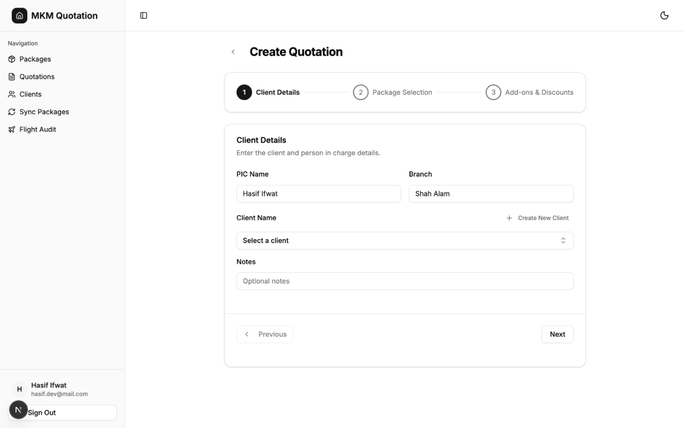
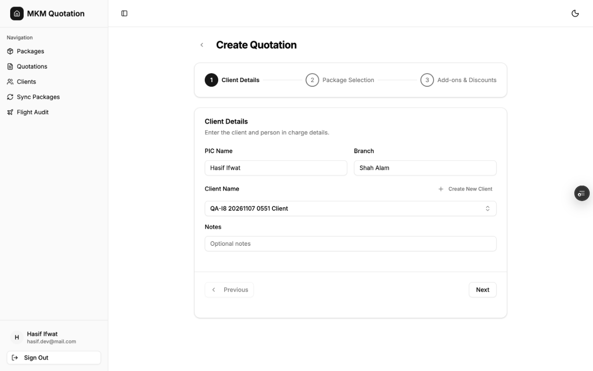
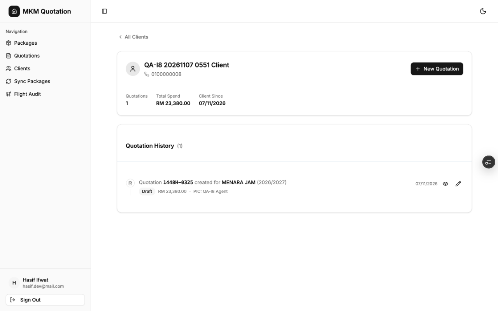
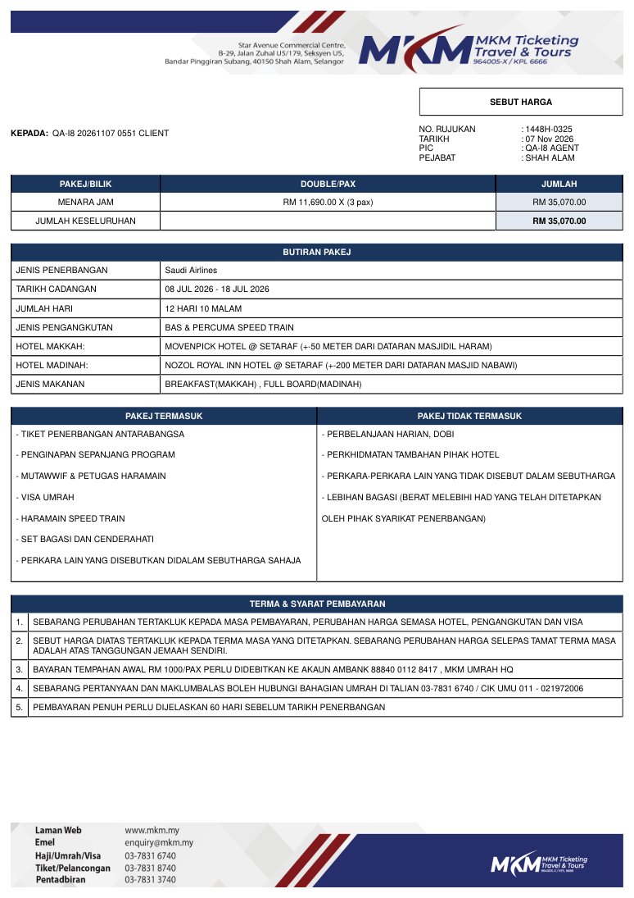

# Issue 8 verification

## Reproduction before the fix

On 2026-11-07, commit `e98314b847fd7813de30a068f8a23e0efa470d28`
failed the client-history entry check in a fresh browser run.
The local Next.js app ran at `http://127.0.0.1:3108` against
`https://glad-wombat-72.convex.cloud`.

1. Sign in with the existing verification account.
2. Open the quotation builder and create `QA-I8 20261107 0551 Client`
   through its existing client modal.
3. Reload Clients. Confirm this client has zero quotations.
4. Expand its row and click its actual **Create quotation** link.
5. Wait for the builder to hydrate.

Observed URL:
`/quotations/create?client_id=j5707vth5vxwmc41p3ar5hnk458hsn2t`.

Observed accessibility tree:

```text
combobox
  text: Select a client
```

The create page does not read search parameters. The builder receives
`initialData={null}` and initializes only PIC name and branch.
No quotation was saved during this failing entry check.

The disposable client ID is `j5707vth5vxwmc41p3ar5hnk458hsn2t`.
Cleanup and passing evidence will be recorded after verification.

## Captured UI evidence

The following images are original captures from the 2026-11-07 verification.
The failing builder ran locally at the base commit above. The passing browser
captures used the deployed fix commit
`f3453d93e9fb9b5d380cbcbf01c5ea18df1f3c75` at
`https://mkm-next-migration-preview-2huxetear-hasififwats-projects.vercel.app`
against `https://glad-wombat-72.convex.cloud`.

### Before the fix

The actual client-history link contains the fixture ID, but the hydrated builder
shows **Select a client**.



### After the fix

Clicking the actual client-history link preselects
**QA-I8 20261107 0551 Client** without manual selection.



### Persistence after reload

After saving two passengers, the client's reloaded history shows quotation
**1448H-0325** for **RM23,380**. This capture precedes the edit to three passengers.



### Downloaded PDF after editing

The final image is a rendered page from the actual downloaded PDF.
It shows the same client and quotation reference after the saved edit to
**3 passengers at RM11,690**, totaling **RM35,070**.



The [complete verification and cleanup record](https://github.com/hasififwat/hasififwat-mkm-quotation-management-system/issues/8#issuecomment-6703179223)
includes the fixture IDs and readback results. The disposable client, quotation,
quotation item, and two logs were removed after verification.
