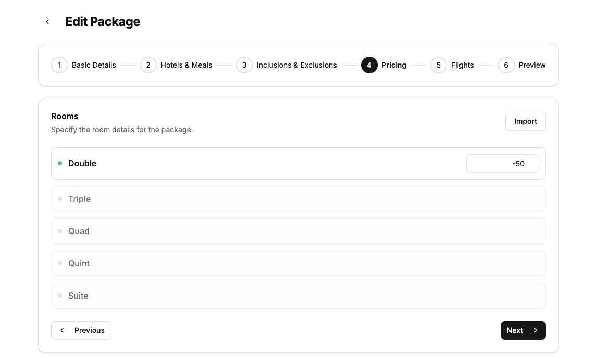
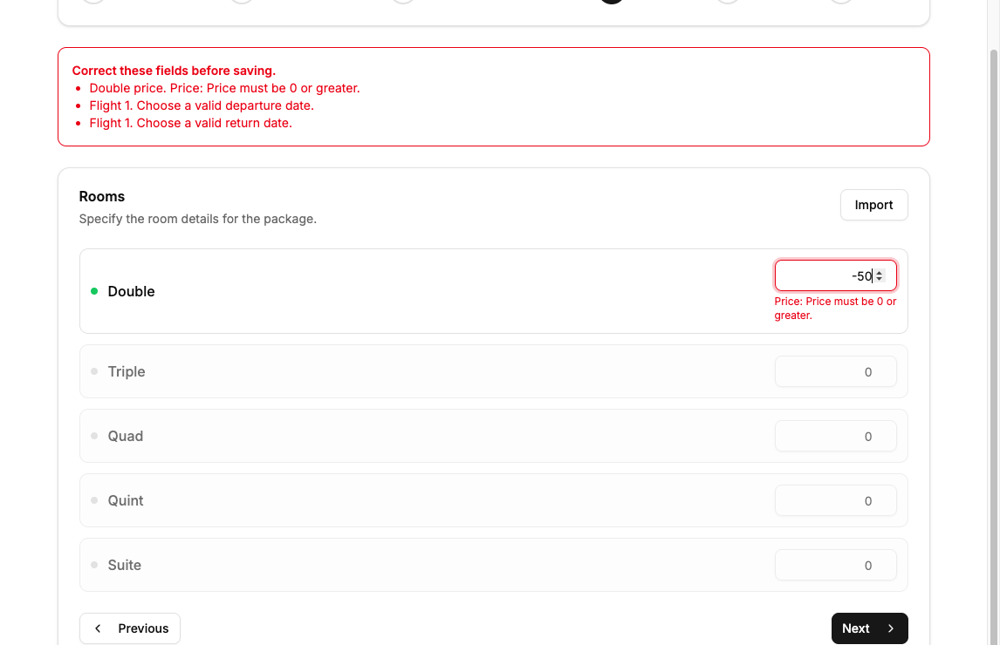
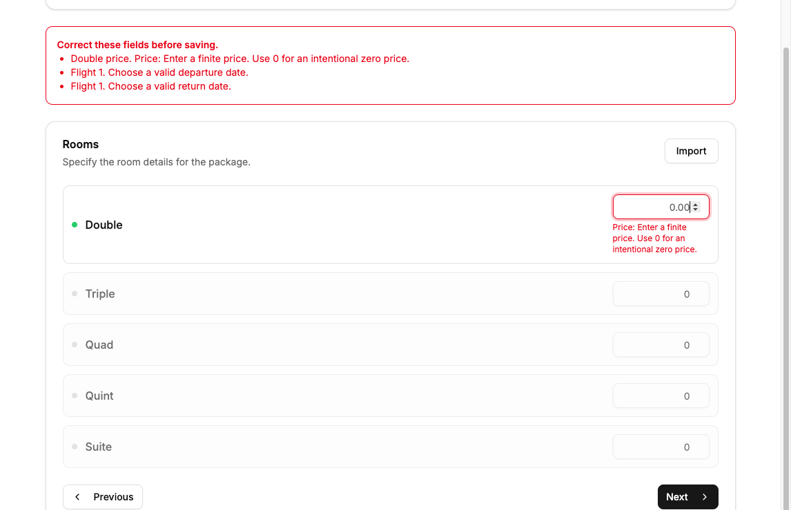
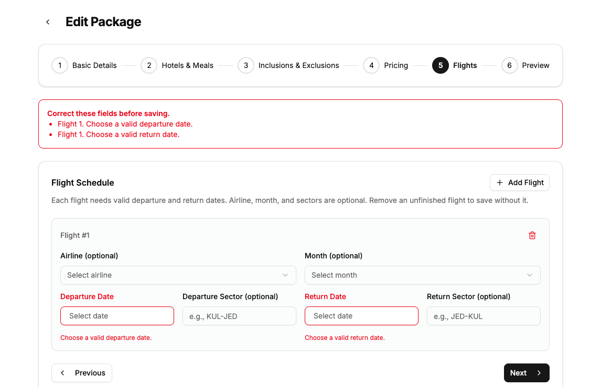
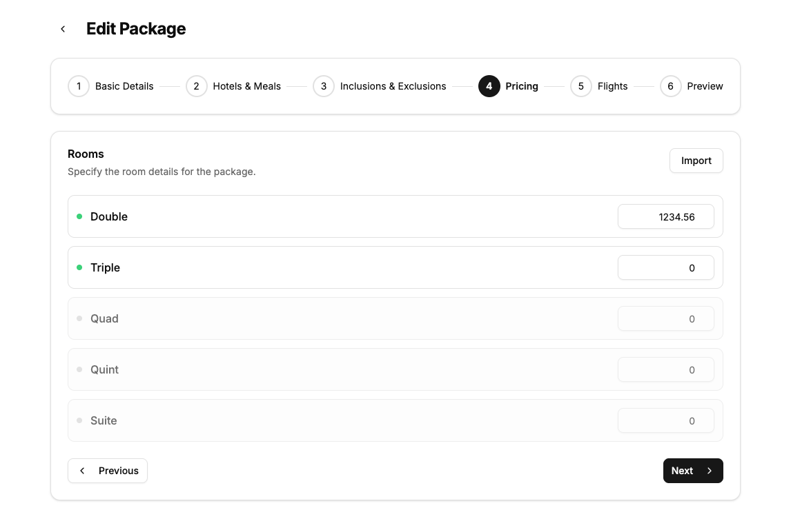

# Complete package submission validation

This implements work item 2 of issue #11. Staff must correct invalid prices and flight dates before saving. Their draft remains in the builder and the step containing the first error opens.

## Rules and design

The operator selected dates-only flight completeness in this run. Each included flight requires real ISO calendar departure and return dates. Return must be on or after departure. Month, airline and both sectors remain optional. Packages may have no flights. No flight draft state was introduced.

New prices must be finite, nonnegative and have at most two decimal places. Zero is intentional and valid. Blank, whitespace and missing prices are invalid. The existing quotation calculation rounds to two decimals. Rejecting new sub-cent prices aligns package entry with that calculation rather than silently rounding staff input. Existing records are not migrated.

Two independent design candidates compared complete frontend-schema reuse, boundary-local duplicated rules and shared pure domain rules. The chosen shared price and date helpers keep one policy owner without making Convex depend on UI-only fields. The frontend schema adapts form field names and numeric text. HTTP routes parse before normalization. Each relevant mutation validates before its first write. Client-only validation would leave direct mutation calls open. A full shared package schema would couple imports and backend writes to UI metadata.

## Regression history

The fresh branch starts at `a3bc744fcbfd9b632fa878e1c6ef813f3dfe99bb` from latest `origin/migration/nextjs-upgrade`. Commit `dace8aff` contains failing regression checks before product changes. The checks invoke actual registered handlers against isolated in-memory tables and compare all table contents and write traces on rejection.

The baseline authenticated browser used `http://127.0.0.1:3102` at the base commit. Staff entered `-50` for Double and added a flight with no dates. Save succeeded. The package appeared in the list and reopened with price `-50` and both date controls empty. Only the uniquely named run-owned package was created.

## Verification boundaries

No backend deployment was performed. Local actual-handler checks establish the proposed Convex guard behavior. Browser checks use the configured existing backend and establish the new frontend and HTTP behavior plus persistence through that backend. They do not establish that the new Convex guards are deployed. The fixture adapter does not reproduce platform argument/document validators, transaction rollback, token verification or concurrent scheduling.

The full baseline lint reports 20 errors and 37 warnings. The quotation-integrity baseline reports 16 existing anonymous-write counterexamples, zero package/flight association failures and zero adapter errors across 864 cases. Both guard-removal mutation tests were detected and the baseline was restored. This work preserves existing authorization behavior and does not fix quotation authentication.

## Browser fixture ledger

- Owned package name is `MKM WI2 20261111-ROOT-0459`.
- Owned package ID is `jd7f0wtvvaz49z6ynerp0wz2098j1pe5`.
- The verification helper isolates frontend source and port. It uses the configured backend without deploying code.
- No historical or unrelated business record is modified by this run.

## Final verification

The authenticated browser tested frontend commit `47a6f3c2ccf41abe11885544aff53d50089b6d47` at `http://127.0.0.1:3102`. The verification manifest records source digest `21b0271adc563184b606e1ada1c56f64b65fc79b5d733c05c3b3a4917bcb64f4`. Later commits add evidence and documentation only.

- Save with `-50` opens Pricing, focuses `rooms.0.price`, displays the field error and keeps the value and package name.
- Clearing the price and saving opens Pricing with an error and retains the blank. It does not become zero.
- Correcting the price to `1234.56` while leaving flight dates blank opens Flights, focuses the departure date trigger and displays both date errors. The price remains `1234.56`.
- These rejected submissions made zero package write requests in the browser network record.
- Staff selected departure `2026-11-12` and return `2026-11-23`, keeping month, sectors and airline blank. Double `1234.56` and enabled Triple `0` saved, reopened and reloaded unchanged. Native price inputs use `min=0` and `step=0.01`.
- A quotation for the existing synthetic `dev_test` client saved with two Double passengers and one Triple passenger. The list showed reference `1448H-0325` and RM 2,469.12. Navigating away and loading the filtered quotation list again retained the same amount. PDF review snapshot automation timed out, so no PDF-rendering or exported-PDF claim is made.

Root independently reran `node --test scripts/complete-submission.test.mjs` with 127 passes, and the supported-year plus authorization/server suites with 96 passes. Root TypeScript and the implementation's nondeploying official Convex typecheck pass. The fresh worktree uses the original ignored `next-env.d.ts` for generated image typing. Convex typecheck used the installed generator's temporary configuration and removed it afterward. `git diff --check` passes.

Full lint has 20 errors and 36 warnings. The diagnostic multiset adds nothing against base, with one warning removed. Root reran the integrity checker with mutation self-tests on the tested code commit. It retains exactly 16 anonymous-write counterexamples, zero association failures, zero adapter errors, both mutants detected and baseline restored.

Initial failing regression output at `dace8aff` was:

```text
ℹ tests 101
ℹ pass 5
ℹ fail 96
```

The fix expands the regression coverage and passes:

```text
ℹ tests 127
ℹ pass 127
ℹ fail 0
```

The scoped independent review found no correctness blocker and no newly added source comments or suppressions. The optional external `deslop` and `control-ui` skills are absent from this installation. The run used the project app verification skill, independent review and direct diff inspection. It did not change skill infrastructure. Origin CLI is absent, so GitHub operations use the available GitHub connector and `gh`.

## Screenshots

These are crops of actual browser captures. They exclude the account sidebar. The layout and field errors were visually inspected before publishing.











## Cleanup

The run-owned package `jd7f0wtvvaz49z6ynerp0wz2098j1pe5` and quotation `k97ceac8keyy1zyfa4khwc62x58j0j53` were archived through their respective UI actions after checking the unique fixture marker. The filtered package list showed `No results.` and the filtered quotation list showed `No quotations found.` afterward. Archived records remain stored. The existing synthetic client was not edited. Quotation sequence numbers were not reset.

Sign-out returned to the login page. All three run-owned preview tabs were closed. Both successful verification helpers and the failed dependency-link startup were cleaned up with the helper. The worktree environment copy was removed. Helper cleanup records remain in the private temporary run directories. The verification port has no listener.

## Remaining findings

The change has no new confirmed blocker in the scoped review and checks. Rarity below is inferred from triggers except the measured lint result. No production-frequency data was inspected.

| Finding | Proof | What goes wrong | What it takes to hit it | Rarity | Who is hurt | Bucket |
|---|---|---|---|---|---|---|
| 1. Existing lint debt | fails, real | Full lint exits with 20 errors and 36 warnings, with no added diagnostics. | Run full lint. | Common, measured. | Maintainers cannot use full-lint exit as a new-regression gate. | Accept as known gap. Separate from this work item. |
| 2. Existing anonymous quotation writes | fails, real | The checker still finds 16 anonymous-write counterexamples. | Directly call an otherwise-valid quotation mutation without identity. | Occasional, inferred. | Business quotation records can receive anonymous writes. | Later ticket. Existing authorization behavior was preserved. |
| 3. New backend guards are undeployed | Not run live | Browser checks cannot establish rejection by the changed Convex code on the configured backend. | Call that existing deployment directly. | Common until a later approved deployment, inferred. | Maintainers must use local handler evidence for the proposed guard behavior. | Accept as known gap. Backend deployment was prohibited. |

Deployment and live endpoint checks would change the third rating. Production usage evidence could change the authentication rarity. Existing schedule-import seasonal-price controls still convert a cleared input to zero before submission. That adjacent UI behavior is outside this parent's manual-builder and section-import scope and was not changed.
