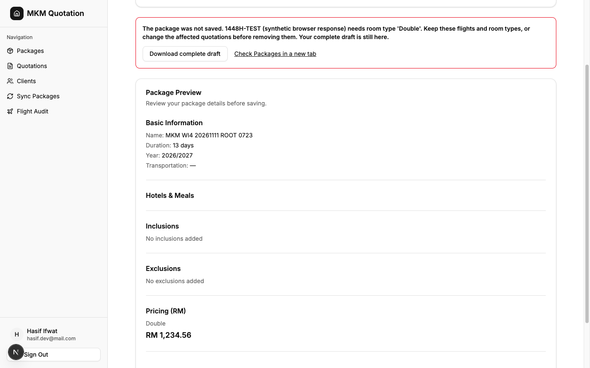
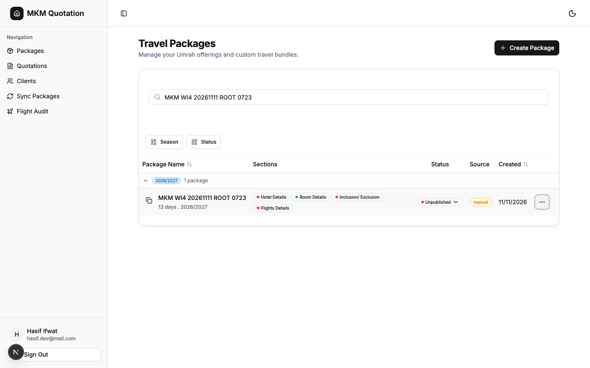
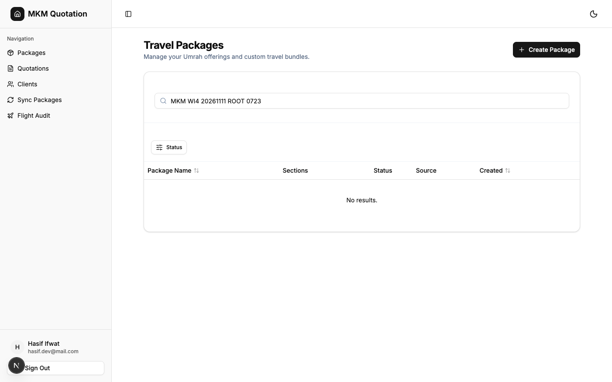

# Protect quotation references during package editing

Staff need to edit packages without removing flight IDs or room types that existing quotations still need. Work item 4 of issue #11 rejects those removals before the manual package update writes anything. Staff see the affected quotation references and required selections, retain their complete draft, and can correct the selection before saving again.

## Pickup and scope

The isolated branch starts at `e9ec009e52ba2bfa4034366152f31e3d1d606abc`, the latest migration branch and merged PR #14. PRs #12 and #13 are also merged. Parent pickup rechecked the 233 inherited tests and TypeScript and retained the completed browser proof at `3cf606c43fd7c132e8fe7bb4bc7d916f68e658ba`. No old browser journey was repeated to reestablish completed work.

This change covers manual package edits and room replacement through the builder's section-import dialog. It preserves supported years, complete submission validation, finite nonnegative prices, intentional zero, currency precision, dates-only flights, authorization, deliberate saving, and manual recovery. It adds no retry guarantee, idempotency, durable drafts, automatic import, stale-edit detection, historical correction, schema migration, or backend deployment.

## Actual dependencies and design choice

The quotation update handler requires the exact flight ID to exist and belong to the selected package. It resolves selected rooms by exact room type. It accepts a disabled room row and does not require the old room ID.

`getQuotationForEdit` resolves a room item's type from its current linked row, then falls back to the item's description when that row is gone. `updatePackage` replaces room rows on every save. The guard therefore compares removed flight IDs and removed room types, rather than treating room ID replacement as removal.

The named conflict shape is `PackageReferenceConflict`. The mutation compares sets of retained flight IDs and room types against indexed quotations and their room items. It checks all statuses and archived quotations. It reads flights before the first package patch and throws a structured `ConvexError` before any write if removal affects a quotation. It identifies up to five affected quotations with human references and stable IDs, explains their required selections, and reports the remaining affected count.

Two independent Sol design sketches compared mutation-only rejection, a dependency projection plus an authoritative guard, and retirement. Mutation-only rejection provides the same authoritative guarantee with fewer query and UI states. Retirement needs a reviewed lifecycle contract across creation, editing, loaders, and imports. Cross-family judging was skipped under the repository's Codex-only configuration.

The update route recognizes only a real `ConvexError` containing the exact reference-conflict code and a string message. It returns HTTP 400. The builder displays that message in its existing rejected state and permits a corrected deliberate save. Other mutation errors remain HTTP 500, and connection failures and uncertain outcomes retain the manual recovery barrier.

`Model the Domain` shaped the selection sets and typed conflict. `Boundary Discipline` placed the authoritative guard before writes and narrowed errors at the HTTP boundary. `Prove It Works` required actual-handler no-write checks and quotation reopen/save checks.

## Throughput checkpoint

Blocking first steps were dependency tracing, pickup, and independent design sketches. Independent workstreams were read-only design exploration, then implementation tests and parent browser verification. One implementation owner controlled the shared branch and froze product source before the browser run. The smallest safe decomposition was one PR covering the mutation guard, route response, builder feedback, and regression proof.

## Local handler proof

The first regression commit, `11a6350e`, fails five of eight actual-handler checks on the unchanged product. Referenced flight removal, room-type removal, combined removal, archived revised quotation protection, and description fallback all fail. The final product commit is `63c57f0c`. Later commits add tests and documentation only.

The final local suite passes 259 tests. These include 19 package-reference checks, six route checks, 11 save-controller checks, and the inherited 223 complete-submission, supported-year, authorization, and server checks. Run:

```sh
node --test scripts/recoverable-save.test.mjs scripts/package-references.test.mjs scripts/package-reference-route.test.mjs scripts/complete-submission.test.mjs scripts/supported-umrah-years.test.mjs scripts/packages-authorization.test.mjs scripts/convex-server-auth.test.mjs
```

Rejection checks compare every fixture table and the attempted write trace. They require zero inserts, patches, and deletes without simulating rollback. Cases cover exact flight identity, room type removal, all statuses, archived revisions, old room IDs, unrelated packages, snapshot-only rooms, add-ons, and bounded feedback. Permitted edits replace room IDs, keep the quoted type disabled, allow zero package price, reopen through actual `getQuotationForEdit`, and save through actual `quotations.update`. The saved quotation items reconnect to the new room ID.

The section-import controller test invokes the actual rendered room import callback. Imported room IDs are cleared. Replacing Quad with Double reaches the actual update handler, rejects without persistence, renders the quotation reference, and keeps the draft. Importing Quad again permits a second deliberate dispatch and confirmed success.

Route tests execute the actual update route and actual registered mutation together. A real reference conflict produces HTTP 400. Ordinary errors, other Convex errors, malformed conflicts, and a plain object imitating an error remain HTTP 500. Permitted edits return the saved package ID.

TypeScript passes. Scoped lint passes. Full lint retains 20 errors and 35 warnings with no new diagnostics. `git diff --check` passes. Optional `deslop` and `control-ui` leaves are absent from this installation, as recorded in the prior work. This run uses direct diff inspection, parent review, and the explicit app verification skill.

Quotation integrity executes all 864 cases with both mutation self-tests. It retains 16 existing anonymous-write counterexamples, zero association failures, and zero adapter errors. Both guard-removal mutants are detected and the original baseline is restored. Quotation source and its helpers are unchanged, so the existing coverage digest remains current.

These checks use the actual registered TypeScript handlers and a simulated database. They do not establish deployed guards, Convex schema or argument validators, network authentication, concurrency, transaction scheduling, or live rollback. The new guards were not deployed. The no-write assertion is stronger than adapter rollback because it verifies that no writes were attempted.

## Browser proof

The authenticated shared browser tested `http://localhost:3104` at product commit `63c57f0c3e370f2659c48bbe260a296e22a092f6`. The helper snapshot records that exact commit and source digest in [browser-run.json](issue-11-protect-references/browser-run.json). Later commits contain tests and documentation only.

The sole owned package was `MKM WI4 20261111 ROOT 0723`, ID `jd762d8eetf8fte6y3m15nbhbs8j1kp3`. It saved with year `2026/2027`, duration `12 days`, enabled Double price `1234.56`, and no flights. The saved link reopened those values.

In its edit form, the browser changed duration to `13 days` and intercepted the update fetch with an explicitly synthetic typed reference rejection. The request never reached the backend. The page displayed the affected selection and synthetic quotation reference, retained the complete preview, and left Save enabled. A separate browser tab still loaded persisted duration `12 days`. This establishes frontend rejection feedback and draft retention, not a deployed reference guard.

After restoring real fetch, a deliberate Save succeeded. The separate tab reloaded duration `13 days`. Its Pricing import dialog selected this same owned package and previewed Double at RM 1,234.56. Import and Save succeeded. A full reload retained duration `13 days`; the filtered Packages list independently showed `13 days` and year `2026/2027`. Actual registered-handler tests establish quotation reopen and save after permitted edits. This browser run created no quotation and makes no live quotation-save claim.





Only the owned package was archived after checking its unique name and ID. The filtered list then showed `No results.` The archived row remains stored. No client, quotation, or unrelated record changed. Sign-out returned to hydrated login controls. Both owned tabs were closed. The helper stopped and removed its private snapshot, including the copied environment. The worktree environment copy was removed. [Cleanup manifest](issue-11-protect-references/browser-cleanup.json) records process cleanup.



Visual review found transition blur in the initial feedback, dialog, and reload captures. The blurred captures were removed. A second read-only capture run at `b39600f25e9abc3a05fd8269a5977421d3e99d46`, with identical product source, reopened the archived owned package and injected the same typed rejection. The settled replacement image above is clear. This run sent no real package writes and created no records. Initial navigation timed out during compilation, then the same owned tab reached hydrated login. Sign-out, tab closure, helper shutdown, and environment removal were repeated. [Capture manifest](issue-11-protect-references/capture-run.json) and [capture cleanup](issue-11-protect-references/capture-cleanup.json) record this evidence-only follow-up.

Parent review inspected the product diff and independently reran all 259 tests, TypeScript, and whitespace checks successfully. The [independent review](issue-11-protect-references/review.md) found no blocker in the stated scope and zero added comments or suppressions. Optional external deslop and control-ui skills remain unavailable; direct diff inspection and the app verification skill supplied those checks. Cross-family trail review was unavailable under the Codex-only project configuration. The two [design](issue-11-protect-references/design-a.md) [candidates](issue-11-protect-references/design-b.md) and [decision log](issue-11-protect-references/decisions.tsv) preserve the choice.

## Accepted boundaries

The ratings below are inferred from trigger conditions, except measured lint. No production-frequency data was inspected.

| Finding | Proof | What goes wrong | What it takes to hit it | Rarity | Who is hurt | Bucket |
| --- | --- | --- | --- | --- | --- | --- |
| 1. New backend guard is undeployed | local-handler proof only | The configured backend still permits the old removal behavior. | Invoke the existing deployed package mutation before a separately authorized backend rollout. | Common, inferred until rollout. | Staff using the existing backend lack this new protection. | Accept as known gap. No deployment is authorized. |
| 2. Other destructive writers remain outside this change | source-backed | Standalone flight deletion and CSV room replacement can still remove quotation dependencies. | Use `packageFlights.deleteFlight` or `syncPackageFromCsv` instead of manual package update. | Occasional, inferred. | Staff editing quotations after those operations. | Later ticket. This PR covers the manual builder and section import. |
| 3. Historical inconsistent selections remain unchanged | passes, real | An item whose description differs from its linked room can resolve differently after ordinary room replacement. Already missing selections remain missing. | Historical quotation data already disagrees with its current room or flight. | Rare, inferred. | Staff handling those historical quotations. | Accept as known gap. No historical correction is authorized. |
| 4. Existing quotation authorization finding | fails, real | Anonymous quotation mutation calls can write business records. | Directly invoke an otherwise-valid quotation create or update without identity. | Occasional, inferred. | Business quotation data. | Later ticket. Existing 16 bounded counterexamples remain unchanged. |
| 5. Existing full-lint debt | fails, real | Full lint exits unsuccessfully. | Run full lint. | Common, measured. | Maintainers need comparison with baseline. | Accept as known gap. 20 errors and 35 warnings remain. |

A separately authorized backend rollout, broader writer coverage, historical repair policy, and authorization fix would change these boundaries. Production usage evidence could change inferred rarity.

[Fail-before output](issue-11-protect-references/fail-before.txt), [final test output](issue-11-protect-references/tests.txt), and [integrity summary](issue-11-protect-references/integrity-summary.json) provide the local evidence.
