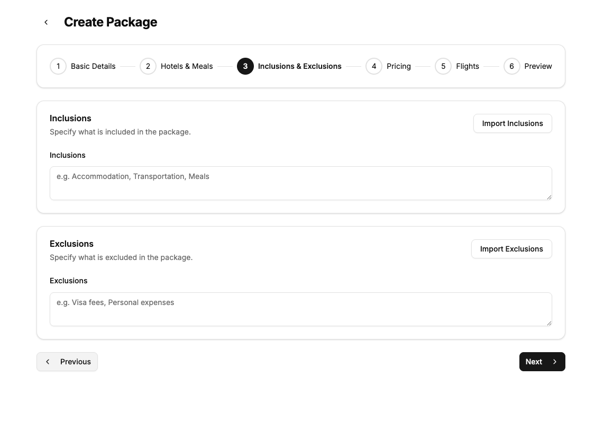
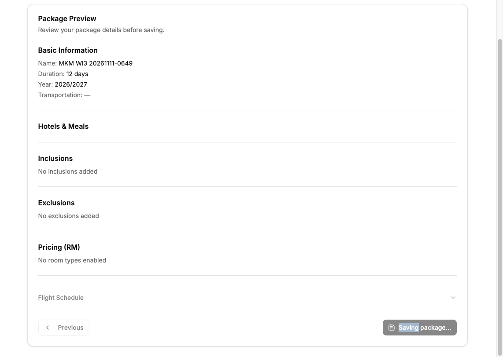
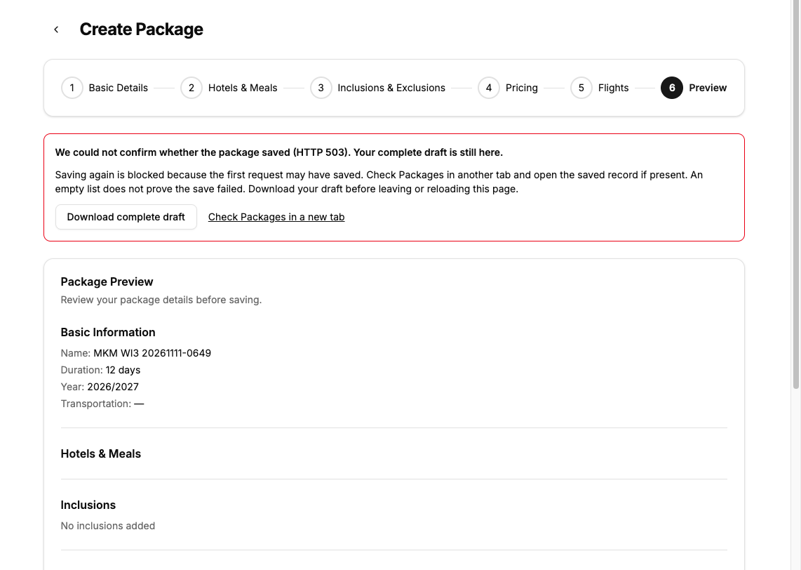
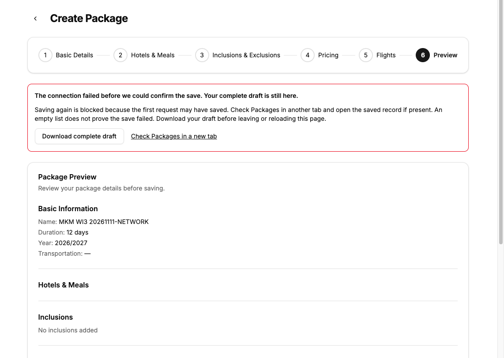
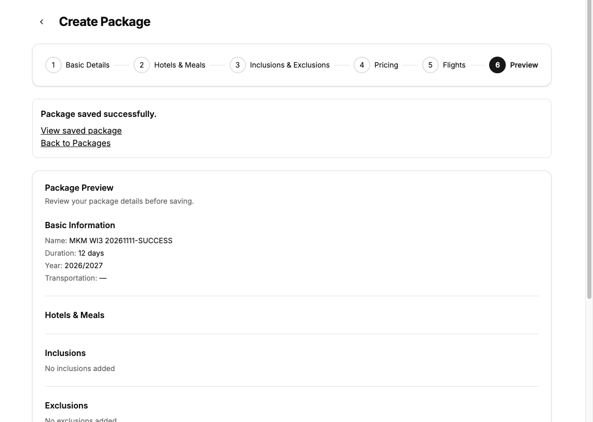
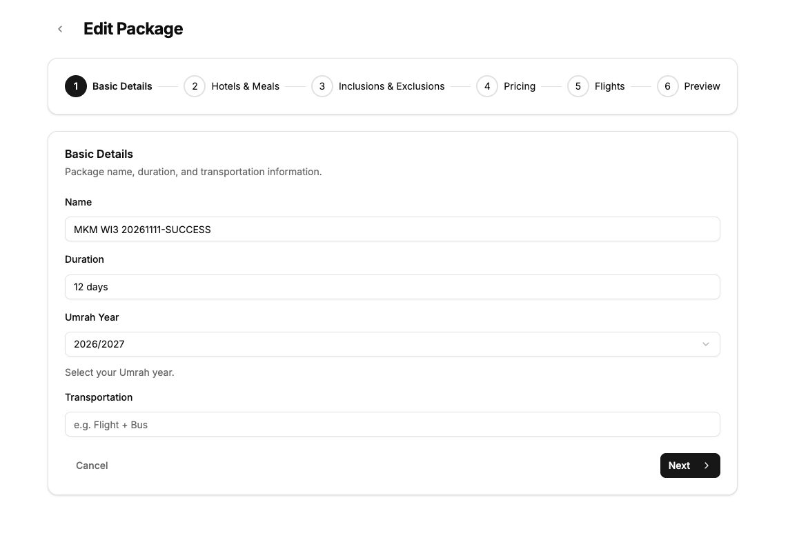
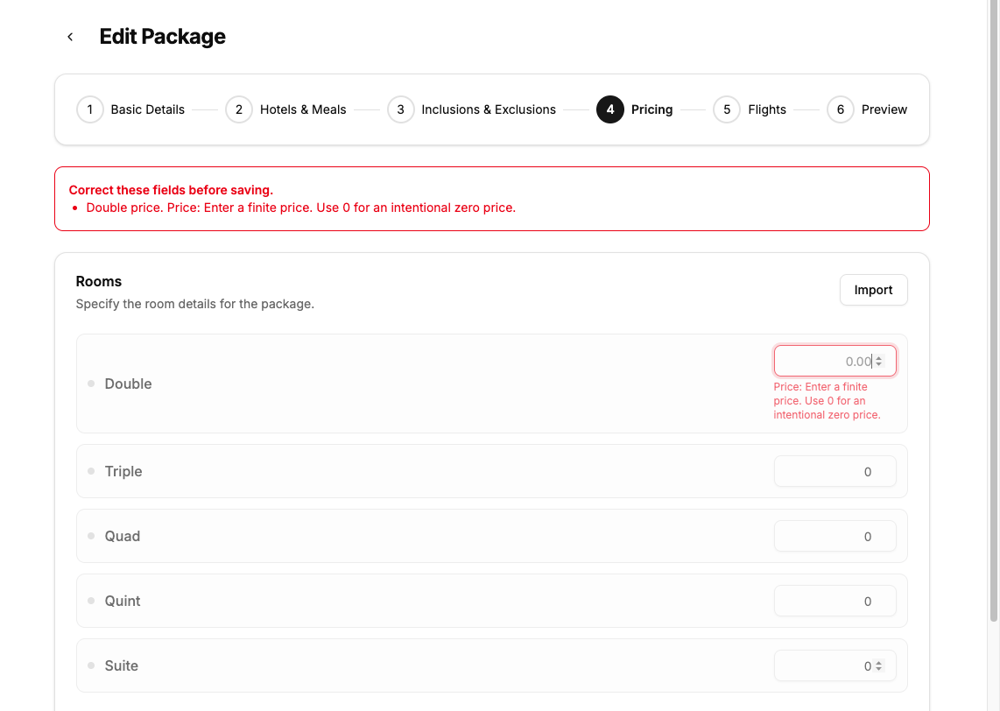
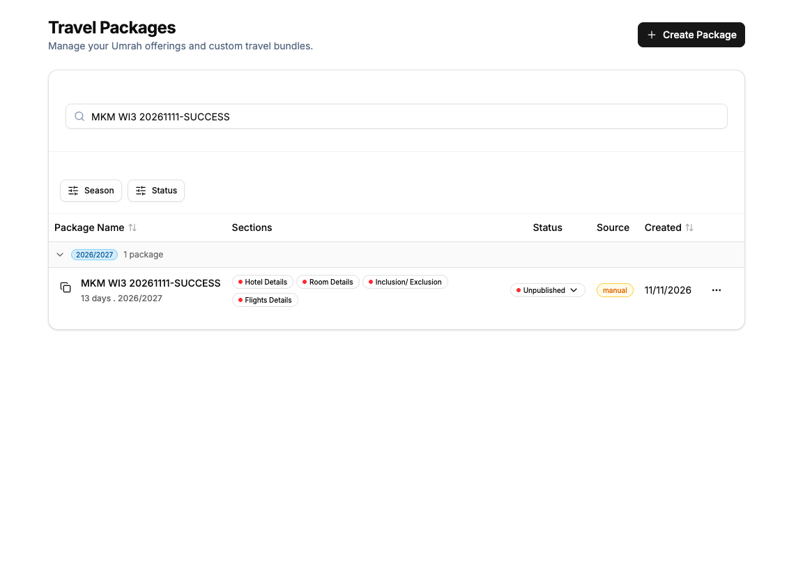
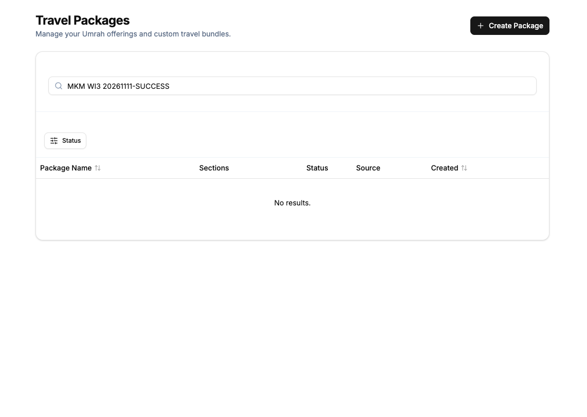

# Deliberate and recoverable package saves

Issue #11 work item 3 gives staff deliberate saving, visible confirmation, and recovery that retains complete drafts without creating duplicate packages.

## Grounding and throughput

The fresh worktree started clean at `b95671a373f7ca65c7ff571d66ce4648986c7b5b`. GitHub confirms this is merged PR13. The builder owns raw React Hook Form values. Complete validation parses those values before the create or update route normalizes them. Convex owns package and nested child writes. The existing create mutation inserts on every call.

Blocking steps are baseline reproduction, failing regressions, and selection of the lost-response contract. Independent workstreams are read-only grounding and two parallel design candidates. The implementation has one owner because the builder and transport contract share mutable save state. The smallest safe decomposition is one code-coupled work item with an independent review. Reference protection and stale-edit detection remain separate work items.

## Baseline proof

The authenticated shared browser ran the unchanged base at `http://localhost:3103`. The verification helper used the original private environment and copied dependencies. Its first dependency-symlink launch failed with Turbopack's filesystem-root error. Copying the installed dependencies resolved it. No backend deployment or watcher ran.

A uniquely named complete draft, `MKM WI3 20261111-0626`, used a supported year, default zero prices and no flights. The browser intercepted package POSTs to avoid creating records during defect reproduction.

- Pricing Previous dispatched one package request. A forced HTTP 503 produced no visible error.
- Double-clicking Preview Save dispatched two requests. Save remained enabled.
- Forced network rejection produced no visible feedback.

The callback checks fail on the base. The first regression commit is `31e16e9c`. The complete-submission baseline passes 127 tests. Supported-year and authorization/server checks pass 96 tests. Lint reports 20 errors and 36 warnings. Quotation integrity executes 864 cases with 16 existing anonymous-write counterexamples, zero association failures, zero adapter errors, both mutants detected and the baseline restored.

## Recovery contract and design choice

The named data shape is `SaveState`. It records idle, saving, rejected, unknown, and saved outcomes. RHF owns the editable raw draft. A separate attempted draft records the values at dispatch. A synchronous ref admits one save callback before any asynchronous work. React state renders the outcome.

Two independent read-only architect candidates compared these structurally distinct designs.

| Candidate | Recovery guarantee | Cost and limitation | Decision |
| --- | --- | --- | --- |
| Transactional receipts | The same authenticated operation key and exact command can return the first committed result on retry. | Requires a new receipt schema, both mutation changes, and deployed backend support. A reload also needs a durable operation journal for safe replay. | Rejected for this bounded frontend-compatible change. This remains the preferred design if automatic safe retry is required. |
| Explicit unknown outcome | An uncertain attempt cannot dispatch another save in the same component session. Staff retain the full draft and inspect Packages separately. | No safe retry promise. An empty list cannot authorize retry. Staff download the complete draft before leaving or reloading. | Selected. It works with the existing backend and makes uncertainty visible. |

The comparison screened safety after response loss, complete raw-draft retention, compatibility with the deployment restriction, interface size, and preservation of PR13 validation. Cross-family judging was skipped under the repository's Codex-only model configuration. Both candidates used the configured Sol model independently. The selected shape grafts immutable attempted-draft capture and strict success acknowledgement from the receipt candidate.

`Model the Domain` drove the explicit unknown state. `Make Operations Idempotent` ruled out offering blind retry. `Prove It Works` drove the sequential actual-handler test that commits a create, loses its response, and attempts another save. No server idempotency is claimed or introduced.

Enter from an ordinary field outside Preview never saves or advances. Textareas keep newline behavior. Enter on an explicitly focused navigation button activates that button. Preview alone admits form submission and runs the existing complete schema validation. Both previously implicit Previous buttons now have explicit button types.

A recognized HTTP 400 validation rejection permits correction and another deliberate save. Other non-OK responses, network exceptions, and malformed success acknowledgements produce an unknown outcome. Unknown and saved outcomes block further submissions for the lifetime of that builder. The current values remain editable after failure. Editing a value does not reset the unknown barrier. Download includes every raw current value, the attempted snapshot, a format version, and the outcome. There is no automatic draft import or browser storage. After success the UI shows confirmation and links to the saved record and Packages. Staff use the existing edit view for further saves.

## Verification boundaries

No Convex code changed, no backend deployment ran, and no `convex dev` process ran. The authenticated browser uses the existing configured backend. HTTP and network faults are injected at the browser fetch boundary. The commit-then-response-loss check invokes the actual registered create handler with the existing in-memory adapter, then rejects the response and attempts another callback. It proves this controller refuses a second dispatch. It does not prove server deduplication, Convex transaction scheduling, or protection across reload, multiple tabs, or independent API callers.

Optional `control-ui` and `deslop` leaves are absent from the local pstack installation. This run used the explicit app verification skill and manual diff inspection. The React best-practices skill was applied to synchronous admission and state ownership. No added comments or suppressions are needed. Origin CLI is absent; GitHub operations use the available connector and `gh`.

## Final proof and review

The browser tested product commit `3cf606c43fd7c132e8fe7bb4bc7d916f68e658ba` at `http://localhost:3103`. The helper recorded source digest `89256ff3ee0029d6f8783f037dcf1aa04ed59fa02a5f9ace45b3140b8ced9191`. Later changes add regression checks and documentation only.

- Both Previous controls and Enter in Basic Details dispatch zero package requests.
- A double-click dispatches one request. The button is disabled and says `Saving package...` while that request is pending.
- Forced HTTP 503 and a rejected fetch show the unknown-outcome instructions. Save stays blocked.
- A downloaded draft contains all four hotel rows, all five room rows including disabled settings, the raw string price `1234.56`, the original attempted snapshot, and the unknown outcome. The deterministic test additionally edits the draft after failure and compares both snapshots in the downloaded JSON.
- The live package `MKM WI3 20261111-SUCCESS`, ID `jd7481drzgbhyxk5fcmgaenjnx8j192b`, saved without flights. Success stayed visible. The separate edit view and a full reload retained its name, duration `12 days`, and year `2026/2027`.
- Editing duration to `13 days` showed success. A full reload and the filtered Packages list both retained `13 days`.
- Clearing Double price and submitting from Preview opened Pricing, focused `rooms.0.price`, retained the blank, and rendered the expected error.

`node --test scripts/recoverable-save.test.mjs scripts/complete-submission.test.mjs scripts/supported-umrah-years.test.mjs scripts/packages-authorization.test.mjs scripts/convex-server-auth.test.mjs` passes 233 tests. These comprise 10 save checks, 127 complete-submission checks, and 96 year/auth/server checks. TypeScript passes. Full lint has 20 errors and 35 warnings against 20 errors and 36 warnings on base. No diagnostics were added; the unused submission-state warning was removed. `git diff --check` passes.

The final quotation-integrity run, including mutation self-tests, retains 16 anonymous-write counterexamples, zero association failures, zero adapter errors, both mutants detected and the baseline restored across 864 cases.

An independent Sol reviewer found no code blocker in the component-session contract. It requested direct export, validation and rendered-feedback evidence. The final test additions use the real schema resolver, compare current and attempted exported JSON after edits, and assert rendered errors and the canonical success link. Browser captures supply the matching runtime evidence. Comment review found zero added comments, zero suppressions, and zero deletion candidates. The parent independently reviews this PR afterward. Cross-family trail review was unavailable under the project Codex-only model constraint.

## Screenshots

These are inspected crops of actual shared-browser captures. They exclude the account sidebar and unrelated customer data.

## Cleanup

Only `jd7481drzgbhyxk5fcmgaenjnx8j192b` was created in the configured backend. Its unique name and ID were checked in the filtered list before its Archive action. The filtered list then showed `No results.` The archived record remains stored. No quotation, customer or unrelated record was created or changed. Fault-injected drafts never reached the backend.

Sign-out returned to the hydrated login page. Both owned browser tabs, including the failed initial connection tab, were closed. All verification helpers were stopped, their private source snapshots and copied environments removed, and port 3103 has no listener. The private worktree environment copy was removed. The downloaded synthetic draft and helper logs remain in private browser and temporary evidence directories. Copied dependencies remain ignored in the worktree.

## Accepted boundaries

No new correctness blocker remains under the selected contract. Rarity below is inferred from trigger conditions, except measured lint. No production-frequency data was inspected.

| Finding | Proof | What goes wrong | What it takes to hit it | Rarity | Who is hurt | Bucket |
| --- | --- | --- | --- | --- | --- | --- |
| 1. Recovery is limited to the mounted builder | passes, real | Reload loses the unsaved draft and the unknown-outcome barrier unless staff first download the draft. Export has no automatic import flow. | Leave or reload after an uncertain request. | Occasional, inferred. | Staff must retain the export and reconcile with saved records. | Accept as known gap. Explicitly shown in the UI; safe retry and durable drafts need a separate contract. |
| 2. Existing lint debt | fails, real | Full lint exits with 20 errors and 35 warnings. | Run full lint. | Common, measured. | Maintainers cannot treat the full-lint exit as a new-regression gate. | Accept as known gap. No added diagnostics. |
| 3. Existing anonymous quotation writes | fails, real | The integrity checker finds 16 anonymous-write counterexamples. | Directly invoke an otherwise-valid quotation mutation without identity. | Occasional, inferred. | Business quotation data can receive anonymous writes. | Later ticket. Existing behavior outside this work item. |

A durable account-scoped operation journal and transaction receipts would change the first rating. Production usage evidence could change the authentication rarity.
