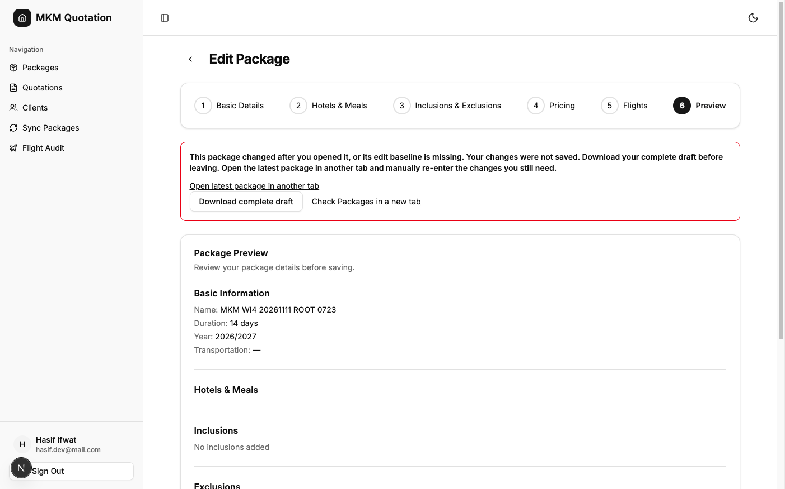
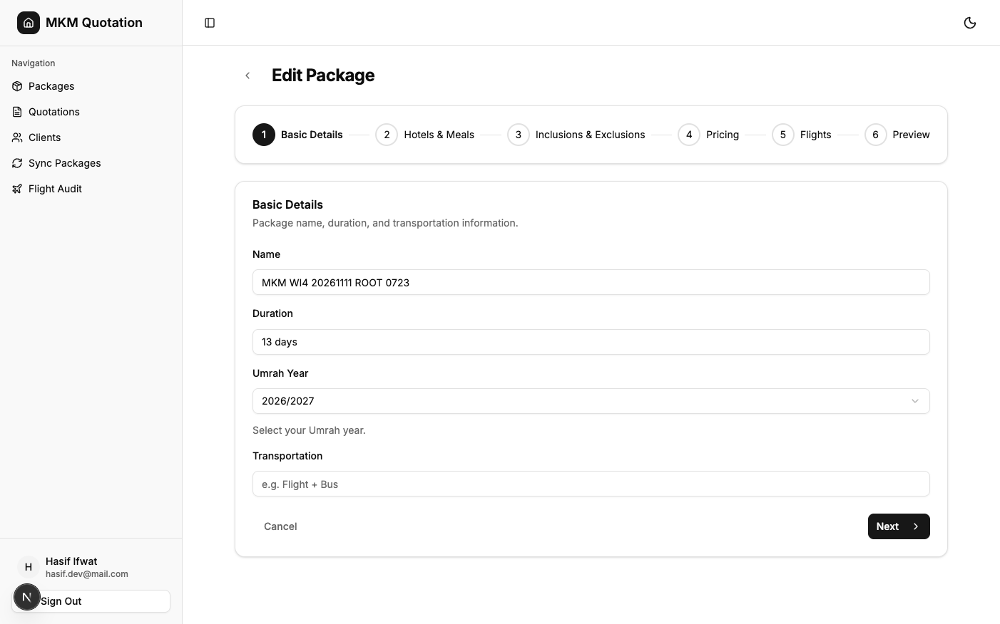

# Reject stale package edits

Staff cannot silently replace newer package edits through an older manual builder. Work item 5 of issue #11 adds an authoritative aggregate baseline and a definite conflict state with complete draft recovery.

The isolated branch `fix/issue-11-stale-package-edits` was rebased onto fetched `origin/migration/nextjs-upgrade` at `e77bacc551cb9806c5cc07e6413b2947c5429cf4` before implementation. This includes merged PR #15. The parent workspace was not changed. [WI4 evidence](issue-11-protect-references.md), and its completed WI1–4 journeys and quotation integrity evidence, remain unchanged.

## Architecture and choice

`getById` reads the package, rooms, flights, hotels, and each hotel's raw meal documents in one query snapshot. A canonical serialization sorts document identities and object keys, includes every stored field, and returns a versioned token alongside the loaded form. The transform and schema retain that token. The mounted builder freezes a deep copy of its initial data in state. Later props and section imports cannot replace the loaded identity or token. The update route forwards that baseline separately from normalized editable fields. The registered mutation recomputes the token and rejects a mismatch or absence before its first write.

Full raw documents include status, archive, source, room price, hotel meals, flight fields, and identities. Independent writers need no parent timestamp or revision bump. This covers current package children regardless of the writer. The token is an equality precondition, not an authentication secret. Serialization repeats package data in transport; a digest could reduce that size later. A revision counter was rejected because every standalone, bulk, maintenance, and sync writer would need to maintain it. [Design and throughput checkpoint](issue-11-stale-edits/design.md) record the alternatives.

Two independent Sol high design agents grounded themselves in the source and preferred the aggregate. Terra max provided how grounding. The owner selected the design under the Codex-only configuration. Cross-family judging was skipped. One owner wrote all product code. The `Model the Domain`, `Boundary Discipline`, `Separate Before Serializing Shared State`, `Test Behavior, Not Implementation`, and `Prove It Works` leaves informed the shape and proof.

The route recognizes only a real ConvexError with the exact typed conflict code and valid message. It returns HTTP 409. Missing tokens are rejected in the route before invoking even an old backend. The builder enters `conflict`, keeps its full editable draft, offers download and a link to the latest record in another tab, and blocks another stale dispatch. Staff reconcile manually in the latest form. Other HTTP 409 responses remain unknown outcomes. Existing reference rejection, field validation, authorization, intentional zero, section import, and uncertain-outcome recovery remain covered.

## Local proof

The fail-before commit is `afcc7a4e`. [Its output](issue-11-stale-edits/fail-before.txt) reproduces the old name-only save overwriting newer inclusions and deleting a newly added flight, plus absent-token and independent-writer gaps. The initial independent source-update case called a no-op on the fixture; the final test corrects it to an actual source write and adds a separate schedule-import field-update case. This correction does not change the two-editor reproduction.

The final suite passes **282 tests**, comprising 259 inherited checks and 23 added checks. [Final output](issue-11-stale-edits/tests.txt) is rerunnable with:

```sh
node --test scripts/package-stale-edits.test.mjs scripts/recoverable-save.test.mjs scripts/package-references.test.mjs scripts/package-reference-route.test.mjs scripts/complete-submission.test.mjs scripts/supported-umrah-years.test.mjs scripts/packages-authorization.test.mjs scripts/convex-server-auth.test.mjs
```

The actual registered handlers prove sequential two-editor rejection, standalone flight create/delete/source update, schedule-import flight field update without parent timestamp change, status, archive, room, hotel, and meal changes. Every rejected save asserts equality of every fixture table and zero attempted inserts, patches, and deletes. Fresh saves, intentional zero, retained flight identity, unrelated-package changes, stable ordering, and anonymous rejection before database access pass. Actual route-plus-handler tests prove typed HTTP 409. Missing-token route checks require zero mutation dispatch. Malformed and forged error objects stay HTTP 500. Builder checks retain complete downloaded drafts, block redispatch, and preserve the original token after prop changes or import-like metadata changes.

Application TypeScript passes after `pnpm exec next typegen`. A nondeploying backend check passes with `pnpm exec tsc --noEmit --target esnext --module esnext --moduleResolution bundler --skipLibCheck convex/packages.ts convex/lib/packageEditSnapshot.ts`. Scoped lint and `git diff --check` pass. [Full lint](issue-11-stale-edits/lint.txt) retains 20 errors and 35 warnings. The temporary added unused test variable warning was removed. Initial application TypeScript needed generated Next image types; type generation resolved the unrelated asset diagnostics.

The independent Sol review inspected the actual diff, ran 275 then-current checks, and separately proved the schedule-import field-update and unrelated-package scenarios. It found no product blocker. Its requested committed test additions now pass in the 282 total. The added-code comment audit found zero comments and zero suppressions. [Review record](issue-11-stale-edits/review.md) records the scope. Optional external `deslop` and `control-ui` were searched once and were unavailable. Direct diff inspection and the app verification skill supplied the applicable checks. No quotation mutation changed, so the completed 864-case quotation integrity run and its known 16 anonymous-write counterexamples were retained without rerunning.

## Authenticated browser proof

The app verification skill and package/authentication journeys guided the run at `http://localhost:3105`. Exact tested product commit is `2f76d7ee3528ae9f82d9d2f84a19645ba930cc4c`. Later commits change tests or evidence only. [Run manifest](issue-11-stale-edits/browser-run.json) records its source digest. The first preverification helper was stopped before restarting against this committed source.

The browser signed in and read only the previously owned archived WI4 fixture `MKM WI4 20261111 ROOT 0723`, ID `jd762d8eetf8fte6y3m15nbhbs8j1kp3`. Its persisted duration was `13 days`. The browser changed its draft to `14 days` and saved through the real HTTP route. Because the backend is undeployed and supplies no token, the route returned typed HTTP 409 before dispatching a backend mutation. **No fetch injection was used.** This proves real missing-baseline frontend feedback and draft retention, not deployed stale-edit enforcement.

The preview retained `14 days` and Double price `1234.56`. Save became disabled. Download contained equal complete current and attempted drafts with duration `14 days` and outcome `conflict`. A separate tab, followed by full reload, still read persisted duration `13 days`. The [browser proof](issue-11-stale-edits/browser-proof.json) and [download](issue-11-stale-edits/downloaded-draft.json) record those observations. No successful live edit is claimed. Local registered-handler checks establish fresh-save behavior. Prior WI1–4 successful persistence evidence remains applicable.





Both captures were visually inspected. The rejection is settled and readable. The second view shows readable loaded values while some form styling is still transitioning; the DOM read after reload independently confirms `13 days`. The run created no record, changed no backend row, and left the existing fixture archived. Sign-out returned to login controls. Both owned tabs were closed, both helper runs were stopped, snapshots and copied environments were removed, and the isolated worktree's private environment copy was removed. [Cleanup manifest](issue-11-stale-edits/browser-cleanup.json) records shutdown. No watcher, merge, or deployment ran.

## Boundaries

Rarity is inferred from trigger conditions without production-frequency data. Lint counts are measured.

| Finding | What goes wrong | What it takes to hit it | Rarity | Who is hurt | Bucket |
| --- | --- | --- | --- | --- | --- |
| 1. Backend rollout remains pending | Existing direct backend callers retain old stale-save behavior. New frontend editing fails closed on a missing baseline. | Use this frontend against the unchanged backend or call the old mutation directly. | Common until rollout. | Staff cannot use the new edit path until coordinated rollout. | Accept as known gap. Deployment is forbidden in this task. |
| 2. Transaction scheduling is not exercised | Local sequential fixtures do not establish live concurrent transaction scheduling. | Two mutations overlap inside Convex. | Rare, inferred. | Staff relying on concurrent saves. | Accept as known gap. The guard reads the aggregate inside the same Convex mutation; deployment and live concurrency proof need separate authorization. |
| 3. Existing lint and other-writer reference gaps remain | Full lint fails; standalone deletion or CSV replacement can still remove quotation dependencies. | Run full lint or remove referenced selections through those separate writers. | Occasional, inferred; lint failure is measured. | Maintainers and staff handling affected quotations. | Later ticket. Unchanged WI4 boundaries. |

Authorized coordinated rollout and a disposable live concurrency test would change the first two boundaries. Historical repair, auto merge, auto retry, durable drafts, general sync redesign, and quotation authorization changes remain excluded.

Attention. Independent review used Sol high. Cross-family trail review is unavailable under the explicit Codex-only configuration. The important limit is the undeployed backend; browser proof covers fail-closed feedback, while the registered-handler fixtures cover stale-save rejection.
