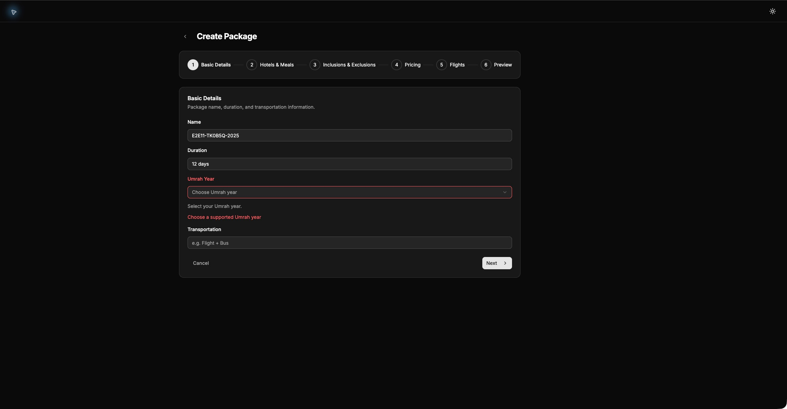
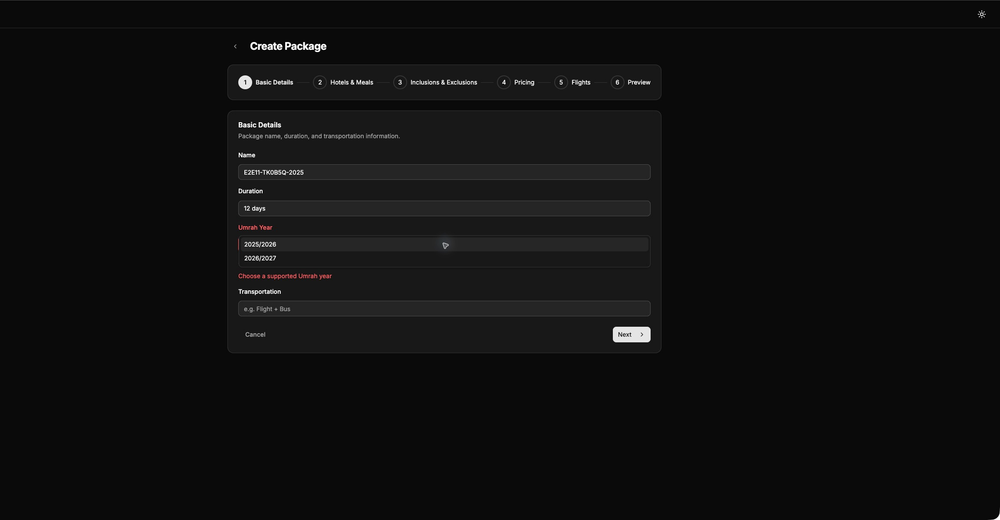
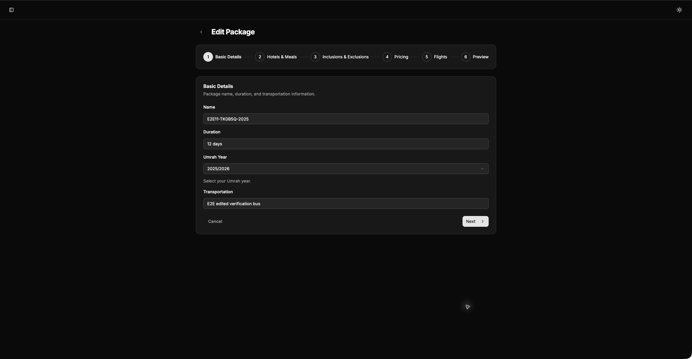
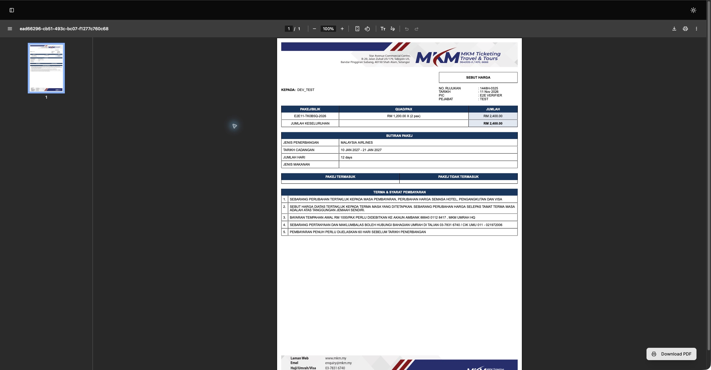

# Issue 11 supported Umrah years

Verified locally on 2026-11-11. The goal is to reject unsupported package years, preserve save/reopen and quotation creation for every offered year, and retain package authorization behavior.

## Revision record

- Requested base, initial HEAD, and local `origin/migration/nextjs-upgrade`: `db4b6555537281618eca5d68bd52bb8cfeb8dbdf`.
- Regression commit: `92beb0b0a66046038b6d5952cd573197850ea7cb` (`test: cover supported Umrah year write boundaries and quotation compatibility`). Production files were unchanged when the regressions ran and when this commit was made.
- Implementation commit: `63b1e6a5e4d67c588c07da5f9fec8c72c049908c`, titled `fix: enforce supported Umrah years across package writers`. A subsequent verification-only commit records the parent review and browser attempt.
- Authenticated browser snapshot: `78e8959dc78dc8648525965cbe43765ab8db3ede`, at `http://localhost:3101`. The following commit adds evidence only.

## Behavior and scope

The dependency-free keyed catalog owns seven explicit Gregorian-to-Hijri mappings and the two existing selectable choices. `2025/2026` maps to `1447H`, through `2031/2032` mapping to `1453H`. Only `2025/2026` and `2026/2027` are offered. Exact string membership uses `Object.hasOwn`, so inherited property names cannot become years.

The create page supplies an empty string. Both package form schemas retain string input and output, including invalid or historical form state, and refine membership at validation. The picker derives its choices from the catalog. Final submit awaits only `trigger("year")` before setting submitting state or calling fetch. Failure exposes the existing year error on Basic Details. Other field validation, numeric coercion, save controls, and navigation remain outside this change.

The normalizer copies year without a date fallback. Actual create/update and create-with-flight handlers authenticate first, then reject unsupported years before database access. CSV inserts enforce the same rule. CSV existing-record updates continue to ignore their unused year argument. Quotation creation uses the shared lookup and retains existing mapping-error wording and numbering. Database schema, historical reads, and stored records have no migration or automatic correction.

## Executable evidence

Commands run from this worktree with Node `v24.19.0`. The initial handler checks shared the root dependencies through an ignored symlink. For the successful browser run, local dependency paths were materialized using the same installed versions to satisfy Turbopack. No dependency versions changed. Set `pnpm_config_verify_deps_before_run=false` for pnpm commands below; otherwise pnpm tries to reinstall the shared dependency directory and aborts for lack of a TTY.

| Command | Before | After |
|---|---|---|
| `node --test scripts/supported-umrah-years.test.mjs` | 64 tests: 13 pass, 51 fail | 64 tests: 64 pass, 0 fail |
| `pnpm test:packages-auth` | Established baseline: 32 pass | 32 pass, 0 fail |
| `pnpm typecheck` | Established baseline: pass | Pass after `pnpm exec next typegen` generated ignored Next declarations |
| `pnpm exec convex typecheck` | No checked-in Convex tsconfig | Pass using the installed Convex package's exact `tsconfigCodegen()` output temporarily at `convex/tsconfig.json`; removed after the command |
| `pnpm lint` | 20 errors, 37 warnings | 20 errors, 37 warnings, exit 1 |
| `git diff --check` | Clean | Pass |

The initial root typecheck exposed missing generated Next image declarations, and the first refinement inferred a narrowed output type. Generating Next declarations and annotating the refinement callback's boolean return preserved the required string output. The final root typecheck passes. The parent independently reran the 64 regression tests, 32 authorization tests, and root typecheck on Node `v26.11.1`. The first Convex command refused to run without its tsconfig; the subsequent command with the temporary official config passed without deployment or codegen.

Failing-before output is retained locally at `/tmp/mkm-year-red.tap`; passing output is `/tmp/mkm-year-green.tap`. The intended failures include `Missing expected rejection` from unsupported writers, schema accepting `2026`, and the normalizer returning `2025/2026` for missing year. One failure records the not-yet-created catalog. All seven valid create/reopen/update/reopen/quotation cases passed before and after. Auth output is `/tmp/mkm-year-auth.log`; root and Convex typecheck logs are `/tmp/mkm-year-typecheck.log` and `/tmp/mkm-year-convex.log`.

Lint JSON is `/tmp/mkm-year-head-eslint.json`, compared against `/tmp/mkm-year-base-eslint.json`. Diagnostic file, rule, severity, and message multisets match exactly after normalizing absolute paths and ignoring shifted line numbers. No suppressions or unrelated lint fixes were added.

## Fixture coverage and limits

The tests transpile actual TypeScript modules and invoke the actual registered Convex `_handler` functions. The loader resolves relative TypeScript dependencies; application imports were not changed to accommodate mocks. The in-memory database implements the query indexes and read/insert/patch/delete operations used by these paths. Each test owns fresh disposable tables. There is no network or backend connection, and all fixtures disappear when the process exits.

The invalid matrix covers empty, calendar `2026`, malformed separators, leading/trailing whitespace, unsupported past/future ranges, `constructor`, `toString`, and `__proto__`. Every invalid writer case starts with a package and children, then checks zero database operations and unchanged tables. Anonymous calls with absent arguments establish authentication before argument inspection and database access. Missing-year normalization is asserted independently and sent to the actual create handler for rejection.

Each of all seven accepted years runs actual normalized create, getById, transformed update, getById, and quotation create. Assertions independently specify the expected Hijri code, reference such as `1447H-0001`, and persisted package snapshot year. Both offered years are included. Alternate writers exercise supported insert paths too, and CSV update accepts an ignored unsupported year without changing stored year. These are handler-level integration tests, not Convex hosted transaction or browser tests. UI wiring was inspected directly; no source-text tests or component rendering are represented as end-to-end proof.

## Authenticated browser verification and cleanup

Used the repository [app-verification skill](../../.agents/skills/verify-mkm-app/SKILL.md) and package journey. The initial helper attempt failed because Turbopack rejected an external dependency symlink; local dependency paths resolved that startup issue. A subsequent login-only attempt did not use the available credentials and was insufficient verification. The authenticated run below supersedes that access limitation.

On 2026-11-11, the web-only helper served an isolated snapshot of frontend commit `78e8959dc78dc8648525965cbe43765ab8db3ede` at `http://localhost:3101`. Signed in using the existing `.env.local` credentials without publishing their values. Real native browser controls drove the actual builders; no internal form setters or mocked pages were used. T3 preview could not paste into the login controls on two attempts, so native Chrome incognito was used. A separate private Safari session additionally reopened the first package. No account was created.

The user explicitly authorized credentialed end-to-end testing. The existing configured Convex deployment was used with uniquely named disposable records. No Convex watcher, deployment, import, or historical-data correction ran. The backend revision was not pinned: these browser results prove valid-path compatibility and UI persistence against that backend, while the local actual-handler regressions prove the changed server guards. Unsupported API values were not submitted to the shared backend.

| Browser check | Observed result |
|---|---|
| Leave year empty and press Basic Details Next | Stayed on Basic Details; displayed `Choose a supported Umrah year` |
| Open Umrah year picker | Exactly `2025/2026` and `2026/2027` offered |
| Create each package through Preview and Save | Both found through the package list, reopened, and fully reloaded with the selected year |
| Edit transportation, save, reopen, and fully reload | Both retained `E2E edited verification bus` and their selected year |
| Create quotation from each package for the existing synthetic `dev_test` client | Both saved using Quad RM 1,200 × 2 passengers |
| Open each saved quotation through its review link, then fully reload | `1447H-0001` and `1448H-0325`, respectively; both PDF reviews retained the intended package and RM 2,400 total |

Fixture marker: `TK0B5Q`. The sanitized [proof ledger](issue-11-supported-year/proof.json) records exact owned IDs and cleanup results. The existing synthetic client was reused without editing it. Cleanup authenticated as the same account, checked exact names, years, quotation package/client IDs, references and the unique notes marker before changing anything. Both owned quotations were deleted and queried again to confirm absence. Both owned packages were archived and queried again to confirm their archived state. No pre-existing package, quotation, or client was edited. Quotation sequence numbers consumed by testing were not reset.

The account was signed out and owned private test windows closed. The helper stopped its owned process and removed its source snapshot; the worktree environment copy was removed. Evidence directory: `/private/var/folders/kz/7v60t07j1cx_rrw_3km16pq80000gn/T/mkm-verify-TK0B5Q`. The local private `/tmp/mkm-year-e2e-evidence` directory retains raw captures and the cleanup backup. Published screenshots are pixel crops of actual browser captures, excluding browser chrome and the account sidebar. They contain only synthetic test details and the application's standard quotation template.

Two independent adversarial reviews found no reproduced regression. Local probes executed the actual builder submission with the installed React Hook Form and Zod resolver, checked empty create defaults and the actual picker choices, verified historical reads, and challenged exact membership and authentication-first guards. Those probes do not substitute for browser interaction.

The existing quotation-integrity checker initially could not resolve the newly shared TypeScript module. Its loader now resolves relative TypeScript helpers through the same repository loader as the tests. The properties and 864-case domain remain unchanged. Base and head both report 16 existing anonymous-write counterexamples, zero package/flight-association failures, and zero adapter errors. Both guard-removal mutation tests were detected, and the original baseline was restored. This is verification maintenance; quotation authentication is outside the supported-year work item. Run `node .agents/skills/verify-quotation-integrity/scripts/check.mjs --self-test`. Exit 1 remains expected for the recorded authentication finding, rather than indicating an adapter failure.

Known gaps below use inferred rarity, not production measurements.

| Finding | What goes wrong | What it takes to hit it | Rarity | Who is hurt | Bucket |
|---|---|---|---|---|---|
| 1. Backend revision not pinned in browser run | The browser run cannot establish that the new server guards were deployed | Use the configured backend without deploying this branch | Common, measured for this run | Reviewer must use the local handler regressions for server-guard evidence | Accept as known gap; no deployment was requested |
| 2. Existing lint debt | Full lint exits 1 despite zero new diagnostics | Run full repository lint | Common, measured on base and head | Maintainers cannot use full lint exit as a new-regression signal | Accept as known gap; unrelated to issue 11 |
| 3. Existing quotation authentication finding | The bounded checker still reproduces anonymous quotation writes on base and head; the year refactor does not change that behavior | Invoke quotation create or update directly without identity using a valid fixture | Occasional, inferred; endpoint usage was not measured | Business quotation records can be written without identity | Later ticket; existing finding outside this year-only fix |
| 4. Unsupported historical values need deliberate selection on save | An existing invalid year cannot be saved again unchanged | Edit an old package outside the seven supported ranges | Occasional, inferred; production prevalence unknown | Package editor must choose a supported year | Accept as known gap required by the requested write invariant; historical reads remain available |

An isolated deployment of this branch would add hosted proof of the new writer guards. Production counts could change the historical-value rarity assessment. No historical-data audit was performed.

## Implementation decisions

Model the Domain put mapping and selection policy in one catalog. Boundary Discipline placed guards after authentication at the writers. Test Behavior, Not Implementation drove assertions through registered handlers and persisted snapshots. Laziness Protocol kept the final submit change to year validation and removed the duplicate quotation map. Prove It Works required successful valid paths alongside rejection tests and an explicit distinction between browser, local-handler and deployed-backend evidence. The unavailable external deslop skill was not installed; the diff received manual cleanup instead. The parent retains independent review, push, PR, and ticket ownership.
