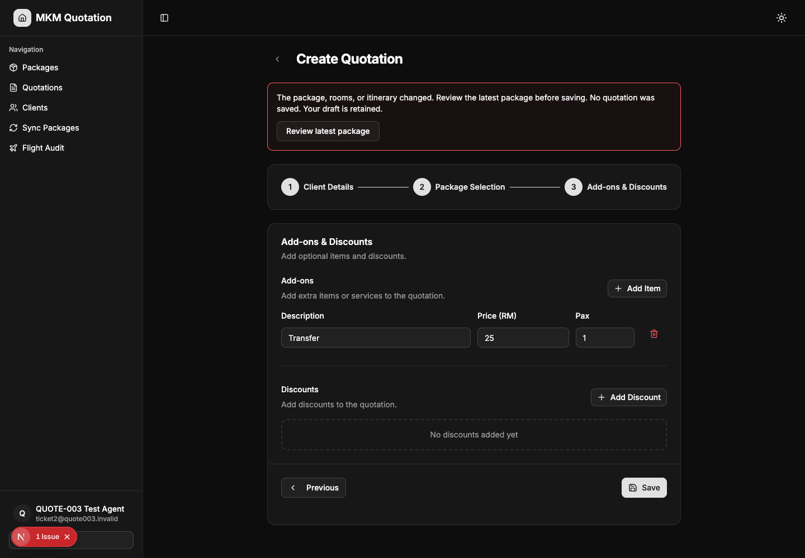
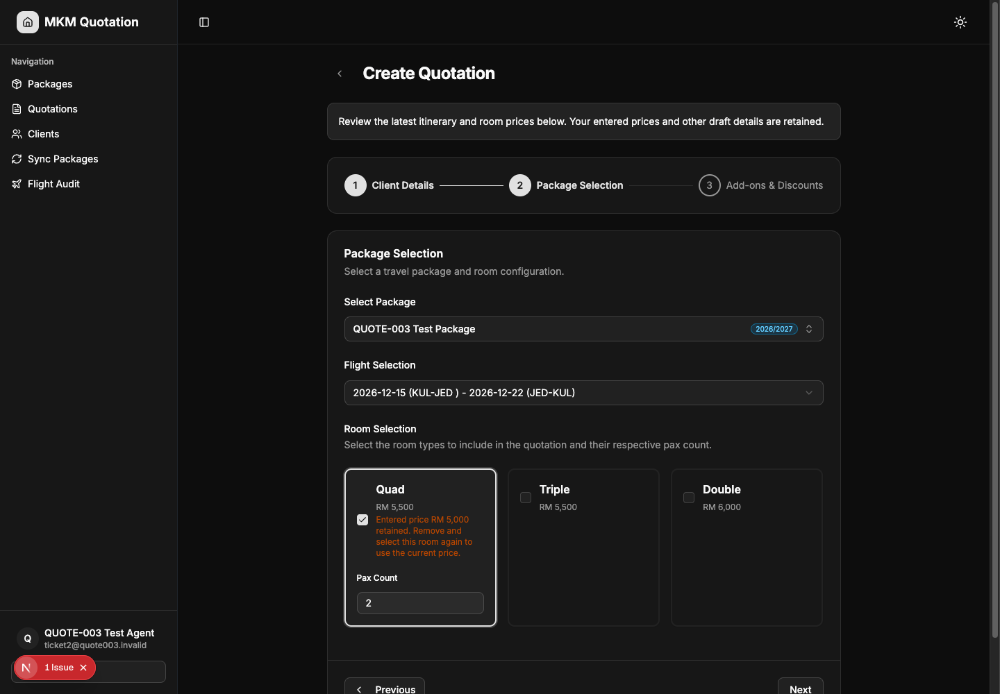
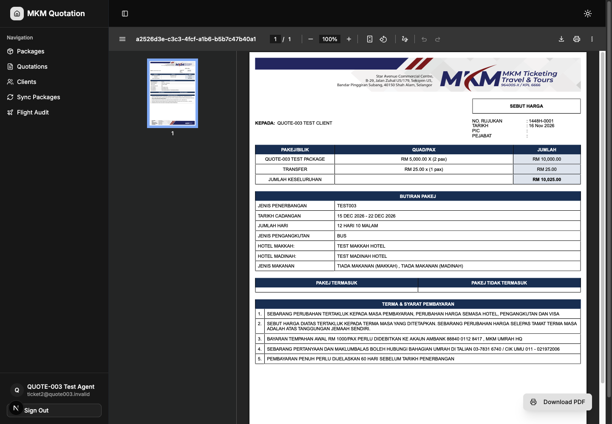

# Reviewed quotation selection

Staff need the saved quotation to match the package and itinerary they reviewed, or an explicit conflict that retains their draft.

The creation request now carries the displayed package's content version. Creation compares it with current package, room, flight, hotel, and meal values in the same mutation before any write. It independently rejects archived packages and disabled selected rooms. The comparison excludes entered line prices, so staff can retain an intentional custom price.

The builder explains HTTP 409 conflicts and keeps the draft. Review latest package explicitly loads current choices and returns to Package Selection. It shows retained prices beside current catalog prices and names unavailable selections that require replacement.

## Runtime evidence

Baseline commit was `b95671a373f7ca65c7ff571d66ce4648986c7b5b`. The tested fix was the clean commit `6a45177bb22dd28e33711636fad6e12e4f0373be`. Both ran against the owner's isolated local Convex backend on port 3230. The preview URL was `http://ticket2.localhost:3130`. The named host isolates auth cookies from other owners' localhost sessions.

The old builder displayed RM5,000 and a 10 December departure. After the package changed to RM5,500 and 15 December, its save succeeded with the retained RM5,000 price and changed departure. The actual-handler probe independently reproduced the same mechanism and unavailable selection acceptance.

The combined fix preserves one shared save path, uncertain-outcome guidance, and navigation to the exact returned saved record. An integration attempt left a duplicate error banner that rendered the old string state; live verification caught it, and the duplicate was removed before this passing run.

The fix returned HTTP 409 for that trigger. Notes, two pax, the entered room price, and a Transfer add-on survived. Explicit review showed 15 December and the current RM5,500 catalog price, with the retained RM5,000 price called out. Staff then saved the reviewed draft. The list and saved review showed RM10,025, two pax at RM5,000, and the RM25 add-on. The saved review showed the same values after reload. A separate live handler read confirmed the saved notes, room values, and itinerary.

Disabling a selected Quad room also caused a conflict. Review latest named Quad as unavailable, removed that selection with visible feedback, and kept the draft notes. Archived packages and disabled rooms with freshly supplied context are covered by the actual-handler regression checks.

- [Structured runtime proof](issue-18-selection/proof.json).
- [Saved handler read](issue-18-selection/live-persistence.json).
- [Baseline handler reproduction](issue-18-selection/baseline.json).
- [Independent review](issue-18-selection/review.md).
- [Shared save integration review](issue-18-selection/combined-review.md).
- [Decision trail](issue-18-selection/decisions.tsv).
- [Recorded conflict, recovery, save, and reload](https://github.com/hasififwat/hasififwat-mkm-quotation-management-system/blob/evidence/quote003-selection/evidence/quote003-selection/conflict-and-save.mp4).

The browser's GitHub profile was signed out. The video is published on the evidence branch, with screenshots rendered in the PR, using the authorized fallback.

## Checks and limits

All 348 repository tests passed. Typecheck, production build, focused lint, and diff whitespace checks passed. The actual-source mutation check detected removal of the context comparison and restored the rejecting baseline. The integrity check ran its 864 cases with zero adapter errors and no flight-association failures. Both flight-guard mutants were detected.

| Finding | What goes wrong | What it takes to hit it | Rarity | Who is hurt | Bucket |
| --- | --- | --- | --- | --- | --- |
| Existing anonymous-write finding remains. | The bounded integrity check still has 16 anonymous write counterexamples. | Call create or update without identity using otherwise valid fixture inputs. | Deterministic within the bounded domain. | Quotation users. | Separate authentication owner. |
| Whole-package comparison is conservative. | A change to an unselected child can require another review. | Another user changes any business value included in the package context. | Depends on overlapping edits. Frequency unknown. | Staff with an open draft. | Accepted tradeoff to keep one comparison aligned with saved snapshots. |

The change covers creation selection consistency. Editing existing quotation snapshots, authentication, CSV, PDF behavior, and duplicate handling remain outside its scope. The browser exercised the existing saved review without modifying its implementation.

## Cleanup

All three test quotations across both successful runs were deleted through the real local handler. The follow-up list was empty. The seeded package was restored to its initial price, departure date, and enabled room state. The seed client and package remain in the private local database. Only this owner's web and backend processes were stopped, and its preview tab was closed. No shared backend was mutated.

- [Fixture cleanup](issue-18-selection/fixture-cleanup.json).
- [Owned process cleanup](issue-18-selection/process-cleanup.json).
